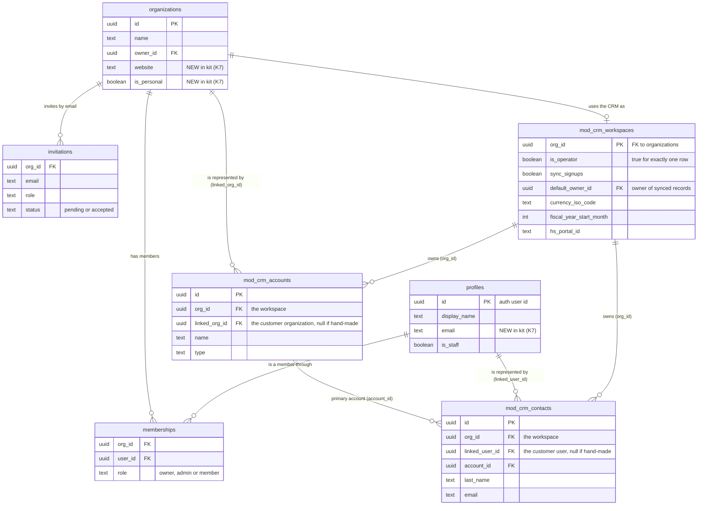

# Dream CRM — MVP build plan (`@acme/mod-crm`)

> Status: **plan**, nothing built yet. Dream CRM is the first **non-bundled, private**
> module: it lives in its own private repo (`vpv-group/dream-mod-crm`) and is installed
> into a kit-based product with `pnpm mod add`, mounting at **`/a/crm`**.
>
> **This document is the MVP.** It ships six record types in the shape of **Salesforce
> Starter Suite**, compatible with **HubSpot's Free plan**, and exchanges data with
> both by file. The full target and the path to it are the CRM module's own
> documentation:
>
> - [`docs/crm/FIELDS.md`](./crm/FIELDS.md) — every record and field, with the Salesforce
>   and HubSpot names.
> - [`docs/crm/UPGRADE.md`](./crm/UPGRADE.md) — the prepared upgrade steps from this MVP
>   to full Salesforce and HubSpot compatibility, including live sync.
>
> Both files move to the private repo's `docs/` when Phase 2 creates it. Section 8
> lists the **kit-side** changes, which stay here.
>
> **Salesforce first, HubSpot compatible.** Salesforce's shape is the canonical one.
> HubSpot support is purely additive: `hs_*` columns sit beside the Salesforce ones and
> no Salesforce field is renamed, retyped or removed. The web UI is written from
> scratch against the kit's [app design system](./DESIGN-SYSTEM.md).

---

## 0. Decisions in this plan (please confirm)

| #   | Decision                              | Recommendation                                                                                                                                                                                                                         | Why                                                                                                                                                                                     |
| --- | ------------------------------------- | -------------------------------------------------------------------------------------------------------------------------------------------------------------------------------------------------------------------------------------- | --------------------------------------------------------------------------------------------------------------------------------------------------------------------------------------- |
| D1  | **Who owns CRM records**              | A **CRM workspace** is an organization. Every record has `org_id` = its workspace. One workspace is the **operator workspace** (your own team), and every organization that signs up to the product becomes an **Account** in it (§2). | This is how Salesforce works (one org of users, customers are Accounts). The same schema also lets a customer organization have its own workspace later.                                |
| D2  | **Where data lives**                  | Supabase `mod_crm_*` tables under **RLS**, not Payload                                                                                                                                                                                 | Golden rule #1: RLS clients (web and native) read and write this data directly. Payload is used only for the module's settings screen.                                                  |
| D3  | **MVP scope**                         | Six records: **Account, Contact, Lead, Opportunity, Task, Note**. Each is created with its full Salesforce field set, but forms open with a short default set (§3). Everything else is an upgrade step.                                | Fields are cheap because forms and lists are generated. Tables, logic and screens are what cost time, so those are cut.                                                                 |
| D4  | **Naming**                            | Labels and picklist values match Salesforce exactly. Columns are `snake_case(ApiName)`. Every field's Salesforce API name is stored in a typed **field registry** (§4).                                                                | The registry is the single map for forms, files and later connectors.                                                                                                                   |
| D5  | **Distribution**                      | Private GitHub repo with semver tags. You install with `pnpm mod add <git-url>#vX.Y.Z` using your own git credentials (§8).                                                                                                            | `mod add` already clones by git URL.                                                                                                                                                    |
| D6  | **UI primitives**                     | Primitives and generic blocks are built into **`@acme/ui`** in a public kit PR, following [DESIGN-SYSTEM.md §7](./DESIGN-SYSTEM.md#7-where-it-lives-in-code). CRM-specific composites are built in the module.                         | Other modules can reuse them.                                                                                                                                                           |
| D7  | **UI source**                         | ✅ **Resolved.** All UI is written from scratch for Dream from [DESIGN-SYSTEM.md](./DESIGN-SYSTEM.md). No third-party template code goes into the kit or the module.                                                                   | The module is distributed to other people.                                                                                                                                              |
| D8  | **How organizations work in the kit** | Add an organization step to sign-up (create or join), with a product-level mode: `required`, `personal` or `off` (§2.3).                                                                                                               | Without it there is nothing to map to Accounts.                                                                                                                                         |
| D9  | **Second CRM**                        | **Salesforce first, HubSpot compatible.** Every table also carries HubSpot's record id, last-modified time and a `hs_properties` column, plus a few HubSpot-only columns.                                                              | The columns cost nothing now and avoid a migration later.                                                                                                                               |
| D10 | **How the MVP connects**              | **By file, not by API.** CSV export and import in Salesforce's shape and in HubSpot's shape (§7). Live sync is an upgrade step.                                                                                                        | It works on Salesforce Starter and HubSpot Free today, and it avoids building two connectors before the CRM itself is proven. Salesforce Starter may not allow API access at all (§10). |

---

## 1. What ships in the MVP

|                 | In the MVP                                                                                  | Later (see [UPGRADE.md](./crm/UPGRADE.md))                                                                                                              |
| --------------- | ------------------------------------------------------------------------------------------- | ------------------------------------------------------------------------------------------------------------------------------------------------------- |
| Records         | Account, Contact, Lead (with Convert), Opportunity, Task, Note                              | Cases (U1), contact relationships (U2), Events (U3), Products and Price Books (U4), Campaigns (U5), Knowledge and case email (U6), person accounts (U7) |
| Fields          | All standard fields on those six, about 120 editable ones                                   | The few that point at later tables                                                                                                                      |
| Logic           | Names, lead conversion, stage → probability, forecast category, closed and won, task closed | Push count, reminders, roll-ups (U8)                                                                                                                    |
| Sign-up mapping | Organization → Account, member → Contact                                                    | One Contact on several Accounts (U2)                                                                                                                    |
| Screens         | Home dashboard, list views, record pages, forms, the opportunity pipeline board             | Calendar, case board, product and campaign screens                                                                                                      |
| Mobile          | Read-only lists and records                                                                 | Editing                                                                                                                                                 |
| Salesforce      | Starter-shaped records; CSV out and in                                                      | Live sync (C1)                                                                                                                                          |
| HubSpot         | Free-plan-shaped records; CSV out and in                                                    | Live sync (C2)                                                                                                                                          |

**Compatibility the MVP guarantees**

|                                  | Salesforce Starter Suite                                     | HubSpot Free                                                                                |
| -------------------------------- | ------------------------------------------------------------ | ------------------------------------------------------------------------------------------- |
| Records                          | All six exist in Starter with the same names and fields      | Account ↔ company, Contact and Lead ↔ contact, Opportunity ↔ deal, Task ↔ task, Note ↔ note |
| Uses only what the plan includes | No quotes, forecasting, custom objects or other Pro features | The default deal pipeline only, no association labels, no custom properties created         |
| Ids kept                         | `sf_id` on every row                                         | `hs_object_id` on every row                                                                 |
| Exchange                         | CSV with Salesforce API names as headers                     | CSV with HubSpot property names as headers                                                  |

**Sources.** Salesforce's
[Object Reference](https://developer.salesforce.com/docs/atlas.en-us.object_reference.meta/object_reference/sforce_api_objects_list.htm)
and
[Free / Starter / Pro comparison chart](https://www.salesforce.com/en-us/wp-content/uploads/sites/4/documents/small-business/comparison-chart-starter-prosuite-features-us.pdf);
HubSpot's [CRM API reference](https://developers.hubspot.com/docs/api-reference/latest/crm/objects/contacts/guide),
[pipeline limits](https://knowledge.hubspot.com/object-settings/set-up-and-customize-pipelines)
and
[association labels](https://knowledge.hubspot.com/object-settings/create-and-use-association-labels);
and the screenshots of the Starter org `flow-force-4450`.

---

## 2. Organizations and sign-up mapping

### 2.1 The model

- A **CRM workspace** is an organization that uses the CRM. It has one row in
  `mod_crm_workspaces`, and every CRM record's `org_id` points at it.
- Exactly one workspace is the **operator workspace**: your own team's organization.
  Its members are your staff. The first staff user who opens `/a/crm` creates it.
- Every **other** organization that signs up to the product becomes an **Account** in
  the operator workspace. Its members become **Contacts**. The link columns
  `linked_org_id` and `linked_user_id` record which is which.
- Sync is **one way, kit → CRM**. Editing an Account never changes the organization.



Constraints that make the mapping safe:

- `unique (org_id, linked_org_id)` on accounts and `unique (org_id, linked_user_id)` on
  contacts, so sync is an idempotent upsert.
- A partial unique index allows one row where `is_operator` is true.
- `linked_org_id` and `linked_user_id` are `on delete set null`. Deleting a customer
  organization keeps its Account and history.

### 2.2 What happens when someone signs up

The sync runs as database triggers, so it covers every path (web, native, staff
invites, guest checkout). The trigger functions are owned by the module and run as
`SECURITY DEFINER`. If no operator workspace exists yet they do nothing, and creating
the workspace runs a one-time backfill.

| Kit event                                                           | Effect in the operator workspace                                                                                                                                                                                                                               |
| ------------------------------------------------------------------- | -------------------------------------------------------------------------------------------------------------------------------------------------------------------------------------------------------------------------------------------------------------- |
| A profile gets an email (sign-up, or an anonymous visitor converts) | Nothing yet if the user has no organization. Anonymous sessions are never synced.                                                                                                                                                                              |
| An organization is created                                          | **Account** upsert: `name` ← organization name, `website` ← organization website, `type` = Prospect, `account_source` = Web, `linked_org_id` set, `owner_id` ← the workspace's default owner.                                                                  |
| A membership is created                                             | **Contact** for that user: matched by `linked_user_id`, else by email inside the workspace (the existing contact is linked instead of duplicated). First and last name come from the display name (last word → Last Name). `account_id` is set if it is empty. |
| …and a **Lead** with that email exists                              | The lead is converted into that Account and Contact (`mod_crm_convert_lead`), so earlier history carries over.                                                                                                                                                 |
| A user joins a second organization                                  | Nothing changes in the MVP: the Contact keeps its first Account. Upgrade step U2 records every membership.                                                                                                                                                     |
| A membership is removed                                             | The Contact stays and keeps its Account.                                                                                                                                                                                                                       |
| An organization or profile is renamed, or the email changes         | The Account or Contact field follows, unless staff have edited that field by hand.                                                                                                                                                                             |
| An organization is deleted                                          | The Account stays; `linked_org_id` becomes null.                                                                                                                                                                                                               |

The operator's own organization is skipped, so your team doesn't appear as a customer.
A personal organization (`is_personal`) becomes an ordinary Account in the MVP.

### 2.3 How organizations should work in the kit (kit change K7)

The kit has `organizations`, `memberships` and `invitations` tables with RLS, but no
screen creates or joins an organization today. The CRM needs that step, and it is
useful to any B2B product, so it belongs in the kit:

1. **Organization mode** — a new setting on the `authentication-settings` global:
   - `required` (B2B): after email confirmation, `/welcome` sends a user with no
     membership to `/onboarding/organization`. They create an organization (name,
     optional website) or accept a pending invitation that matches their email.
   - `personal`: the first sign-in creates a personal organization named after the
     user (`is_personal = true`). They can create or join real ones later.
   - `off` (today's behaviour, and right for consumer apps): no organizations. The CRM
     then has nothing to map, and has no customer records until person accounts ship (upgrade step U7).
2. **Invitations.** Accepting an invitation creates the membership and marks the
   invitation accepted. The tables exist; the flow doesn't.
3. **Active organization.** A cookie plus a `useActiveOrg()` hook in `packages/app`,
   and an organization switcher in the app header for users in more than one.
4. **Three new columns:** `profiles.email` (mirrored from the auth user by the existing
   `handle_new_user` trigger, read-own under RLS), `organizations.website` and
   `organizations.is_personal`. Module SQL can't read `auth.users`, so without
   `profiles.email` a Contact would have no email.
5. **Trigger hook-points.** The module framework lets a module declare
   `database.triggersOn: ["organizations", "memberships", "profiles"]`, and the SQL
   lint allows `create trigger mod_<slug>_*` on exactly those core tables. The module's
   `drop.sql` removes them.

### 2.4 Other ways records arrive

In the MVP: the forms in the CRM, and CSV import (§7). Later: website form submissions
becoming Leads, and subscriptions becoming Closed Won Opportunities. Both are small
additions after the MVP and need no schema change.

---

## 3. MVP records and fields

The complete field tables, with Salesforce API names, column names, types, picklist
values and the HubSpot mapping, are in [`docs/crm/FIELDS.md`](./crm/FIELDS.md). This
section says what the MVP takes from it.

**Rules** (details in FIELDS.md §1–§2 and §13):

- Table `mod_crm_<plural>`, column `snake_case(ApiName)`, labels and picklist values
  exactly as Salesforce has them.
- Every record table has `id, org_id, owner_id, created_at, created_by, updated_at,
updated_by, deleted_at`, the Salesforce columns `sf_id, sf_system_modstamp,
custom_fields`, and the HubSpot columns `hs_object_id, hs_lastmodifieddate,
hs_properties`.
- Picklists are rows in `mod_crm_picklist_values`, seeded with Salesforce's defaults
  and editable per workspace.

**The six records**

| Record      | Table                   | Editable fields | Default form (everything else is behind "Show all fields")                                                                               |
| ----------- | ----------------------- | --------------- | ---------------------------------------------------------------------------------------------------------------------------------------- |
| Account     | `mod_crm_accounts`      | 30              | Account Name\*, Phone, Website, Type, Industry, Employees, Annual Revenue, Billing Address, Description, Account Owner                   |
| Contact     | `mod_crm_contacts`      | 33              | First Name, Last Name\*, Account Name, Title, Email, Phone, Mobile, Mailing Address, Description, Contact Owner                          |
| Lead        | `mod_crm_leads`         | 23              | First Name, Last Name\*, Company\*, Title, Email, Phone, Lead Status\*, Lead Source, Rating, Description, Lead Owner                     |
| Opportunity | `mod_crm_opportunities` | 14              | Opportunity Name\*, Account Name, Primary Contact, Amount, Close Date\*, Stage\*, Probability, Type, Lead Source, Next Step, Description |
| Task        | `mod_crm_tasks`         | 18              | Subject, Due Date, Status\*, Priority\*, Name (lead or contact), Related To (account or opportunity), Assigned To, Comments              |
| Note        | `mod_crm_notes`         | 2               | Title\*, body                                                                                                                            |

\* required, as in Salesforce.

**HubSpot-only columns in the MVP:** `hs_domain` on accounts; `hs_lifecycle_stage` on
accounts, contacts and leads; `hs_lead_status` on contacts and leads; `hs_pipeline` and
`hs_dealstage` on opportunities; `hs_object_type` and `hs_associations` on tasks;
`hs_associations` on notes; `hs_portal_id` on the workspace.

**Where the MVP differs from the full reference**

| Record                  | In the MVP                                                                                                              | Changes with                    |
| ----------------------- | ----------------------------------------------------------------------------------------------------------------------- | ------------------------------- |
| Contact                 | Belongs to one Account                                                                                                  | U2 adds relations to several    |
| Opportunity             | Primary Contact is an ordinary editable field. No Price Book or Primary Campaign Source.                                | U2, U4, U5                      |
| Task, Note              | "Related To" can be an Account or an Opportunity                                                                        | U1 and U5 add Case and Campaign |
| Account                 | No person accounts                                                                                                      | U7                              |
| Lead, Opportunity, Task | Push Count, Last Stage Change Date, Unread By Owner, High Priority and reminders exist as columns but aren't maintained | U8                              |

**Logic the MVP does include**

- `name` on Contact and Lead (First + Middle + Last + Suffix).
- **Convert Lead** (`mod_crm_convert_lead`): creates or reuses the Account and
  Contact, optionally creates an Opportunity, moves the lead's Tasks and Notes, and
  stamps the converted fields.
- Opportunity stage → default Probability and Forecast Category, `is_closed`, `is_won`,
  and Expected Revenue (Amount × Probability).
- Task status → `is_closed` and Completed Date/Time.
- "Recently Viewed" per user (`mod_crm_recent_items`).

---

## 4. Field registry — the single source of truth

The client-safe barrel `@acme/mod-crm` exports **`CRM_OBJECTS`**. It is pure data, so
it is safe for web, native and the future connector:

```ts
export const Account = defineCrmObject({
  apiName: "Account",
  label: "Account",
  labelPlural: "Accounts",
  table: "mod_crm_accounts",
  slug: "accounts",
  icon: "IconBuilding",
  nameField: "name",
  fields: {
    name: {
      apiName: "Name",
      label: "Account Name",
      type: "text",
      required: true,
    },
    type: { apiName: "Type", label: "Type", type: "picklist" },
    annual_revenue: {
      apiName: "AnnualRevenue",
      label: "Annual Revenue",
      type: "currency",
    },
    parent_id: {
      apiName: "ParentId",
      label: "Parent Account",
      type: "lookup",
      to: "Account",
    },
    // …
  },
  layout: [
    // mirrors the Salesforce page-layout sections in the modals
    {
      section: "Account Information",
      fields: ["name", "owner_id", "type", "industry"],
    },
    { section: "Address Information", fields: ["billing_*", "shipping_*"] },
    { section: "Description Information", fields: ["description"] },
  ],
  listColumns: ["name", "type", "phone", "owner_id"],
  compactLayout: ["type", "phone", "website", "owner_id"], // highlights panel
});
```

A field may also carry an optional `hubspot` entry (`{ property, transform? }`), and
an object an optional `hubspot: { object }`. It is filled from [FIELDS.md §13](./crm/FIELDS.md#13-hubspot-compatibility-additive) and is only read by
the HubSpot connector; the Salesforce `apiName` stays the primary key of the registry.

Each field carries its `kind` (stored, derived or reserved) from the field reference, and a
`since` version, so a later release adds objects and fields without touching earlier ones. These all come
from the registry: **zod validators** (forms and server), **form dialogs** (the section
layout, the `*` = Required Information legend, the two-column grid), **list columns and
filters**, **record detail pages**, **CSV import headers** (Salesforce API names are
accepted as column headers) and the **connector field map**. Derived and reserved
fields never appear in a form.

The SQL migrations are still written by hand, which keeps them reviewable. A vitest
**parity test** checks that every registry column exists in the generated Supabase
types with a compatible type, and the other way round. A second test loads the Phase 0
describe fixtures and fails if a registry field's API name, type or requiredness
disagrees with Salesforce.

---

## 5. Database (module migrations)

`modules/crm/supabase/migrations/`:

| File                  | Contents                                                                                                                                                                                                                                                      |
| --------------------- | ------------------------------------------------------------------------------------------------------------------------------------------------------------------------------------------------------------------------------------------------------------- |
| `001_core.sql`        | `mod_crm_workspaces`, `mod_crm_picklist_values` (+ Salesforce default seed rows for the six records), the six record tables with their Salesforce and `hs_*` columns, `mod_crm_recent_items`, generated `name` columns, composite same-workspace FKs, indexes |
| `002_triggers.sql`    | `updated_at` / `updated_by` stamping, picklist validation, opportunity stage logic, task closed fields                                                                                                                                                        |
| `003_functions.sql`   | `mod_crm_convert_lead()`, `mod_crm_search(q)` (name and email `ilike`), `mod_crm_set_owner(object, ids[], owner)` for bulk Change Owner, `mod_crm_create_workspace()`                                                                                         |
| `004_views.sql`       | dashboard views created with **`security_invoker = true`** so RLS applies: `mod_crm_pipeline_by_stage`, `mod_crm_leads_by_source`, `mod_crm_closed_won_by_period`                                                                                             |
| `005_signup_sync.sql` | the sign-up sync of §2.2: trigger functions on `organizations`, `memberships` and `profiles`, the backfill function, and the `mod_crm_sync_errors` log                                                                                                        |
| `drop.sql`            | drops everything above, including the triggers on core tables, for `mod remove`                                                                                                                                                                               |

Later tables arrive as `006_…` onwards, one file per upgrade step
([UPGRADE.md §4](./crm/UPGRADE.md#4-upgrade-steps-to-the-full-starter-schema-l2)).
The `hs_*` columns are nullable, have no triggers, and nothing in the MVP reads them
except CSV import and export.

**RLS template** (every object table):

```sql
alter table mod_crm_accounts enable row level security;
-- read: workspace members; soft-deleted rows only for workspace admins (Recycle Bin)
create policy "read" on mod_crm_accounts for select to authenticated
  using (public.is_org_member(org_id) and (deleted_at is null or public.is_org_admin(org_id)));
create policy "insert" on mod_crm_accounts for insert to authenticated
  with check (public.is_org_member(org_id) and created_by = (select auth.uid()));
create policy "update" on mod_crm_accounts for update to authenticated
  using (public.is_org_member(org_id)) with check (public.is_org_member(org_id));
create policy "delete" on mod_crm_accounts for delete to authenticated
  using (owner_id = (select auth.uid()) or public.is_org_admin(org_id));
-- anonymous sessions never touch CRM data
create policy "no_anon" on mod_crm_accounts as restrictive for all to authenticated
  using (not coalesce(((select auth.jwt())->>'is_anonymous')::boolean, false));
```

- This is the same as Salesforce's "Public Read/Write" org-wide default. Private
  opportunities narrow their read policy to the owner and workspace
  admins.
- **A customer never sees the operator's CRM.** Being the subject of an Account
  (`linked_org_id`) grants nothing; only membership of the workspace organization
  does. An RLS test covers this.
- **Same-workspace integrity** comes from composite FKs, for example
  `(account_id, org_id)` referencing `mod_crm_accounts (id, org_id)`. This makes it
  impossible to link a contact to another workspace's account, with no trigger needed.
- Owner and audit columns reference `public.profiles (id)`. Module SQL can't reference
  the `auth` schema.

**Creating a workspace.** `mod_crm_create_workspace(org_id)` inserts the workspace row.
A staff user (`profiles.is_staff`) creates the operator workspace the first time they
open `/a/crm`; that call also runs the sign-up backfill. Non-staff users see the CRM
only if the module setting "Customers can have their own workspace" is on. Otherwise
`/a/crm` is hidden from them.

---

## 6. UI — Salesforce screen → design-system pattern → module component

Every screen is written from scratch with `@acme/ui` primitives and blocks, following
[DESIGN-SYSTEM.md](./DESIGN-SYSTEM.md). Section numbers in the middle column refer to
that document. The CRM uses only semantic tokens (`--chart-1…5`, status tones,
`bg-muted`, …), so the host's `theme-settings` global themes it like the rest of the
app.

| Salesforce screen                                                       | Design-system pattern                                      | Module component                                                                                                                                                                                                                      |
| ----------------------------------------------------------------------- | ---------------------------------------------------------- | ------------------------------------------------------------------------------------------------------------------------------------------------------------------------------------------------------------------------------------- |
| App nav bar (Leads · Contacts · Accounts · …)                           | Sub-navigation (§3)                                        | `CrmAppNav`: object tabs inside `/a/crm`. Order and visibility come from module settings (the equivalent of Salesforce App Manager). The kit sidebar shows one **CRM** entry.                                                         |
| CRM home (Analytics: My Pipeline, Opportunities Won…)                   | Stat tile (§4.2), charts (§4.8), lists inside cards (§4.7) | `CrmHomePage` (below)                                                                                                                                                                                                                 |
| Object home / list view ("Recently Viewed", "All Open Cases" ▾)         | List view (§4.3), status tones (§5)                        | `ObjectListView`: list-view picker (Recently Viewed · All · My · Open), column visibility, filters builder, sorting, pagination, bulk select                                                                                          |
| List actions (New · Import · Change Owner · Add to list · Assign Label) | Page header (§3), buttons (§4.9)                           | New · Import · Export · Change Owner · Delete (button group plus overflow menu)                                                                                                                                                       |
| _New …_ modal (as in the _New Case_ screenshot)                         | Record form (§4.4)                                         | `RecordFormDialog`: generated from `layout`, with section bars, two-column grid, `*` required legend, Cancel / **Save & New** / Save. It opens with the record's **default fields** (§3) and a "Show all fields" switch for the rest. |
| Lookup ("Search Accounts…", "Search Contacts…")                         | Record form → lookups (§4.4)                               | `LookupField`: debounced search over the target object, plus "+ New Account" inline                                                                                                                                                   |
| Record page (`/lightning/r/…/view`)                                     | Record page (§4.5)                                         | `RecordPage`: highlights panel, **Path** (stage or status stepper for Opportunity and Lead), tabs **Details · Related · Activity**                                                                                                    |
| Related lists (Contacts, Opportunities, Open Activities…)               | Record page → related lists (§4.5)                         | `RelatedList`, driven by the registry's relationships                                                                                                                                                                                 |
| Activity timeline                                                       | Record page → activity (§4.5)                              | `ActivityTimeline`: tasks and notes for the record, with "New Task" and "New Note"                                                                                                                                                    |
| Opportunity pipeline                                                    | Board (§4.6)                                               | `PipelineBoard` grouped by `stage_name`. Each column shows the sum of `amount`. Dragging a card updates the stage, and the trigger recomputes probability. Shown as `?view=board` on the list.                                        |
| Tasks                                                                   | List view (§4.3) + task rows (§4.7)                        | `TasksPage`: My Tasks · Overdue · Today · All                                                                                                                                                                                         |
| Global search                                                           | Command menu (⌘K)                                          | `CrmCommandMenu` → `mod_crm_search`                                                                                                                                                                                                   |
| Convert Lead                                                            | Record form (§4.4)                                         | `ConvertLeadDialog` (new or existing account, contact, optional opportunity)                                                                                                                                                          |
| No workspace / no records                                               | Empty state (§4.10)                                        | "Create your CRM workspace", "New account / Import / Load sample data"                                                                                                                                                                |

A synced Account shows a small "Signed up" badge and a link to the organization's
members; a synced Contact shows the user's sign-up date.

**`CrmHomePage` (`/a/crm`)**: a dashboard of design-system tiles bound to real data,
each modelled on a Salesforce standard report:

| Tile            | Pattern                     | Data (Salesforce standard report it imitates)                              |
| --------------- | --------------------------- | -------------------------------------------------------------------------- |
| Quarter target  | Stat tile + radial progress | Closed Won this quarter vs. a quarterly target set in module settings      |
| Customers       | Stat tile                   | Accounts where `type like 'Customer%'` ("Top Accounts")                    |
| New sign-ups    | Stat tile                   | Accounts with `linked_org_id` created in the period                        |
| Open deals      | Stat tile                   | open Opportunities count ("My Pipeline")                                   |
| Revenue won     | Stat tile                   | Closed Won amount for the period ("Opportunities Won")                     |
| Leads by source | Donut (§4.8)                | `mod_crm_leads_by_source` (Lead Source)                                    |
| My tasks        | Task rows (§4.7)            | my open Tasks by due date ("My Open Tasks")                                |
| Pipeline        | Pipeline bar (§4.8)         | `mod_crm_pipeline_by_stage`, with stages and tones from the stage picklist |
| Recent leads    | Compact list view (§4.3)    | latest Leads                                                               |

A date-range picker in the page header drives every tile. **Export** downloads CSV.

**Routes** (manifest `routes.web`; stubs come from `mod sync`):

```
""                      CrmHomePage
"[object]"              ObjectListPage     accounts|contacts|leads|opportunities|tasks
"[object]/[id]"         RecordPage
"r/[sfId]"              SalesforceIdRedirect   (→ /a/crm/<object>/<id>; useful once synced)
"settings"              CrmSettingsPage    (workspace settings and picklist editor for admins)
```

A single `[object]` segment, validated against `CRM_OBJECTS`, keeps the route table
small and makes new objects registry-only changes. Phase 1 confirms that `mod sync`
supports multi-segment dynamic paths.

**Native (Expo, MVP, react-native-reusables):** `CrmHomeScreen` (pipeline
summary and my tasks), `ObjectListScreen` and `RecordScreen` for Accounts, Contacts,
Leads and Opportunities. The MVP is **read-only** on mobile apart from ticking a task
done. Editing, the pipeline board and import are web-only. The validators and hooks come from the shared barrel, so both platforms
use the same logic.

**Dashboard widget:** `CrmWidget` (web and native) shows pipeline value and my open
tasks count on the kit's dashboard module.

---

## 7. Module manifest, server, settings and file exchange

```ts
export default defineModule({
  slug: "crm",
  name: "Dream CRM",
  version: "1.0.0",
  kitCompat: ">=2.1.0 <3",
  description:
    "Salesforce-compatible CRM: accounts, contacts, leads, opportunities, tasks.",
  nav: {
    web: [{ title: "CRM", href: "/a/crm", icon: "IconBriefcase", order: 25 }],
    native: [
      { title: "CRM", href: "/a/crm", icon: "IconBriefcase", order: 25 },
    ],
  },
  routes: {
    web: [], // §6
    native: [],
  },
  database: {
    tables: [], // every mod_crm_* table
    triggersOn: ["organizations", "memberships", "profiles"], // new, see K7
  },
  widgets: { web: "CrmWidget", native: "CrmWidget" },
  server: { routes: true },
  cms: { hasSettings: true },
});
```

**Server routes** (served by the dispatcher at `/api/mod/crm/…`; authed and
rate-limited by the kit):

| Route                         | Purpose                             |
| ----------------------------- | ----------------------------------- |
| `GET /export/:object?format=` | CSV export of the current list view |
| `POST /import/:object`        | CSV import with a dry-run preview   |

**File exchange** is how the MVP connects to the two CRMs:

| Format       | Export                                                                                                                                                                                                                                                                                            | Import                                                                                                              |
| ------------ | ------------------------------------------------------------------------------------------------------------------------------------------------------------------------------------------------------------------------------------------------------------------------------------------------- | ------------------------------------------------------------------------------------------------------------------- |
| `salesforce` | Headers are Salesforce API names (`Name`, `AnnualRevenue`, `AccountId`…), and `Id` carries `sf_id`. The file loads into Salesforce's Data Import Wizard, which Starter Suite includes.                                                                                                            | A Salesforce report or data export. `Id` is stored in `sf_id`, so a later re-import updates instead of duplicating. |
| `hubspot`    | Headers are HubSpot property names, using the mapping in [FIELDS.md §13](./crm/FIELDS.md#13-hubspot-compatibility-additive), and `Record ID` carries `hs_object_id`. Leads export as contacts with lifecycle stage Lead. The file loads into HubSpot's import tool, which the Free plan includes. | A HubSpot export. `Record ID` is stored in `hs_object_id`.                                                          |
| `dream`      | Every column, by column name                                                                                                                                                                                                                                                                      | The same                                                                                                            |

Import matches rows in this order: the external id for that format, then email
(contacts and leads), then name plus website (accounts). Unmatched rows are created.
The preview shows what will be created, updated and skipped before anything is
written.

Everything else goes **direct to Supabase under RLS** through the shared react-query
hooks (`useCrmList`, `useCrmRecord`, `useCrmMutation`, `usePicklist`).

**Module settings** (`defineModuleSettings`, Modules admin group): visible object tabs
and their order, the quarterly sales target, "Sync sign-ups into the operator
workspace" (on by default), and "Customers can have their own workspace" (off by
default). Currency, fiscal-year start and picklists are **per workspace**, edited in
`/a/crm/settings`.

**After the MVP.** The upgrade steps (U1–U8) and the two live connectors (C1
Salesforce, C2 HubSpot) are specified in [UPGRADE.md](./crm/UPGRADE.md), each with its
migration, backfill and plan requirements.

---

## 8. Private distribution and kit-side changes

### 8.1 The private repo

- **Repo:** `vpv-group/dream-mod-crm` (private). The package is `@acme/mod-crm` with
  `"license": "UNLICENSED"`, and a proprietary `LICENSE` / EULA file goes at the root.
  Confirm `pnpm license:check` accepts `UNLICENSED` for a vendored module, and if not,
  allowlist first-party proprietary modules.
- **Created with the kit's own tools:** in a scratch branch of a kit clone, run
  `pnpm mod create crm`, build the module, then run
  `pnpm mod eject crm --repo git@github.com:vpv-group/dream-mod-crm.git`. The repo
  keeps the module CI from the scaffold, where tag = package.json = manifest version.
- **Releases:** semver tags (`v1.0.0`). CHANGELOG entries list any new migrations.
- **⚠️ The public kit never lists `crm`** in `modules.lock`. Development and testing
  happen in a private host repo, either your product repo or a private
  `dream-crm-sandbox` fork of the kit.
- **⚠️ Vendoring copies the source into the host repo.** Installing the CRM into a
  **public** product repo publishes it. `mod add` should warn when the source is
  private and the host remote is public (see K1).

### 8.2 Kit changes (public PRs, kit minor bump → `kitCompat >=2.1.0`)

| #   | Change                                                                                                                                                                                                                                                                                                                                                                                                                                                                                                           | Where                                                                                                                                      |
| --- | ---------------------------------------------------------------------------------------------------------------------------------------------------------------------------------------------------------------------------------------------------------------------------------------------------------------------------------------------------------------------------------------------------------------------------------------------------------------------------------------------------------------- | ------------------------------------------------------------------------------------------------------------------------------------------ |
| K1  | **Private git sources.** Local `pnpm mod add https://github.com/vpv-group/dream-mod-crm#v1.0.0` should already work with the developer's git credentials (verify `ls-remote` and `clone`). For CI and `/admin`: a new optional **`MOD_SOURCE_TOKEN`** repo secret, which needs contents:read on the private module repos. `module-ops.yml` then rewrites GitHub URLs to use it before `mod add` / `mod update`, and the daily update job's `ls-remote` does the same. Document it in MODULES.md → Founder setup. | `.github/workflows/module-ops.yml`, `tooling/mod/src/lifecycle.ts` (clearer error when auth fails, public-host warning), `docs/MODULES.md` |
| K2  | **Catalog flags:** `"private": true` and `"license": "commercial"` in catalog entries. `/admin/modules` shows a lock badge and "requires access" copy. Add the schema to `docs/module-catalog.example.json`.                                                                                                                                                                                                                                                                                                     | admin modules view, catalog schema                                                                                                         |
| K3  | **`@acme/ui` design-system build-out** (D6): the primitives and generic blocks listed in [DESIGN-SYSTEM.md §7](./DESIGN-SYSTEM.md#7-where-it-lives-in-code), including the framed card variant, badge status tones, data-table shell, stat tile, board shell, timeline and empty state. Write them from the spec; some primitives already exist in `apps/nextjs/src/components/ui` and can move into the package with subpath exports.                                                                           | `packages/ui`                                                                                                                              |
| K4  | **Route stubs:** confirm (and fix if needed) multi-segment dynamic paths like `[object]/[id]` in `mod sync` for both web and Expo.                                                                                                                                                                                                                                                                                                                                                                               | `tooling/mod`                                                                                                                              |
| K5  | **Module-owned RLS and e2e tests:** have the RLS runner and Playwright config also pick up `modules/*/tests/rls/**` and `modules/*/e2e/**`. A private module cannot add files to `tooling/`. (This is the "per-module RLS test relocation" follow-up already noted in CLAUDE.md.)                                                                                                                                                                                                                                | `tooling/rls-tests`, `tooling/web-e2e`                                                                                                     |
| K6  | _(Optional, for selling to other teams)_ **Licensed zip channel.** `module-ops` already accepts a signed zip URL, so a small licence-key service could return short-lived signed URLs to release assets. This avoids handing out GitHub access to the private repo, which fine-grained tokens can't do across organizations anyway.                                                                                                                                                                              | separate service; decide later                                                                                                             |
| K7  | **Organizations in the kit** (§2.3): the organization mode setting; the `/onboarding/organization` create-or-join step and invitation acceptance; the active-organization cookie, hook and switcher; the columns `profiles.email`, `organizations.website` and `organizations.is_personal` (new migration + `docs/ERD.md`); and the module manifest field `database.triggersOn` with its SQL lint rule. RLS tests for the new flows.                                                                             | `supabase/migrations`, `apps/nextjs` auth routes, `packages/app`, `packages/mod-kit`, `docs/ERD.md`, `docs/AUTH.md`, `docs/MODULES.md`     |

---

## 9. Phases and checkpoints

Every phase ends green on `pnpm typecheck && pnpm lint && pnpm test`, plus
`pnpm test:rls` whenever the schema changes.

| Phase                             | Work                                                                                                                                                                                                                                                                                                                                                                                                                                                        | Done when                                                                                                                                                                                              |
| --------------------------------- | ----------------------------------------------------------------------------------------------------------------------------------------------------------------------------------------------------------------------------------------------------------------------------------------------------------------------------------------------------------------------------------------------------------------------------------------------------------- | ------------------------------------------------------------------------------------------------------------------------------------------------------------------------------------------------------ |
| **0. Ground truth**               | For the six MVP records, capture the real field and picklist definitions from the Starter org `flow-force-4450` and commit them to `fixtures/salesforce/` in the private repo. Use `sf sobject describe` if the org allows API access; if it doesn't, export them from Setup → Object Manager. Note the answer, because it decides whether live Salesforce sync is possible on Starter (§10). Resolve every † picklist for the six records. Confirm D1–D10. | The fixtures are committed and no † remains for the MVP records.                                                                                                                                       |
| **1. Kit prerequisites**          | K1, K3, K4 and K7 as public kit PRs (K7 is its own PR), then a kit minor version bump. K2, K5 and K6 can follow the MVP.                                                                                                                                                                                                                                                                                                                                    | `mod add` of a private test repo works locally; a new user can create or join an organization.                                                                                                         |
| **2. Scaffold and data**          | `mod create crm` → the registry (§4) for six records → migrations 001–005 → RLS → `pnpm db:reset && pnpm db:gen-types` → tests: registry parity, fixture parity, RLS (cross-workspace isolation, customers can't read the operator CRM, anon blocked, delete rules, same-workspace FKs), lead conversion, sign-up sync (each row of §2.2) → `mod eject` to the private repo, taking `docs/crm/` with it.                                                    | `pnpm test:rls` passes with the module installed.                                                                                                                                                      |
| **3. Web UI**                     | Build the CRM composites from scratch on the `@acme/ui` blocks (K3): `ObjectListView`, `RecordFormDialog` with default fields, `RecordPage`, `RelatedList`, `PipelineBoard`, `CrmHomePage`, `ConvertLeadDialog`, ⌘K search, workspace creation. Check each screen with Playwright screenshots against the Salesforce screenshots.                                                                                                                           | Each of the six records can be created, edited, viewed, deleted and found in a list on the web.                                                                                                        |
| **4. File exchange and settings** | CSV export and import in the three formats with the dry-run preview; module settings; workspace settings and the picklist editor; empty states.                                                                                                                                                                                                                                                                                                             | A Salesforce-format export loads into the Starter org's Data Import Wizard, and a HubSpot-format export loads into a HubSpot Free account's import tool. Both re-import into Dream without duplicates. |
| **5. Native**                     | Read-only lists and record screens, plus the dashboard widget.                                                                                                                                                                                                                                                                                                                                                                                              | The CI `expo export` smoke check is green.                                                                                                                                                             |
| **6. Release**                    | Module e2e: sign up as a customer and create an organization → it appears as an Account with a Contact in the operator CRM → create an opportunity → move it to Closed Won → the dashboard updates. Docs, tag `v1.0.0`, install into the real product via `pnpm mod add`.                                                                                                                                                                                   | Installed from the tag in a clean kit clone, with the full suite green.                                                                                                                                |

What comes next is in [UPGRADE.md §7](./crm/UPGRADE.md#7-recommended-order).

---

## 10. Risks and open points

- **Salesforce Starter and API access:** it isn't clear that Starter Suite allows API
  calls. Salesforce's pages don't say, and third-party sources say it doesn't. The MVP
  avoids the question by exchanging files. Phase 0 settles it for your org, and
  UPGRADE.md §5 covers what to do either way.
- **HubSpot Free limits:** one pipeline per record type, no association labels, and a
  small allowance of custom properties. The MVP stays inside all three.
- **Picklist drift between orgs:** picklists are data, seeded from Salesforce's
  defaults and corrected from the Phase 0 fixtures.
- **Triggers on core tables:** the sign-up sync adds module-owned triggers to
  `organizations`, `memberships` and `profiles`. K7 makes that an explicit, linted
  permission. A trigger failure must never block a sign-up, so each function catches
  its own errors and logs them to `mod_crm_sync_errors`.
- **Names:** the kit stores one `display_name`; Salesforce needs a Last Name. The sync
  splits on the last space, which is wrong for some names. Staff can correct the
  Contact, and a corrected field stops following the profile.
- **Owners:** Salesforce lets a queue own a Lead or Task. The MVP has user owners only.
- **One Account per Contact** until U2: a user in several organizations shows under
  the first one.
- **The CRM requires organizations:** a product that removed the organization tables
  (docs/ERD.md allows this for single-user apps) can't install the CRM. `mod add`
  should fail with a clear message.
- **Bundle size:** dnd-kit, TanStack Table and Recharts load only under `/a/crm` route
  chunks and stay out of `./native`.
