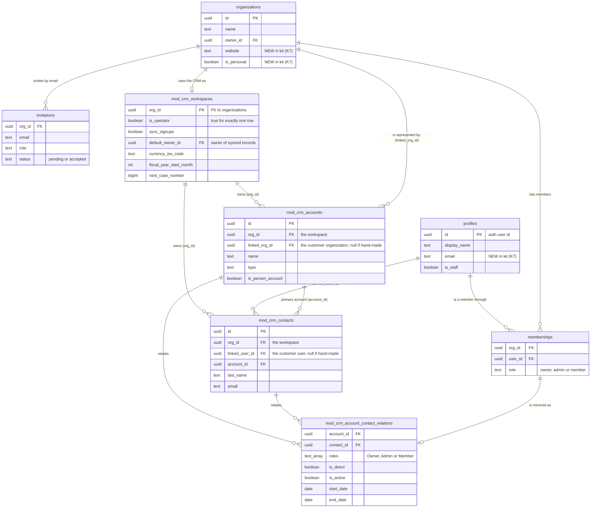
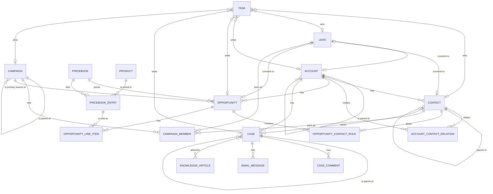

# Dream CRM — implementation plan (`@acme/mod-crm`)

> Status: **plan**, nothing built yet. Dream CRM is the first **non-bundled, private**
> module: it lives in its own private repo (`vpv-group/dream-mod-crm`) and is installed
> into a kit-based product with `pnpm mod add`, mounting at **`/a/crm`**. Its data model
> follows **Salesforce Starter Suite's standard objects** (labels, API names, picklists,
> relationships) so that adding a Salesforce connector later is a mapping exercise, not a
> migration. Its web UI is written from scratch against the kit's
> [app design system](./DESIGN-SYSTEM.md) and themed by the host's shadcn tokens.
>
> Sections 1–7 are the module spec. When Phase 2 creates the private repo, they move into
> that repo's `docs/`. Section 8 lists the **kit-side** changes, which stay here.
>
> **Salesforce first, HubSpot compatible.** Salesforce's shape is the canonical one and
> the Salesforce connector is built first. HubSpot support is purely additive: `hs_*`
> columns sit beside the Salesforce ones and no Salesforce field is renamed, retyped or
> removed (§3.13).

**Sources.** Field names, types and requiredness come from Salesforce's
[Object Reference](https://developer.salesforce.com/docs/atlas.en-us.object_reference.meta/object_reference/sforce_api_objects_list.htm)
(API v258). Scope comes from Salesforce's
[Free / Starter / Pro comparison chart](https://www.salesforce.com/en-us/wp-content/uploads/sites/4/documents/small-business/comparison-chart-starter-prosuite-features-us.pdf).
Layouts and some picklist values come from the screenshots of the Starter org
`flow-force-4450`.

**How to read the field tables (§3).** A mark after a picklist says where its values
came from:

| Mark | Meaning                                                                                                                                                                                 |
| ---- | --------------------------------------------------------------------------------------------------------------------------------------------------------------------------------------- |
| ✓    | Listed in Salesforce's Object Reference, or visible in the screenshots                                                                                                                  |
| †    | Salesforce's usual default, written from memory. The Object Reference doesn't list these (they are per-org data), so Phase 0 confirms them against your org with `sf sobject describe`. |

---

## 0. Decisions in this plan (please confirm)

| #   | Decision                              | Recommendation                                                                                                                                                                                                                                                              | Why                                                                                                                                                                                                                            |
| --- | ------------------------------------- | --------------------------------------------------------------------------------------------------------------------------------------------------------------------------------------------------------------------------------------------------------------------------- | ------------------------------------------------------------------------------------------------------------------------------------------------------------------------------------------------------------------------------ |
| D1  | **Who owns CRM records**              | A **CRM workspace** is an organization. Every record has `org_id` = its workspace. One workspace is the **operator workspace** (your own team), and every organization that signs up to the product becomes an **Account** in it (§2).                                      | This is how Salesforce works (one org of users, customers are Accounts), and it is what "map accounts to organizations as they sign up" needs. The same schema also lets a customer organization have its own workspace later. |
| D2  | **Where data lives**                  | Supabase `mod_crm_*` tables under **RLS**, not Payload                                                                                                                                                                                                                      | Golden rule #1: RLS clients (web and native) read and write this data directly, and a sync engine will write to it later. Payload is used only for the module's settings screen.                                               |
| D3  | **Object scope**                      | Every record type Starter Suite includes (§1). The **schema for all of them ships in v1.0**; the UI arrives in three steps.                                                                                                                                                 | Creating all tables up front means the Salesforce connector and CSV import never wait on a migration.                                                                                                                          |
| D4  | **Naming**                            | Labels and picklist values match Salesforce exactly. Columns are `snake_case(ApiName)`. Every field's Salesforce API name is stored in a typed **field registry** (§4).                                                                                                     | The registry is the single map a connector will use.                                                                                                                                                                           |
| D5  | **Distribution**                      | Private GitHub repo with semver tags. You install with `pnpm mod add <git-url>#vX.Y.Z` using your own git credentials. The kit gets a `MOD_SOURCE_TOKEN` so `/admin/modules` and auto-update can reach private sources (§8).                                                | `mod add` already clones by git URL. Only the CI and admin path need credentials.                                                                                                                                              |
| D6  | **UI primitives**                     | Primitives and generic blocks are built into **`@acme/ui`** in a public kit PR, following [DESIGN-SYSTEM.md §7](./DESIGN-SYSTEM.md#7-where-it-lives-in-code). CRM-specific composites are built in the module.                                                              | Other modules can reuse them, and the private repo stays focused on the CRM.                                                                                                                                                   |
| D7  | **UI source**                         | ✅ **Resolved.** All UI is written from scratch for Dream from [DESIGN-SYSTEM.md](./DESIGN-SYSTEM.md). No third-party template code goes into the kit or the module.                                                                                                        | The module is distributed to other people, so every line of it has to be ours to ship.                                                                                                                                         |
| D8  | **How organizations work in the kit** | Add an organization step to sign-up (create or join), with a product-level mode: `required`, `personal` or `off` (§2.3). Today the kit has the tables but no screen creates an organization.                                                                                | Without it there is nothing to map to Accounts.                                                                                                                                                                                |
| D9  | **Second CRM**                        | **Salesforce first, HubSpot compatible.** Every table also carries HubSpot's record id, last-modified time and a `hs_properties` column, plus a few HubSpot-only columns (§3.13). Where the two systems disagree, Salesforce's shape wins and the HubSpot connector adapts. | Adding the columns now costs nothing and avoids a migration when the HubSpot connector is built.                                                                                                                               |

---

## 1. Scope — what Starter Suite includes

From Salesforce's comparison chart. "Records in Dream CRM" says which record types we
model.

| Area      | Starter Suite includes                                                   | Records in Dream CRM                                                                                                                   | UI ships in               |
| --------- | ------------------------------------------------------------------------ | -------------------------------------------------------------------------------------------------------------------------------------- | ------------------------- |
| Sales     | Account, contact, lead and opportunity management                        | Account, Contact, AccountContactRelation, Lead, Opportunity, OpportunityContactRole                                                    | v1.0                      |
| Sales     | Task management and activity feed; email and calendar sync               | Task, Event, Note                                                                                                                      | v1.0 (calendar view v1.1) |
| Sales     | Products and price books                                                 | Product2, Pricebook2, PricebookEntry, OpportunityLineItem                                                                              | v1.1                      |
| Sales     | Customizable reports and dashboards                                      | Dashboard tiles on `/a/crm` (fixed set)                                                                                                | v1.0                      |
| Service   | Case management, integrated email support                                | Case, CaseComment, EmailMessage                                                                                                        | v1.0 (email v1.2)         |
| Service   | Knowledge management                                                     | Knowledge\_\_kav (+ case ↔ article link)                                                                                               | v1.2                      |
| Marketing | Email campaigns, segmentation, campaign analytics                        | Campaign, CampaignMember                                                                                                               | v1.1                      |
| Marketing | Landing pages and forms                                                  | _Not modelled._ The kit's Payload `pages` and `forms` already do this; form submissions create Leads (§2.4).                           | —                         |
| Commerce  | Storefront, checkout, Pay Now, order summaries, promotions, buyer groups | _Not modelled._ The kit's billing module (Stripe) owns payments. **Person accounts** (listed under Commerce) are supported on Account. | —                         |
| Platform  | Custom fields                                                            | `custom_fields` column on every table                                                                                                  | v1.0                      |

**Not in Starter Suite, so left out on purpose** (they are Pro Suite or higher):
quotes, forecast management, macros, omni-channel routing, in-app and web messaging,
custom objects, custom apps. The _Messaging Sessions_ tab appears in the trial org but
the feature is Pro-only, and the kit's chat module owns messaging anyway.
`ForecastCategoryName` stays on Opportunity because it is a standard field on the
record.

### What the documentation review changed

The first draft of this plan was checked field by field against the Object Reference.
These are the corrections:

1. **Opportunity → Primary Contact.** `Opportunity.ContactId` can only be set when the
   opportunity is created. After that Salesforce derives it from
   `OpportunityContactRole`. The plan now includes that object.
2. **Forecast categories.** The valid values are Pipeline, Best Case, Most Likely,
   Commit, Omitted and Closed. "Most Likely" was missing.
3. **Names.** `Name` on Contact and Lead is First + Middle + Last + Suffix, not First +
   Last. `MiddleName` and `Suffix` are added.
4. **Task subtype.** `TaskSubtype` is Task, Email, ListEmail, Cadence, Call or LinkedIn,
   and it can't be changed after creation.
5. **Knowledge visibility.** `IsVisibleInApp` is always on and can't be set. The
   settable channels are `IsVisibleInCsp` (customer), `IsVisibleInPkb` (public) and
   `IsVisibleInPrm` (partner).
6. **Case comments and email.** A case's comments are their own object (`CaseComment`),
   and Starter's "integrated email support" is `EmailMessage`. Both are added.
7. **Contacts on several accounts.** Salesforce models this with
   `AccountContactRelation`. It is added because a kit user can belong to several
   organizations.
8. **Queues.** `OwnerId` on Lead, Case and Task can be a user _or_ a queue. Dream CRM
   supports user owners only in v1 (§10).
9. **Missing basic fields.** Each object gained its remaining standard fields, for
   example Account Site, Ownership, SIC Code and Ticker Symbol; Contact Assistant,
   Home Phone, Other Address and Fax Opt Out; Lead Fax and Unread By Owner; Opportunity
   Private, Primary Campaign Source and Quantity.
10. **Owner references.** Owner and audit columns reference `public.profiles`, not
    `auth.users`. The kit's module SQL lint forbids touching the `auth` schema.

---

## 2. Organizations and sign-up mapping

### 2.1 The model

- A **CRM workspace** is an organization that uses the CRM. It has one row in
  `mod_crm_workspaces`, and every CRM record's `org_id` points at it.
- Exactly one workspace is the **operator workspace**: your own team's organization.
  Its members are your staff. The first staff user who opens `/a/crm` creates it.
- Every **other** organization that signs up to the product becomes an **Account** in
  the operator workspace. Its members become **Contacts**. The link columns
  `linked_org_id` and `linked_user_id` record which is which.
- Sync is **one way, kit → CRM**. Editing an Account never changes the organization.



Constraints that make the mapping safe:

- `unique (org_id, linked_org_id)` on accounts and `unique (org_id, linked_user_id)` on
  contacts, so sync is an idempotent upsert.
- A partial unique index allows one row where `is_operator` is true.
- `linked_org_id` and `linked_user_id` are `on delete set null`. Deleting a customer
  organization keeps its Account and history.

### 2.2 What happens when someone signs up

The sync runs as database triggers, so it covers every path (web, native, staff
invites, guest checkout). The trigger functions are owned by the module and run as
`SECURITY DEFINER`. If no operator workspace exists yet they do nothing, and creating
the workspace runs a one-time backfill.

| Kit event                                                           | Effect in the operator workspace                                                                                                                                                                                                                                                                                                      |
| ------------------------------------------------------------------- | ------------------------------------------------------------------------------------------------------------------------------------------------------------------------------------------------------------------------------------------------------------------------------------------------------------------------------------- |
| A profile gets an email (sign-up, or an anonymous visitor converts) | Nothing yet if the user has no organization. Anonymous sessions are never synced.                                                                                                                                                                                                                                                     |
| An organization is created                                          | **Account** upsert: `name` ← organization name, `website` ← organization website, `type` = Prospect, `account_source` = Web, `linked_org_id` set, `owner_id` ← the workspace's default owner. A personal organization (`is_personal`) becomes a **person account**.                                                                   |
| A membership is created                                             | **Contact** for that user: matched by `linked_user_id`, else by email inside the workspace (the existing contact is linked instead of duplicated). First and last name come from the display name (last word → Last Name). `account_id` is set if empty. An **AccountContactRelation** row is added with role Owner, Admin or Member. |
| …and a **Lead** with that email exists                              | The lead is converted into that Account and Contact (`mod_crm_convert_lead`), so marketing history carries over.                                                                                                                                                                                                                      |
| A membership's role changes                                         | The relation's `roles` is updated.                                                                                                                                                                                                                                                                                                    |
| A membership is removed                                             | The relation gets `is_active = false` and `end_date = today`. The Contact stays.                                                                                                                                                                                                                                                      |
| An organization or profile is renamed, or the email changes         | The Account or Contact field follows, unless staff have edited that field by hand.                                                                                                                                                                                                                                                    |
| An organization is deleted                                          | The Account stays; `linked_org_id` becomes null.                                                                                                                                                                                                                                                                                      |

The operator's own organization is skipped, so your team doesn't appear as a customer.

### 2.3 How organizations should work in the kit (kit change K7)

The kit has `organizations`, `memberships` and `invitations` tables with RLS, but no
screen creates or joins an organization today. The CRM needs that step, and it is
useful to any B2B product, so it belongs in the kit:

1. **Organization mode** — a new setting on the `authentication-settings` global:
   - `required` (B2B): after email confirmation, `/welcome` sends a user with no
     membership to `/onboarding/organization`. They create an organization (name,
     optional website) or accept a pending invitation that matches their email.
   - `personal`: the first sign-in creates a personal organization named after the
     user (`is_personal = true`). They can create or join real ones later.
   - `off` (today's behaviour, and right for consumer apps): no organizations. The CRM
     then has nothing to map, and falls back to one person account per user (v1.1).
2. **Invitations.** Accepting an invitation creates the membership and marks the
   invitation accepted. The tables exist; the flow doesn't.
3. **Active organization.** A cookie plus a `useActiveOrg()` hook in `packages/app`,
   and an organization switcher in the app header for users in more than one.
4. **Three new columns:** `profiles.email` (mirrored from the auth user by the existing
   `handle_new_user` trigger, read-own under RLS), `organizations.website` and
   `organizations.is_personal`. Module SQL can't read `auth.users`, so without
   `profiles.email` a Contact would have no email.
5. **Trigger hook-points.** The module framework lets a module declare
   `database.triggersOn: ["organizations", "memberships", "profiles"]`, and the SQL
   lint allows `create trigger mod_<slug>_*` on exactly those core tables. The module's
   `drop.sql` removes them.

### 2.4 Other ways records arrive (v1.1)

| Source                                                | Becomes                                                                                                  |
| ----------------------------------------------------- | -------------------------------------------------------------------------------------------------------- |
| A Payload **form** submission (contact, demo request) | **Lead**, Lead Source = Web. If the email already belongs to a Contact, a Task on that Contact instead.  |
| An active **subscription** (billing module)           | The member's Account `type` → Customer - Direct, plus a Closed Won **Opportunity** named after the plan. |
| CSV import                                            | Any object (§7).                                                                                         |

---

## 3. Object and field reference

### 3.1 Naming rules

| Salesforce                         | Dream CRM                                                                        | Example                                                        |
| ---------------------------------- | -------------------------------------------------------------------------------- | -------------------------------------------------------------- |
| Object API name                    | table `mod_crm_<plural_snake>`                                                   | `Opportunity` → `mod_crm_opportunities`                        |
| Field API name                     | column `snake_case(ApiName)`                                                     | `AnnualRevenue` → `annual_revenue`, `StageName` → `stage_name` |
| `…Id` lookup                       | `…_id uuid` FK, composite with `org_id`                                          | `AccountId` → `account_id`                                     |
| Compound address                   | prefixed columns                                                                 | `BillingPostalCode` → `billing_postal_code`                    |
| `Id`                               | `id uuid` (Dream) + `sf_id text` (18-character Salesforce Id, null until synced) |                                                                |
| `OwnerId`                          | `owner_id uuid` → `profiles` (default: the current user)                         |                                                                |
| `CreatedDate` / `LastModifiedDate` | `created_at` / `updated_at` (kit convention)                                     |                                                                |
| `CreatedById` / `LastModifiedById` | `created_by` / `updated_by` → `profiles`                                         |                                                                |
| `IsDeleted` (Recycle Bin)          | `deleted_at timestamptz` (soft delete)                                           |                                                                |
| `SystemModstamp`                   | `sf_system_modstamp timestamptz` (reserved for sync)                             |                                                                |
| Custom fields `Foo__c`             | `custom_fields jsonb`, keyed by API name                                         | `{"Region__c": "EMEA"}`                                        |
| Object URL slug                    | plural kebab label                                                               | `/a/crm/opportunities`, `/a/crm/price-books`                   |

**Every object table has these columns:** `id, org_id, owner_id, created_at, created_by,
updated_at, updated_by, deleted_at, sf_id, sf_system_modstamp, custom_fields`, plus a
unique index on `(org_id, sf_id) where sf_id is not null`. Child tables with no owner in
Salesforce (line items, contact roles, campaign members, case comments) leave out
`owner_id`.

**HubSpot columns, added beside the Salesforce ones** on every object table:
`hs_object_id`, `hs_lastmodifieddate` and `hs_properties`, plus a unique index on
`(org_id, hs_object_id) where hs_object_id is not null`. They mirror `sf_id`,
`sf_system_modstamp` and `custom_fields`, and are described in §3.13.

**Column kinds** used below:

| Kind     | Meaning                                                                                                                    |
| -------- | -------------------------------------------------------------------------------------------------------------------------- |
| stored   | An ordinary editable column                                                                                                |
| derived  | Read-only in Salesforce. Dream computes it with a generated column, a trigger or a view, and never accepts it from a form. |
| reserved | The column exists so data round-trips with Salesforce, but v1 shows no UI for it                                           |

**Left out of every object** (they need features Starter doesn't have, or are
Salesforce internals): Data.com fields (`Jigsaw`, `CleanStatus`, `DunsNumber`,
`NaicsCode`, …), geocode and ISO-code address parts (`…Latitude`, `…Longitude`,
`…GeocodeAccuracy`, `…CountryCode`, `…StateCode`), Sales Engagement cadence fields,
Einstein and activity-metric fields, portal and partner flags, `RecordTypeId`,
`MasterRecordId`, `PhotoUrl`, `IsPriorityRecord`, `CurrencyIsoCode` (the workspace has
one currency), `Division`, `Territory2Id`, `IndividualId`, and `LastViewedDate` /
`LastReferencedDate` (replaced by `mod_crm_recent_items`).

### 3.2 Picklists are data, not enums

Salesforce picklists can be edited per org, and some values carry extra metadata.
These are stored in **`mod_crm_picklist_values`**:

```
(org_id nullable, object, field, value, label, sort_order, is_default, is_active, meta jsonb)
```

- `org_id is null` rows hold the **global Salesforce defaults**. Every signed-in member
  can read them.
- When a workspace admin edits a picklist, the defaults are copied into
  workspace-owned rows first. Reads prefer workspace rows and fall back to the
  defaults, so no per-workspace seeding step is needed.
- `meta` mirrors Salesforce's metadata objects: `OpportunityStage`
  (`{defaultProbability, forecastCategoryName, isClosed, isWon}`), `CaseStatus` and
  `TaskStatus` (`{isClosed}`), `LeadStatus` (`{isConverted}`), `TaskPriority`
  (`{isHighPriority}`) and campaign member status (`{hasResponded}`). It also holds
  the design-system status tone for each value.
- Columns stay `text`, and a trigger checks each value against the active picklist.
  Sync can switch the check off so an unknown value from Salesforce never fails a
  write.
- `meta.hubspot` holds the matching HubSpot internal value for a picklist value, and
  for stages and statuses the HubSpot pipeline it belongs to (§3.13). The Salesforce
  value stays the stored one.

Shared picklists used by several objects:

| Picklist                                           | Values                                                                                                                                                                                                                                                                                                                                                                                                  |
| -------------------------------------------------- | ------------------------------------------------------------------------------------------------------------------------------------------------------------------------------------------------------------------------------------------------------------------------------------------------------------------------------------------------------------------------------------------------------- |
| Salutation †                                       | Mr., Ms., Mrs., Dr., Prof., Mx.                                                                                                                                                                                                                                                                                                                                                                         |
| Lead Source †                                      | Web, Phone Inquiry, Partner Referral, Purchased List, Other                                                                                                                                                                                                                                                                                                                                             |
| Industry †                                         | Agriculture, Apparel, Banking, Biotechnology, Chemicals, Communications, Construction, Consulting, Education, Electronics, Energy, Engineering, Entertainment, Environmental, Finance, Food & Beverage, Government, Healthcare, Hospitality, Insurance, Machinery, Manufacturing, Media, Not For Profit, Other, Recreation, Retail, Shipping, Technology, Telecommunications, Transportation, Utilities |
| Rating †                                           | Hot, Warm, Cold                                                                                                                                                                                                                                                                                                                                                                                         |
| Contact role (Opportunity and Account relations) ✓ | Business User, Decision Maker, Economic Buyer, Economic Decision Maker, Evaluator, Executive Sponsor, Influencer, Technical Buyer, Other. Dream adds Owner, Admin and Member for synced memberships.                                                                                                                                                                                                    |

### 3.3 How the records relate



Events and Notes relate to the same "who" and "what" records as Tasks.

### 3.4 Account — `Account` → `mod_crm_accounts` → `/a/crm/accounts`

| Label             | API name                                                                              | Column                                                                                      | Type            | Kind / notes                                                                                                                   |
| ----------------- | ------------------------------------------------------------------------------------- | ------------------------------------------------------------------------------------------- | --------------- | ------------------------------------------------------------------------------------------------------------------------------ |
| Account Name      | `Name`                                                                                | `name`                                                                                      | text(255)       | stored, **required**                                                                                                           |
| Account Owner     | `OwnerId`                                                                             | `owner_id`                                                                                  | user            | stored                                                                                                                         |
| Parent Account    | `ParentId`                                                                            | `parent_id`                                                                                 | → Account       | stored                                                                                                                         |
| Account Number    | `AccountNumber`                                                                       | `account_number`                                                                            | text(40)        | stored                                                                                                                         |
| Account Site      | `Site`                                                                                | `site`                                                                                      | text(80)        | stored                                                                                                                         |
| Type              | `Type`                                                                                | `type`                                                                                      | picklist        | Prospect, Customer - Direct, Customer - Channel, Channel Partner / Reseller, Installation Partner, Technology Partner, Other † |
| Industry          | `Industry`                                                                            | `industry`                                                                                  | picklist        | shared list                                                                                                                    |
| Rating            | `Rating`                                                                              | `rating`                                                                                    | picklist        | shared list                                                                                                                    |
| Ownership         | `Ownership`                                                                           | `ownership`                                                                                 | picklist        | Public, Private, Subsidiary, Other †                                                                                           |
| Account Source    | `AccountSource`                                                                       | `account_source`                                                                            | picklist        | Lead Source list                                                                                                               |
| Annual Revenue    | `AnnualRevenue`                                                                       | `annual_revenue`                                                                            | currency        | stored                                                                                                                         |
| Employees         | `NumberOfEmployees`                                                                   | `number_of_employees`                                                                       | int             | stored                                                                                                                         |
| Phone             | `Phone`                                                                               | `phone`                                                                                     | phone           | stored                                                                                                                         |
| Fax               | `Fax`                                                                                 | `fax`                                                                                       | phone           | stored                                                                                                                         |
| Website           | `Website`                                                                             | `website`                                                                                   | url             | stored                                                                                                                         |
| Ticker Symbol     | `TickerSymbol`                                                                        | `ticker_symbol`                                                                             | text(20)        | stored                                                                                                                         |
| SIC Code          | `Sic`                                                                                 | `sic`                                                                                       | text(20)        | stored                                                                                                                         |
| SIC Description   | `SicDesc`                                                                             | `sic_desc`                                                                                  | text(80)        | stored                                                                                                                         |
| Billing Address   | `BillingStreet`, `BillingCity`, `BillingState`, `BillingPostalCode`, `BillingCountry` | `billing_street`, `billing_city`, `billing_state`, `billing_postal_code`, `billing_country` | address         | stored                                                                                                                         |
| Shipping Address  | `Shipping…` (same five parts)                                                         | `shipping_*`                                                                                | address         | stored                                                                                                                         |
| Description       | `Description`                                                                         | `description`                                                                               | long text       | stored                                                                                                                         |
| Is Person Account | `IsPersonAccount`                                                                     | `is_person_account`                                                                         | bool            | derived (set at creation)                                                                                                      |
| Contact ID        | `PersonContactId`                                                                     | `person_contact_id`                                                                         | → Contact       | derived; the paired Contact holds the person's fields                                                                          |
| Last Activity     | `LastActivityDate`                                                                    | —                                                                                           | date            | derived (view over tasks and events)                                                                                           |
| _Dream only_      | —                                                                                     | `linked_org_id`                                                                             | → organizations | the customer organization this Account represents (§2)                                                                         |

### 3.5 Contact — `Contact` → `mod_crm_contacts` → `/a/crm/contacts`

| Label                       | API name                                 | Column                                       | Type           | Kind / notes                                   |
| --------------------------- | ---------------------------------------- | -------------------------------------------- | -------------- | ---------------------------------------------- |
| Salutation                  | `Salutation`                             | `salutation`                                 | picklist       | shared list                                    |
| First Name                  | `FirstName`                              | `first_name`                                 | text(40)       | stored                                         |
| Middle Name                 | `MiddleName`                             | `middle_name`                                | text(40)       | reserved                                       |
| Last Name                   | `LastName`                               | `last_name`                                  | text(80)       | stored, **required**                           |
| Suffix                      | `Suffix`                                 | `suffix`                                     | text(40)       | reserved                                       |
| Name                        | `Name`                                   | `name`                                       | text           | derived: First + Middle + Last + Suffix        |
| Account Name                | `AccountId`                              | `account_id`                                 | → Account      | stored (the primary account)                   |
| Contact Owner               | `OwnerId`                                | `owner_id`                                   | user           | stored                                         |
| Title                       | `Title`                                  | `title`                                      | text           | stored                                         |
| Department                  | `Department`                             | `department`                                 | text           | stored                                         |
| Reports To                  | `ReportsToId`                            | `reports_to_id`                              | → Contact      | stored                                         |
| Email                       | `Email`                                  | `email`                                      | email          | stored                                         |
| Phone (Business Phone)      | `Phone`                                  | `phone`                                      | phone          | stored                                         |
| Mobile                      | `MobilePhone`                            | `mobile_phone`                               | phone          | stored                                         |
| Home Phone                  | `HomePhone`                              | `home_phone`                                 | phone          | stored                                         |
| Other Phone                 | `OtherPhone`                             | `other_phone`                                | phone          | stored                                         |
| Fax (Business Fax)          | `Fax`                                    | `fax`                                        | phone          | stored                                         |
| Assistant                   | `AssistantName`                          | `assistant_name`                             | text           | stored                                         |
| Asst. Phone                 | `AssistantPhone`                         | `assistant_phone`                            | phone          | stored                                         |
| Birthdate                   | `Birthdate`                              | `birthdate`                                  | date           | stored                                         |
| Lead Source                 | `LeadSource`                             | `lead_source`                                | picklist       | shared list                                    |
| Mailing Address             | `Mailing…` (five parts)                  | `mailing_*`                                  | address        | stored                                         |
| Other Address               | `Other…` (five parts)                    | `other_*`                                    | address        | stored                                         |
| Contact Description         | `Description`                            | `description`                                | long text      | stored                                         |
| Do Not Call                 | `DoNotCall`                              | `do_not_call`                                | bool           | stored                                         |
| Email Opt Out               | `HasOptedOutOfEmail`                     | `has_opted_out_of_email`                     | bool           | stored                                         |
| Fax Opt Out                 | `HasOptedOutOfFax`                       | `has_opted_out_of_fax`                       | bool           | stored                                         |
| Gender Identity             | `GenderIdentity`                         | `gender_identity`                            | picklist       | reserved; values from Phase 0                  |
| Pronouns                    | `Pronouns`                               | `pronouns`                                   | picklist       | reserved; values from Phase 0                  |
| Email Bounced Date / Reason | `EmailBouncedDate`, `EmailBouncedReason` | `email_bounced_date`, `email_bounced_reason` | datetime, text | reserved                                       |
| Is Email Bounced            | `IsEmailBounced`                         | —                                            | bool           | derived                                        |
| Last Activity               | `LastActivityDate`                       | —                                            | date           | derived                                        |
| _Dream only_                | —                                        | `linked_user_id`                             | → profiles     | the customer user this Contact represents (§2) |

**AccountContactRelation** → `mod_crm_account_contact_relations` (a related list on
both records, no page of its own):

| Label                 | API name               | Column                   | Type                     | Kind / notes                                             |
| --------------------- | ---------------------- | ------------------------ | ------------------------ | -------------------------------------------------------- |
| Account               | `AccountId`            | `account_id`             | → Account                | stored, **required**, fixed after creation               |
| Contact               | `ContactId`            | `contact_id`             | → Contact                | stored, **required**, fixed after creation               |
| Roles                 | `Roles`                | `roles`                  | multipicklist (`text[]`) | Contact role list ✓                                      |
| Direct                | `IsDirect`             | `is_direct`              | bool                     | derived: true when this is the contact's primary account |
| Active                | `IsActive`             | `is_active`              | bool                     | stored                                                   |
| Start Date / End Date | `StartDate`, `EndDate` | `start_date`, `end_date` | date                     | stored                                                   |

### 3.6 Lead — `Lead` → `mod_crm_leads` → `/a/crm/leads`

| Label                                              | API name                                                             | Column                                                                     | Type      | Kind / notes                                                                                                                            |
| -------------------------------------------------- | -------------------------------------------------------------------- | -------------------------------------------------------------------------- | --------- | --------------------------------------------------------------------------------------------------------------------------------------- |
| Salutation, First, Middle, Last Name, Suffix, Name | as Contact                                                           | as Contact                                                                 |           | `last_name` **required**; `name` derived                                                                                                |
| Company                                            | `Company`                                                            | `company`                                                                  | text      | stored, **required** (leave empty to convert to a person account)                                                                       |
| Title                                              | `Title`                                                              | `title`                                                                    | text(128) | stored                                                                                                                                  |
| Lead Owner                                         | `OwnerId`                                                            | `owner_id`                                                                 | user      | stored                                                                                                                                  |
| Lead Status                                        | `Status`                                                             | `status`                                                                   | picklist  | stored, **required.** Open - Not Contacted (default), Working - Contacted, Closed - Converted (`isConverted`), Closed - Not Converted † |
| Lead Source                                        | `LeadSource`                                                         | `lead_source`                                                              | picklist  | shared list                                                                                                                             |
| Industry                                           | `Industry`                                                           | `industry`                                                                 | picklist  | shared list                                                                                                                             |
| Rating                                             | `Rating`                                                             | `rating`                                                                   | picklist  | shared list                                                                                                                             |
| Annual Revenue                                     | `AnnualRevenue`                                                      | `annual_revenue`                                                           | currency  | stored                                                                                                                                  |
| No. of Employees                                   | `NumberOfEmployees`                                                  | `number_of_employees`                                                      | int       | stored                                                                                                                                  |
| Email                                              | `Email`                                                              | `email`                                                                    | email     | stored                                                                                                                                  |
| Phone                                              | `Phone`                                                              | `phone`                                                                    | phone     | stored                                                                                                                                  |
| Mobile                                             | `MobilePhone`                                                        | `mobile_phone`                                                             | phone     | stored                                                                                                                                  |
| Fax                                                | `Fax`                                                                | `fax`                                                                      | phone     | stored                                                                                                                                  |
| Website                                            | `Website`                                                            | `website`                                                                  | url       | stored                                                                                                                                  |
| Address                                            | `Street`, `City`, `State`, `PostalCode`, `Country`                   | `street`, `city`, `state`, `postal_code`, `country`                        | address   | stored                                                                                                                                  |
| Description                                        | `Description`                                                        | `description`                                                              | long text | stored                                                                                                                                  |
| Email Opt Out                                      | `HasOptedOutOfEmail`                                                 | `has_opted_out_of_email`                                                   | bool      | stored                                                                                                                                  |
| Fax Opt Out                                        | `HasOptedOutOfFax`                                                   | `has_opted_out_of_fax`                                                     | bool      | stored                                                                                                                                  |
| Unread By Owner                                    | `IsUnreadByOwner`                                                    | `is_unread_by_owner`                                                       | bool      | stored; cleared when the owner first opens the lead                                                                                     |
| Gender Identity, Pronouns                          | as Contact                                                           | as Contact                                                                 | picklist  | reserved                                                                                                                                |
| Email Bounced Date / Reason                        | as Contact                                                           | as Contact                                                                 |           | reserved                                                                                                                                |
| Converted                                          | `IsConverted`                                                        | `is_converted`                                                             | bool      | derived (set only by Convert)                                                                                                           |
| Converted Date                                     | `ConvertedDate`                                                      | `converted_date`                                                           | date      | derived                                                                                                                                 |
| Converted Account / Contact / Opportunity          | `ConvertedAccountId`, `ConvertedContactId`, `ConvertedOpportunityId` | `converted_account_id`, `converted_contact_id`, `converted_opportunity_id` | lookup    | derived                                                                                                                                 |
| Last Activity                                      | `LastActivityDate`                                                   | —                                                                          | date      | derived                                                                                                                                 |

**Convert Lead** is a Postgres function, `mod_crm_convert_lead(lead_id, account_id?,
contact_id?, create_opportunity bool, opportunity_name?)`. It runs with the caller's
permissions, so RLS applies. In one transaction it creates or reuses the Account and
Contact, optionally creates the Opportunity (with a primary contact role), re-parents
the lead's Tasks, Events, Notes and campaign memberships, and stamps the `converted_*`
fields. Field mapping follows Salesforce's default lead conversion: Company → Account
Name, the lead's address → the account's billing address and the contact's mailing
address, Lead Source carried to all three records.

### 3.7 Opportunity — `Opportunity` → `mod_crm_opportunities` → `/a/crm/opportunities`

| Label                            | API name                                | Column                       | Type         | Kind / notes                                                                                                |
| -------------------------------- | --------------------------------------- | ---------------------------- | ------------ | ----------------------------------------------------------------------------------------------------------- |
| Opportunity Name                 | `Name`                                  | `name`                       | text(120)    | stored, **required**                                                                                        |
| Account Name                     | `AccountId`                             | `account_id`                 | → Account    | stored                                                                                                      |
| Opportunity Owner                | `OwnerId`                               | `owner_id`                   | user         | stored                                                                                                      |
| Amount                           | `Amount`                                | `amount`                     | currency     | stored; becomes derived (the sum of products) once the opportunity has line items ✓                         |
| Close Date                       | `CloseDate`                             | `close_date`                 | date         | stored, **required**                                                                                        |
| Stage                            | `StageName`                             | `stage_name`                 | picklist     | stored, **required** — values below                                                                         |
| Probability (%)                  | `Probability`                           | `probability`                | percent      | stored; defaults from the stage and can be overridden ✓                                                     |
| Forecast Category                | `ForecastCategoryName`                  | `forecast_category_name`     | picklist     | stored; defaults from the stage. Pipeline, Best Case, Most Likely, Commit, Omitted, Closed ✓                |
| Opportunity Type                 | `Type`                                  | `type`                       | picklist     | Existing Customer - Upgrade, Existing Customer - Replacement, Existing Customer - Downgrade, New Customer † |
| Lead Source                      | `LeadSource`                            | `lead_source`                | picklist     | shared list                                                                                                 |
| Next Step                        | `NextStep`                              | `next_step`                  | text(255)    | stored                                                                                                      |
| Description                      | `Description`                           | `description`                | long text    | stored                                                                                                      |
| Private                          | `IsPrivate`                             | `is_private`                 | bool         | stored; a private opportunity is visible only to its owner and workspace admins                             |
| Primary Campaign Source          | `CampaignId`                            | `campaign_id`                | → Campaign   | stored                                                                                                      |
| Price Book                       | `Pricebook2Id`                          | `pricebook_id`               | → Pricebook2 | stored                                                                                                      |
| Quantity                         | `TotalOpportunityQuantity`              | `total_opportunity_quantity` | number       | stored                                                                                                      |
| Primary Contact                  | `ContactId`                             | `contact_id`                 | → Contact    | derived: accepted at creation only, then follows the primary contact role ✓                                 |
| Expected Revenue                 | `ExpectedRevenue`                       | `expected_revenue`           | currency     | derived: Amount × Probability ✓                                                                             |
| Closed / Won                     | `IsClosed`, `IsWon`                     | `is_closed`, `is_won`        | bool         | derived from the stage ✓                                                                                    |
| Has Line Item                    | `HasOpportunityLineItem`                | `has_opportunity_line_item`  | bool         | derived                                                                                                     |
| Last Stage Change Date           | `LastStageChangeDate`                   | `last_stage_change_date`     | datetime     | derived (trigger)                                                                                           |
| Push Count                       | `PushCount`                             | `push_count`                 | int          | derived: +1 each time the close date moves to a later month ✓                                               |
| Fiscal Period / Quarter / Year   | `Fiscal`, `FiscalQuarter`, `FiscalYear` | —                            |              | derived (view; uses the workspace's fiscal-year start month)                                                |
| Has Open Activity / Overdue Task | `HasOpenActivity`, `HasOverdueTask`     | —                            | bool         | derived (view)                                                                                              |

Not included: `ContractId` and `SyncedQuoteId` (contracts and quotes are outside
Starter), `IsSplit`, `IqScore`, history ids.

Default stages †, as `value (probability %, forecast category)`: Prospecting (10,
Pipeline) · Qualification (10, Pipeline) · Needs Analysis (20, Pipeline) · Value
Proposition (50, Pipeline) · Id. Decision Makers (60, Pipeline) · Perception Analysis
(70, Pipeline) · Proposal/Price Quote (75, Pipeline) · Negotiation/Review (90,
Pipeline) · Closed Won (100, Closed, won) · Closed Lost (0, Omitted, closed).

**OpportunityContactRole** → `mod_crm_opportunity_contact_roles` (the "Contact Roles"
related list):

| Label       | API name        | Column           | Type          | Kind / notes                                       |
| ----------- | --------------- | ---------------- | ------------- | -------------------------------------------------- |
| Opportunity | `OpportunityId` | `opportunity_id` | → Opportunity | stored, **required**, fixed after creation         |
| Contact     | `ContactId`     | `contact_id`     | → Contact     | stored, **required**                               |
| Role        | `Role`          | `role`           | picklist      | Contact role list ✓                                |
| Primary     | `IsPrimary`     | `is_primary`     | bool          | stored; one per opportunity (partial unique index) |

### 3.8 Products and price books (UI in v1.1)

**Product** — `Product2` → `mod_crm_products` → `/a/crm/products`

| Label                    | API name                | Column                     | Type      | Kind / notes                                                 |
| ------------------------ | ----------------------- | -------------------------- | --------- | ------------------------------------------------------------ |
| Product Name             | `Name`                  | `name`                     | text      | stored, **required**                                         |
| Product Code             | `ProductCode`           | `product_code`             | text      | stored                                                       |
| Product SKU              | `StockKeepingUnit`      | `stock_keeping_unit`       | text      | stored                                                       |
| Product Description      | `Description`           | `description`              | long text | stored                                                       |
| Active                   | `IsActive`              | `is_active`                | bool      | stored                                                       |
| Product Family           | `Family`                | `family`                   | picklist  | no default values; the workspace defines them ✓              |
| Quantity Unit Of Measure | `QuantityUnitOfMeasure` | `quantity_unit_of_measure` | picklist  | Each ✓                                                       |
| Display URL              | `DisplayUrl`            | `display_url`              | url       | stored                                                       |
| External ID              | `ExternalId`            | `external_id`              | text      | stored; holds the Stripe product id when synced from billing |
| Archived                 | `IsArchived`            | `is_archived`              | bool      | derived                                                      |
| Type                     | `Type`                  | `type`                     | picklist  | reserved (Commerce variations)                               |

Not included: revenue and quantity schedule fields, `IsSerialized`, billing and tax
policy ids. They need features outside Starter.

**Price Book** — `Pricebook2` → `mod_crm_pricebooks` → `/a/crm/price-books`

| Label                  | API name               | Column                   | Type     | Kind / notes                                                           |
| ---------------------- | ---------------------- | ------------------------ | -------- | ---------------------------------------------------------------------- |
| Price Book Name        | `Name`                 | `name`                   | text     | stored, **required**                                                   |
| Description            | `Description`          | `description`            | text     | stored                                                                 |
| Active                 | `IsActive`             | `is_active`              | bool     | stored                                                                 |
| Is Standard Price Book | `IsStandard`           | `is_standard`            | bool     | derived; each workspace gets exactly one, created with the workspace ✓ |
| Archived               | `IsArchived`           | `is_archived`            | bool     | derived                                                                |
| Valid From / Valid To  | `ValidFrom`, `ValidTo` | `valid_from`, `valid_to` | datetime | reserved (Commerce)                                                    |

**Price Book Entry** — `PricebookEntry` → `mod_crm_pricebook_entries`

| Label                       | API name              | Column               | Type         | Kind / notes                                                       |
| --------------------------- | --------------------- | -------------------- | ------------ | ------------------------------------------------------------------ |
| Price Book                  | `Pricebook2Id`        | `pricebook_id`       | → Pricebook2 | stored, **required**                                               |
| Product                     | `Product2Id`          | `product_id`         | → Product2   | stored, **required**; unique per price book                        |
| List Price                  | `UnitPrice`           | `unit_price`         | currency     | stored, **required**                                               |
| Active                      | `IsActive`            | `is_active`          | bool         | stored                                                             |
| Use Standard Price          | `UseStandardPrice`    | `use_standard_price` | bool         | stored; when true the list price follows the standard price book ✓ |
| Product Name / Product Code | `Name`, `ProductCode` | —                    | text         | derived from the product                                           |
| Archived                    | `IsArchived`          | `is_archived`        | bool         | derived                                                            |

Salesforce's rule is kept: a product needs an entry in the standard price book before
it can be added to any other.

**Opportunity Product** — `OpportunityLineItem` → `mod_crm_opportunity_line_items`

| Label               | API name              | Column               | Type             | Kind / notes                                                      |
| ------------------- | --------------------- | -------------------- | ---------------- | ----------------------------------------------------------------- |
| Opportunity         | `OpportunityId`       | `opportunity_id`     | → Opportunity    | stored, **required**                                              |
| Price Book Entry    | `PricebookEntryId`    | `pricebook_entry_id` | → PricebookEntry | stored, **required**; must belong to the opportunity's price book |
| Product             | `Product2Id`          | `product_id`         | → Product2       | derived from the entry                                            |
| Quantity            | `Quantity`            | `quantity`           | number           | stored, **required**                                              |
| Sales Price         | `UnitPrice`           | `unit_price`         | currency         | stored; defaults to the list price                                |
| List Price          | `ListPrice`           | `list_price`         | currency         | derived (copied from the entry)                                   |
| Discount            | `Discount`            | `discount`           | percent          | stored                                                            |
| Subtotal            | `Subtotal`            | `subtotal`           | currency         | derived: Quantity × Sales Price                                   |
| Total Price         | `TotalPrice`          | `total_price`        | currency         | derived: Subtotal less Discount                                   |
| Date                | `ServiceDate`         | `service_date`       | date             | stored                                                            |
| Line Description    | `Description`         | `description`        | text(255)        | stored                                                            |
| Sort Order          | `SortOrder`           | `sort_order`         | int              | stored                                                            |
| Product Code / Name | `ProductCode`, `Name` | —                    | text             | derived                                                           |

### 3.9 Case — `Case` → `mod_crm_cases` → `/a/crm/cases`

| Label                                | API name                                                            | Column                                                                  | Type        | Kind / notes                                                                                                   |
| ------------------------------------ | ------------------------------------------------------------------- | ----------------------------------------------------------------------- | ----------- | -------------------------------------------------------------------------------------------------------------- |
| Case Number                          | `CaseNumber`                                                        | `case_number`                                                           | auto-number | derived; per-workspace counter, `00001000` format                                                              |
| Status                               | `Status`                                                            | `status`                                                                | picklist    | stored, **required.** New (default), Working, Waiting on Customer, Escalated, Closed (`isClosed`) ✓ screenshot |
| Priority                             | `Priority`                                                          | `priority`                                                              | picklist    | High, Medium (default), Low ✓ screenshot                                                                       |
| Case Origin                          | `Origin`                                                            | `origin`                                                                | picklist    | Phone, Email, Web †                                                                                            |
| Type                                 | `Type`                                                              | `type`                                                                  | picklist    | Problem, Feature Request, Question †                                                                           |
| Case Reason                          | `Reason`                                                            | `reason`                                                                | picklist    | User didn't attend training, Complex functionality, Existing problem, Instructions not clear, New problem †    |
| Case Owner                           | `OwnerId`                                                           | `owner_id`                                                              | user        | stored                                                                                                         |
| Contact Name                         | `ContactId`                                                         | `contact_id`                                                            | → Contact   | stored                                                                                                         |
| Account Name                         | `AccountId`                                                         | `account_id`                                                            | → Account   | stored; defaults from the contact                                                                              |
| Parent Case                          | `ParentId`                                                          | `parent_id`                                                             | → Case      | stored                                                                                                         |
| Subject                              | `Subject`                                                           | `subject`                                                               | text(255)   | stored                                                                                                         |
| Description                          | `Description`                                                       | `description`                                                           | long text   | stored                                                                                                         |
| Escalated                            | `IsEscalated`                                                       | `is_escalated`                                                          | bool        | stored                                                                                                         |
| Web Name / Email / Phone / Company   | `SuppliedName`, `SuppliedEmail`, `SuppliedPhone`, `SuppliedCompany` | `supplied_name`, `supplied_email`, `supplied_phone`, `supplied_company` | text        | stored (filled by web and email intake)                                                                        |
| Closed                               | `IsClosed`                                                          | `is_closed`                                                             | bool        | derived from the status ✓                                                                                      |
| Date/Time Closed                     | `ClosedDate`                                                        | `closed_date`                                                           | datetime    | derived                                                                                                        |
| Closed When Created                  | `IsClosedOnCreate`                                                  | `is_closed_on_create`                                                   | bool        | derived                                                                                                        |
| Contact Email / Phone / Mobile / Fax | `ContactEmail`, `ContactPhone`, `ContactMobile`, `ContactFax`       | —                                                                       |             | derived (view; reads the contact)                                                                              |
| Internal Comments                    | `Comments`                                                          | —                                                                       |             | not a column: saving it inserts a Case Comment ✓                                                               |

Not included: `BusinessHoursId`, entitlement and SLA fields, `AssetId`, social and
community fields. The modal's _Send notification email to contact_ checkbox is a
save-time option, not a field. It renders disabled until email support ships (v1.2).

**Case Comment** — `CaseComment` → `mod_crm_case_comments`

| Label     | API name      | Column         | Type       | Kind / notes                               |
| --------- | ------------- | -------------- | ---------- | ------------------------------------------ |
| Case      | `ParentId`    | `case_id`      | → Case     | stored, **required**                       |
| Body      | `CommentBody` | `comment_body` | text(4000) | stored                                     |
| Published | `IsPublished` | `is_published` | bool       | stored; true means the customer may see it |

**Email Message** — `EmailMessage` → `mod_crm_email_messages` (UI in v1.2)

| Label                      | API name                                                                  | Column                                                                           | Type           | Kind / notes                                             |
| -------------------------- | ------------------------------------------------------------------------- | -------------------------------------------------------------------------------- | -------------- | -------------------------------------------------------- |
| Case                       | `ParentId`                                                                | `case_id`                                                                        | → Case         | stored                                                   |
| Related To                 | `RelatedToId`                                                             | `account_id` / `opportunity_id` / `campaign_id`                                  | lookup         | stored (same pattern as Task)                            |
| Activity                   | `ActivityId`                                                              | `task_id`                                                                        | → Task         | stored                                                   |
| Subject                    | `Subject`                                                                 | `subject`                                                                        | text           | stored                                                   |
| Text Body / HTML Body      | `TextBody`, `HtmlBody`                                                    | `text_body`, `html_body`                                                         | long text      | stored                                                   |
| Headers                    | `Headers`                                                                 | `headers`                                                                        | long text      | stored (incoming only)                                   |
| From Name / From Address   | `FromName`, `FromAddress`                                                 | `from_name`, `from_address`                                                      | text, email    | stored                                                   |
| To / CC / BCC Address      | `ToAddress`, `CcAddress`, `BccAddress`                                    | `to_address`, `cc_address`, `bcc_address`                                        | text           | stored                                                   |
| Is Incoming                | `Incoming`                                                                | `incoming`                                                                       | bool           | stored                                                   |
| Status                     | `Status`                                                                  | `status`                                                                         | picklist       | 0 New, 1 Read, 2 Replied, 3 Sent, 4 Forwarded, 5 Draft ✓ |
| Message Date               | `MessageDate`                                                             | `message_date`                                                                   | datetime       | stored                                                   |
| Message ID / Thread ID     | `MessageIdentifier`, `ThreadIdentifier`                                   | `message_identifier`, `thread_identifier`                                        | text           | stored                                                   |
| In Reply To                | `ReplyToEmailMessageId`                                                   | `reply_to_email_message_id`                                                      | → EmailMessage | stored                                                   |
| Has Attachment             | `HasAttachment`                                                           | `has_attachment`                                                                 | bool           | derived                                                  |
| Bounced / Opened / Tracked | `IsBounced`, `IsOpened`, `IsTracked`, `FirstOpenedDate`, `LastOpenedDate` | `is_bounced`, `is_opened`, `is_tracked`, `first_opened_date`, `last_opened_date` |                | reserved                                                 |

### 3.10 Activities and notes

**Task** — `Task` → `mod_crm_tasks` → `/a/crm/tasks`

| Label                           | API name                                                 | Column                                                        | Type                                  | Kind / notes                                                                                                          |
| ------------------------------- | -------------------------------------------------------- | ------------------------------------------------------------- | ------------------------------------- | --------------------------------------------------------------------------------------------------------------------- |
| Subject                         | `Subject`                                                | `subject`                                                     | combobox (free text with suggestions) | stored. Suggestions: Call, Email, Send Letter, Send Quote, Other †                                                    |
| Status                          | `Status`                                                 | `status`                                                      | picklist                              | stored, **required.** Not Started (default), In Progress, Completed (`isClosed`), Waiting on someone else, Deferred ✓ |
| Priority                        | `Priority`                                               | `priority`                                                    | picklist                              | stored, **required.** High (`isHighPriority`), Normal (default), Low ✓                                                |
| Due Date                        | `ActivityDate`                                           | `activity_date`                                               | date                                  | stored                                                                                                                |
| Comments                        | `Description`                                            | `description`                                                 | long text                             | stored                                                                                                                |
| Assigned To                     | `OwnerId`                                                | `owner_id`                                                    | user                                  | stored                                                                                                                |
| Name                            | `WhoId`                                                  | `lead_id` / `contact_id`                                      | lookup                                | stored; at most one                                                                                                   |
| Related To                      | `WhatId`                                                 | `account_id` / `opportunity_id` / `case_id` / `campaign_id`   | lookup                                | stored; at most one                                                                                                   |
| Type                            | `Type`                                                   | `type`                                                        | picklist                              | Call, Email, Meeting, Other †                                                                                         |
| Task Subtype                    | `TaskSubtype`                                            | `task_subtype`                                                | picklist                              | Task, Email, ListEmail, Call, LinkedIn, Cadence ✓; fixed after creation                                               |
| Closed                          | `IsClosed`                                               | `is_closed`                                                   | bool                                  | derived from the status                                                                                               |
| High Priority                   | `IsHighPriority`                                         | `is_high_priority`                                            | bool                                  | derived from the priority                                                                                             |
| Completed Date/Time             | `CompletedDateTime`                                      | `completed_date_time`                                         | datetime                              | derived                                                                                                               |
| Call Type                       | `CallType`                                               | `call_type`                                                   | picklist                              | Inbound, Internal, Outbound ✓                                                                                         |
| Call Duration / Result / Object | `CallDurationInSeconds`, `CallDisposition`, `CallObject` | `call_duration_in_seconds`, `call_disposition`, `call_object` | int, text, text                       | stored (for "Log a Call")                                                                                             |
| Reminder Set / Reminder         | `IsReminderSet`, `ReminderDateTime`                      | `is_reminder_set`, `reminder_date_time`                       | bool, datetime                        | stored; delivered through the kit's reminders module                                                                  |
| Account                         | `AccountId`                                              | —                                                             | lookup                                | derived from Who / What ✓                                                                                             |

**Polymorphic `WhoId` and `WhatId`** become real foreign-key columns, so referential
integrity and RLS stay simple. A `CHECK` allows at most one of each group. The
connector maps them by Salesforce key prefix (`00Q` Lead, `003` Contact, `001` Account,
`006` Opportunity, `500` Case, `701` Campaign).

**Event** — `Event` → `mod_crm_events` → `/a/crm/calendar` (calendar view in v1.1; in
v1.0 events appear on the activity timeline)

| Label                         | API name                           | Column                                | Type           | Kind / notes                                                          |
| ----------------------------- | ---------------------------------- | ------------------------------------- | -------------- | --------------------------------------------------------------------- |
| Subject                       | `Subject`                          | `subject`                             | combobox       | stored. Suggestions: Call, Email, Meeting, Send Letter/Quote, Other † |
| Start / End                   | `StartDateTime`, `EndDateTime`     | `start_date_time`, `end_date_time`    | datetime       | stored                                                                |
| All-Day Event                 | `IsAllDayEvent`                    | `is_all_day_event`                    | bool           | stored                                                                |
| Duration                      | `DurationInMinutes`                | `duration_in_minutes`                 | int            | derived from start and end                                            |
| Due Date Only / Due Date Time | `ActivityDate`, `ActivityDateTime` | `activity_date`, `activity_date_time` | date, datetime | derived from the start                                                |
| Location                      | `Location`                         | `location`                            | text           | stored                                                                |
| Description                   | `Description`                      | `description`                         | long text      | stored                                                                |
| Show Time As                  | `ShowAs`                           | `show_as`                             | picklist       | Busy (default), Out of Office, Free ✓                                 |
| Private                       | `IsPrivate`                        | `is_private`                          | bool           | stored                                                                |
| Type                          | `Type`                             | `type`                                | picklist       | Call, Email, Meeting, Other †                                         |
| Event Subtype                 | `EventSubtype`                     | `event_subtype`                       | picklist       | Event ✓; fixed                                                        |
| Assigned To                   | `OwnerId`                          | `owner_id`                            | user           | stored                                                                |
| Name / Related To             | `WhoId`, `WhatId`                  | as Task                               | lookup         | stored                                                                |
| Reminder Set / Reminder       | as Task                            | as Task                               |                | stored                                                                |
| Repeat rule                   | `Recurrence2PatternText`           | `recurrence_pattern_text`             | text (RRULE)   | reserved                                                              |

Not included: invitees and the Classic `Recurrence*` fields.

**Note** — `ContentNote` → `mod_crm_notes`: Title (`Title`, **required**), body
(`Content`, rich text), Owner (`OwnerId`), preview (`TextPreview`, derived). The parent
record uses the same Who / What columns. On sync the link maps to
`ContentDocumentLink`.

**Recently Viewed** → `mod_crm_recent_items (user_id, object, record_id, viewed_at)`
with own-row RLS. It backs the "Recently Viewed" list view that every object home
shows by default, as in the Accounts screenshot.

### 3.11 Campaigns (UI in v1.1)

**Campaign** — `Campaign` → `mod_crm_campaigns` → `/a/crm/campaigns`

| Label                                                                                          | API name                                                                                                                                | Column                         | Type       | Kind / notes                                                                                                                                         |
| ---------------------------------------------------------------------------------------------- | --------------------------------------------------------------------------------------------------------------------------------------- | ------------------------------ | ---------- | ---------------------------------------------------------------------------------------------------------------------------------------------------- |
| Campaign Name                                                                                  | `Name`                                                                                                                                  | `name`                         | text(80)   | stored, **required**                                                                                                                                 |
| Campaign Owner                                                                                 | `OwnerId`                                                                                                                               | `owner_id`                     | user       | stored                                                                                                                                               |
| Parent Campaign                                                                                | `ParentId`                                                                                                                              | `parent_id`                    | → Campaign | stored                                                                                                                                               |
| Type                                                                                           | `Type`                                                                                                                                  | `type`                         | picklist   | Conference, Webinar, Trade Show, Public Relations, Partners, Referral Program, Advertisement, Banner Ads, Direct Mail, Email, Telemarketing, Other † |
| Status                                                                                         | `Status`                                                                                                                                | `status`                       | picklist   | Planned (default), In Progress, Completed, Aborted †                                                                                                 |
| Start Date / End Date                                                                          | `StartDate`, `EndDate`                                                                                                                  | `start_date`, `end_date`       | date       | stored                                                                                                                                               |
| Active                                                                                         | `IsActive`                                                                                                                              | `is_active`                    | bool       | stored                                                                                                                                               |
| Description                                                                                    | `Description`                                                                                                                           | `description`                  | long text  | stored                                                                                                                                               |
| Budgeted Cost / Actual Cost                                                                    | `BudgetedCost`, `ActualCost`                                                                                                            | `budgeted_cost`, `actual_cost` | currency   | stored                                                                                                                                               |
| Expected Revenue                                                                               | `ExpectedRevenue`                                                                                                                       | `expected_revenue`             | currency   | stored                                                                                                                                               |
| Expected Response (%)                                                                          | `ExpectedResponse`                                                                                                                      | `expected_response`            | percent    | stored                                                                                                                                               |
| Num Sent                                                                                       | `NumberSent`                                                                                                                            | `number_sent`                  | number     | stored                                                                                                                                               |
| Leads / Converted Leads / Contacts / Responses / Opportunities / Won Opportunities in Campaign | `NumberOfLeads`, `NumberOfConvertedLeads`, `NumberOfContacts`, `NumberOfResponses`, `NumberOfOpportunities`, `NumberOfWonOpportunities` | —                              | int        | derived (view)                                                                                                                                       |
| Value Opportunities / Value Won Opportunities in Campaign                                      | `AmountAllOpportunities`, `AmountWonOpportunities`                                                                                      | —                              | currency   | derived (view)                                                                                                                                       |

Not included: the `Hierarchy*` roll-ups (computed in the UI when a campaign has
children) and Marketing Cloud fields.

**Campaign Member** — `CampaignMember` → `mod_crm_campaign_members`

| Label                                  | API name              | Column                  | Type       | Kind / notes                                 |
| -------------------------------------- | --------------------- | ----------------------- | ---------- | -------------------------------------------- |
| Campaign                               | `CampaignId`          | `campaign_id`           | → Campaign | stored, **required**                         |
| Lead / Contact                         | `LeadId`, `ContactId` | `lead_id`, `contact_id` | lookup     | stored; exactly one is required ✓            |
| Status                                 | `Status`              | `status`                | picklist   | Sent (default), Responded (`hasResponded`) † |
| Responded                              | `HasResponded`        | `has_responded`         | bool       | derived from the status ✓                    |
| First Responded Date                   | `FirstRespondedDate`  | `first_responded_date`  | date       | derived                                      |
| Name, Email, Company, Title, address … | (read-only copies)    | —                       |            | derived (view; reads the lead or contact)    |

### 3.12 Knowledge (UI in v1.2)

**Knowledge** — `Knowledge__kav` → `mod_crm_knowledge_articles` → `/a/crm/knowledge`.
One row is one **version** of an article, as in Salesforce.

| Label                                | API name                                              | Column                                                     | Type        | Kind / notes                                                                             |
| ------------------------------------ | ----------------------------------------------------- | ---------------------------------------------------------- | ----------- | ---------------------------------------------------------------------------------------- |
| Title                                | `Title`                                               | `title`                                                    | text(255)   | stored, **required** ✓ screenshot                                                        |
| URL Name                             | `UrlName`                                             | `url_name`                                                 | text(255)   | stored, **required**, unique; letters, digits and hyphens. Auto-filled from the title. ✓ |
| Summary                              | `Summary`                                             | `summary`                                                  | text(1000)  | stored                                                                                   |
| Article Body                         | _custom field in the org_                             | `body`                                                     | rich text   | stored. Phase 0 reads its API name from your org. ✓ screenshot                           |
| Language                             | `Language`                                            | `language`                                                 | picklist    | stored, **required**; defaults to `en_US`                                                |
| Publication Status                   | `PublishStatus`                                       | `publish_status`                                           | picklist    | derived by Publish / Archive: Draft, Online, Archived ✓                                  |
| Validation Status                    | `ValidationStatus`                                    | `validation_status`                                        | picklist    | Not Validated (default), Validated ✓                                                     |
| Version Number                       | `VersionNumber`                                       | `version_number`                                           | int         | derived                                                                                  |
| Is Latest Version                    | `IsLatestVersion`                                     | `is_latest_version`                                        | bool        | derived                                                                                  |
| Knowledge Article ID                 | `KnowledgeArticleId`                                  | `knowledge_article_id`                                     | uuid        | derived; the same for every version of one article                                       |
| Article Number                       | `ArticleNumber`                                       | `article_number`                                           | auto-number | derived; `000001000` format                                                              |
| Visible In Internal App              | `IsVisibleInApp`                                      | `is_visible_in_app`                                        | bool        | derived; always true ✓                                                                   |
| Visible to Customer                  | `IsVisibleInCsp`                                      | `is_visible_in_csp`                                        | bool        | stored ✓ screenshot                                                                      |
| Visible In Public Knowledge Base     | `IsVisibleInPkb`                                      | `is_visible_in_pkb`                                        | bool        | stored                                                                                   |
| Visible to Partner                   | `IsVisibleInPrm`                                      | `is_visible_in_prm`                                        | bool        | reserved                                                                                 |
| Article Owner                        | `OwnerId`                                             | `owner_id`                                                 | user        | stored                                                                                   |
| Assigned To / Due Date / Note        | `AssignedToId`, `AssignmentDueDate`, `AssignmentNote` | `assigned_to_id`, `assignment_due_date`, `assignment_note` |             | stored                                                                                   |
| Next Review Date                     | `NextReviewDate`                                      | `next_review_date`                                         | datetime    | stored                                                                                   |
| First / Last Published Date          | `FirstPublishedDate`, `LastPublishedDate`             | `first_published_date`, `last_published_date`              | datetime    | derived                                                                                  |
| Article Created Date / By            | `ArticleCreatedDate`, `ArticleCreatedById`            | `article_created_date`, `article_created_by_id`            |             | derived ✓ screenshot                                                                     |
| Article Archived Date / By           | `ArticleArchivedDate`, `ArticleArchivedById`          | `article_archived_date`, `article_archived_by_id`          |             | derived ✓ screenshot                                                                     |
| Total View Count / Case Attach Count | `ArticleTotalViewCount`, `ArticleCaseAttachCount`     | —                                                          | int         | derived (view)                                                                           |

Not included: translation fields and external-source fields. **Case ↔ article links**
live in `mod_crm_case_articles (case_id, knowledge_article_id)`, matching Salesforce's
`CaseArticle`.

### 3.13 HubSpot compatibility (additive)

Dream CRM is built **Salesforce first**. This section adds what a HubSpot connector
needs **without changing any field in §3.4–§3.12**. Every addition is a new column
prefixed `hs_`, a new key inside picklist `meta`, or a rule for the connector.

Marks in this section: ✓ = confirmed in HubSpot's developer docs; ‡ = HubSpot's usual
internal name, written from memory, to confirm with HubSpot's Properties API (Phase 0).

#### Columns on every object table

| Column                             | HubSpot source                                                       | Salesforce twin      | Notes                                                                                                                                                                   |
| ---------------------------------- | -------------------------------------------------------------------- | -------------------- | ----------------------------------------------------------------------------------------------------------------------------------------------------------------------- |
| `hs_object_id text`                | `hs_object_id` (the record ID) ✓                                     | `sf_id`              | Null until synced. HubSpot ids are numeric strings and are unique **per object type**, not globally, so uniqueness is per table: `unique (org_id, hs_object_id)`.       |
| `hs_lastmodifieddate timestamptz`  | `hs_lastmodifieddate` ✓ (contacts call it `lastmodifieddate` ✓)      | `sf_system_modstamp` | The cursor for incremental sync and for last-write-wins.                                                                                                                |
| `hs_properties jsonb default '{}'` | any HubSpot property with no Salesforce column, custom ones included | `custom_fields`      | Keyed by HubSpot internal name, e.g. `{"hs_analytics_source": "ORGANIC_SEARCH"}`. `custom_fields` keeps holding Salesforce `__c` fields only, so the two never collide. |

And one on the workspace: `mod_crm_workspaces.hs_portal_id text`, the HubSpot account
(Hub ID) the workspace is connected to. Record ids are only meaningful inside one
portal.

#### HubSpot-only columns on specific tables

| Table                                                                        | Column                                       | Why HubSpot needs it                                                                                                                                                        |
| ---------------------------------------------------------------------------- | -------------------------------------------- | --------------------------------------------------------------------------------------------------------------------------------------------------------------------------- |
| `mod_crm_accounts`                                                           | `hs_domain text`                             | HubSpot's unique key for companies is `domain` ✓. Filled from `website` by default; indexed for matching.                                                                   |
| `mod_crm_accounts`, `mod_crm_contacts`, `mod_crm_leads`                      | `hs_lifecycle_stage text`                    | `lifecyclestage` ✓ is HubSpot's central field and has no Salesforce equivalent.                                                                                             |
| `mod_crm_contacts`, `mod_crm_leads`                                          | `hs_lead_status text`                        | `hs_lead_status` ✓. Its values differ from Salesforce's Lead Status, so `status` is left alone.                                                                             |
| `mod_crm_opportunities`                                                      | `hs_pipeline text`, `hs_dealstage text`      | A HubSpot deal belongs to one pipeline, and a stage id is only valid inside it ✓. `stage_name` keeps the Salesforce stage.                                                  |
| `mod_crm_cases`                                                              | `hs_pipeline text`, `hs_pipeline_stage text` | Same rule for tickets ✓. `status` keeps the Salesforce status.                                                                                                              |
| `mod_crm_tasks`                                                              | `hs_object_type text`                        | Salesforce logs a call as a Task. HubSpot has separate `tasks` and `calls` records, each with its own id space, so the row must say which one `hs_object_id` refers to.     |
| `mod_crm_tasks`, `mod_crm_events`, `mod_crm_notes`, `mod_crm_email_messages` | `hs_associations jsonb`                      | A HubSpot activity can be attached to many records. Dream keeps one "who" and one "what" (the Salesforce model); the rest are kept here so nothing is lost on the way back. |

Everything else HubSpot-specific (recurring billing terms on products and line items,
call recording URLs, meeting outcomes, original source) goes in `hs_properties`.

#### How each record maps

| Dream record (Salesforce)  | HubSpot record                            | Fit             | Rule                                                                                                                                                                                                            |
| -------------------------- | ----------------------------------------- | --------------- | --------------------------------------------------------------------------------------------------------------------------------------------------------------------------------------------------------------- |
| Account                    | Company                                   | Good            | Matched by `hs_domain`. Parent Account ↔ the parent/child company association.                                                                                                                                  |
| Contact                    | Contact                                   | Good            | Matched by email, which is HubSpot's unique key ✓.                                                                                                                                                              |
| AccountContactRelation     | Contact ↔ company association             | Good            | `roles` ↔ association labels; `is_direct` ↔ the primary company. No HubSpot record id.                                                                                                                          |
| Lead                       | **Contact** with lifecycle stage `lead`   | Different model | HubSpot has no separate person record for a lead. `hs_object_id` on the lead row is the HubSpot **contact** id. When the lead converts, the new Dream Contact takes the same id and the lead row stops syncing. |
| Opportunity                | Deal                                      | Good            | `hs_pipeline` + `hs_dealstage` carry HubSpot's stage.                                                                                                                                                           |
| OpportunityContactRole     | Deal ↔ contact association                | OK              | `role` ↔ association label. HubSpot has no "primary contact"; `is_primary` stays Dream-side.                                                                                                                    |
| Product2                   | Product                                   | OK              | Recurring terms in `hs_properties`.                                                                                                                                                                             |
| Pricebook2, PricebookEntry | —                                         | None            | HubSpot has no price books. Only the **standard** price book entry maps, to the product's `price` ✓. Other price books stay in Dream.                                                                           |
| OpportunityLineItem        | Line item                                 | Good            | `hs_product_id` ✓ ↔ the product behind the price book entry.                                                                                                                                                    |
| Case                       | Ticket                                    | Good            | `hs_pipeline` + `hs_pipeline_stage`. No case number, parent case or escalation in HubSpot; those stay Dream-side.                                                                                               |
| CaseComment                | Note on the ticket                        | OK              | `is_published` has no HubSpot equivalent.                                                                                                                                                                       |
| EmailMessage               | Email                                     | Good            |                                                                                                                                                                                                                 |
| Task                       | Task, or Call when `task_subtype` is Call | Good            | `hs_object_type` says which.                                                                                                                                                                                    |
| Event                      | Meeting                                   | Good            |                                                                                                                                                                                                                 |
| Note                       | Note                                      | Good            | HubSpot notes have no title: the title becomes the first line of the body going out, and is cut from it coming in.                                                                                              |
| Campaign, CampaignMember   | —                                         | Not synced      | HubSpot campaigns group marketing assets and have no member-with-status.                                                                                                                                        |
| Knowledge                  | —                                         | Not synced      | No write API for knowledge base articles ‡.                                                                                                                                                                     |

#### Property mapping

Only fields that map are listed. A Salesforce field with no row here has no HubSpot
home and simply isn't sent.

| Dream column (Salesforce field)                                                             | HubSpot property                                                           | Notes                                                                                                                             |
| ------------------------------------------------------------------------------------------- | -------------------------------------------------------------------------- | --------------------------------------------------------------------------------------------------------------------------------- |
| **Account → Company**                                                                       |                                                                            |                                                                                                                                   |
| `name` (`Name`)                                                                             | `name` ✓                                                                   | HubSpot requires `name` or `domain` ✓                                                                                             |
| `website` (`Website`)                                                                       | `website` ‡ and `domain` ✓                                                 | `domain` is derived from the URL                                                                                                  |
| `phone` (`Phone`)                                                                           | `phone` ✓                                                                  |                                                                                                                                   |
| `industry` (`Industry`)                                                                     | `industry` ✓                                                               | HubSpot uses a fixed list with different values; translated through `meta.hubspot`                                                |
| `type` (`Type`)                                                                             | `type` ‡                                                                   | different value list; translated                                                                                                  |
| `annual_revenue`, `number_of_employees`                                                     | `annualrevenue` ‡, `numberofemployees` ‡                                   |                                                                                                                                   |
| `description`                                                                               | `description` ‡                                                            |                                                                                                                                   |
| `billing_street`, `billing_city`, `billing_state`, `billing_postal_code`, `billing_country` | `address` ‡, `city` ✓, `state` ✓, `zip` ‡, `country` ‡                     | HubSpot has **one** address per company. Billing maps; Shipping stays Dream-side.                                                 |
| `owner_id` (`OwnerId`)                                                                      | `hubspot_owner_id` ✓                                                       | matched by the owner's email                                                                                                      |
| `hs_lifecycle_stage`                                                                        | `lifecyclestage` ✓                                                         |                                                                                                                                   |
| **Contact → Contact**                                                                       |                                                                            |                                                                                                                                   |
| `email`                                                                                     | `email` ✓                                                                  | the upsert key                                                                                                                    |
| `first_name`, `last_name`                                                                   | `firstname` ✓, `lastname` ✓                                                | HubSpot requires only one of email, first name or last name ✓                                                                     |
| `salutation`                                                                                | `salutation` ‡                                                             |                                                                                                                                   |
| `title` (`Title`)                                                                           | `jobtitle` ✓                                                               |                                                                                                                                   |
| `phone`, `mobile_phone`, `fax`                                                              | `phone` ✓, `mobilephone` ✓, `fax` ✓                                        |                                                                                                                                   |
| `birthdate`                                                                                 | `date_of_birth` ‡                                                          |                                                                                                                                   |
| `mailing_street`, `mailing_city`, `mailing_state`, `mailing_postal_code`, `mailing_country` | `address` ✓, `city` ✓, `state` ✓, `zip` ✓, `country` ✓                     | one address; Other Address stays Dream-side                                                                                       |
| `account_id` (`AccountId`)                                                                  | primary company association                                                |                                                                                                                                   |
| `owner_id`                                                                                  | `hubspot_owner_id` ✓                                                       |                                                                                                                                   |
| `hs_lifecycle_stage`, `hs_lead_status`                                                      | `lifecyclestage` ✓, `hs_lead_status` ✓                                     |                                                                                                                                   |
| `has_opted_out_of_email`                                                                    | —                                                                          | Not a property write in HubSpot. It goes through the communication-preferences API, in one direction at a time.                   |
| **Lead → Contact**                                                                          |                                                                            | same as Contact, plus:                                                                                                            |
| `company` (`Company`)                                                                       | `company` ✓                                                                | free text on the contact                                                                                                          |
| `website`, `industry`, `annual_revenue`                                                     | `website` ✓, `industry` ‡, `annualrevenue` ‡                               |                                                                                                                                   |
| `street`, `city`, `state`, `postal_code`, `country`                                         | `address` ✓, `city` ✓, `state` ✓, `zip` ✓, `country` ✓                     |                                                                                                                                   |
| **Opportunity → Deal**                                                                      |                                                                            |                                                                                                                                   |
| `name` (`Name`)                                                                             | `dealname` ✓                                                               |                                                                                                                                   |
| `amount`, `close_date`                                                                      | `amount` ✓, `closedate` ✓                                                  |                                                                                                                                   |
| `hs_pipeline`, `hs_dealstage`                                                               | `pipeline` ✓, `dealstage` ✓                                                | HubSpot requires `dealstage`, and `pipeline` when there is more than one ✓                                                        |
| `type` (`Type`)                                                                             | `dealtype` ‡                                                               | HubSpot has two values (new, existing business); translated                                                                       |
| `next_step`, `description`                                                                  | `hs_next_step` ‡, `description` ‡                                          |                                                                                                                                   |
| `owner_id`                                                                                  | `hubspot_owner_id` ✓                                                       |                                                                                                                                   |
| `account_id`, contact roles                                                                 | company and contact associations                                           |                                                                                                                                   |
| **Product2 → Product**                                                                      |                                                                            |                                                                                                                                   |
| `name`, `description`                                                                       | `name` ✓, `description` ✓                                                  |                                                                                                                                   |
| `stock_keeping_unit` (`StockKeepingUnit`)                                                   | `hs_sku` ✓                                                                 |                                                                                                                                   |
| standard price book entry `unit_price`                                                      | `price` ✓                                                                  |                                                                                                                                   |
| **OpportunityLineItem → Line item**                                                         |                                                                            |                                                                                                                                   |
| product (via the price book entry)                                                          | `hs_product_id` ✓                                                          |                                                                                                                                   |
| `quantity`, `unit_price`                                                                    | `quantity` ✓, `price` ✓                                                    |                                                                                                                                   |
| `discount`                                                                                  | `hs_discount_percentage` ‡                                                 |                                                                                                                                   |
| `description`                                                                               | `description` ‡                                                            |                                                                                                                                   |
| **Case → Ticket**                                                                           |                                                                            |                                                                                                                                   |
| `subject`                                                                                   | `subject` ✓                                                                | required by HubSpot ✓                                                                                                             |
| `description`                                                                               | `content` ‡                                                                |                                                                                                                                   |
| `hs_pipeline`, `hs_pipeline_stage`                                                          | `hs_pipeline` ✓, `hs_pipeline_stage` ✓                                     | stage is required ✓                                                                                                               |
| `priority`                                                                                  | `hs_ticket_priority` ✓                                                     | High ↔ `HIGH` ✓; Medium, Low ↔ `MEDIUM`, `LOW` ‡                                                                                  |
| `origin` (`Origin`)                                                                         | `source_type` ‡                                                            |                                                                                                                                   |
| `type` (`Type`)                                                                             | `hs_ticket_category` ‡                                                     |                                                                                                                                   |
| `owner_id`, `contact_id`, `account_id`                                                      | `hubspot_owner_id` ✓ and associations                                      |                                                                                                                                   |
| **Task → Task**                                                                             |                                                                            |                                                                                                                                   |
| `subject`, `description`                                                                    | `hs_task_subject` ✓, `hs_task_body` ✓                                      |                                                                                                                                   |
| `activity_date` (Due Date)                                                                  | `hs_timestamp` ✓                                                           | **required** by HubSpot ✓. A task with no due date sends its creation time.                                                       |
| `status`                                                                                    | `hs_task_status` ✓                                                         | Completed ↔ `COMPLETED` ✓, Not Started ↔ `NOT_STARTED` ✓; In Progress, Waiting, Deferred ↔ `IN_PROGRESS`, `WAITING`, `DEFERRED` ‡ |
| `priority`                                                                                  | `hs_task_priority` ✓                                                       | High ↔ `HIGH`, Normal ↔ `MEDIUM`, Low ↔ `LOW` ✓                                                                                   |
| `type`                                                                                      | `hs_task_type` ✓                                                           | Call ↔ `CALL`, Email ↔ `EMAIL`, anything else ↔ `TODO` ✓                                                                          |
| `reminder_date_time`                                                                        | `hs_task_reminders` ✓                                                      |                                                                                                                                   |
| **Task (subtype Call) → Call**                                                              |                                                                            |                                                                                                                                   |
| `subject`, `description`                                                                    | `hs_call_title` ✓, `hs_call_body` ✓                                        |                                                                                                                                   |
| `call_duration_in_seconds`                                                                  | `hs_call_duration` ✓                                                       | HubSpot stores **milliseconds** ✓                                                                                                 |
| `call_type`                                                                                 | `hs_call_direction` ✓                                                      | Inbound ↔ `INBOUND`, Outbound ↔ `OUTBOUND` ✓; Internal has no equivalent                                                          |
| `call_disposition`                                                                          | `hs_call_disposition` ✓                                                    | HubSpot stores an outcome GUID ✓; translated                                                                                      |
| completed time                                                                              | `hs_timestamp` ✓                                                           | required ✓                                                                                                                        |
| **Event → Meeting**                                                                         |                                                                            |                                                                                                                                   |
| `subject`, `description`                                                                    | `hs_meeting_title` ✓, `hs_meeting_body` ✓                                  | title is required ✓                                                                                                               |
| `start_date_time`, `end_date_time`                                                          | `hs_meeting_start_time` ✓ (also `hs_timestamp` ✓), `hs_meeting_end_time` ✓ | start is required ✓                                                                                                               |
| `location`                                                                                  | `hs_meeting_location` ✓                                                    |                                                                                                                                   |
| `owner_id`                                                                                  | `hubspot_owner_id` ✓                                                       | required for meetings ✓                                                                                                           |
| **Note → Note**                                                                             |                                                                            |                                                                                                                                   |
| `title` + `body`                                                                            | `hs_note_body` ✓                                                           | 65,536 characters max ✓                                                                                                           |
| `created_at`                                                                                | `hs_timestamp` ✓                                                           | required ✓                                                                                                                        |
| **EmailMessage → Email**                                                                    |                                                                            |                                                                                                                                   |
| `subject`, `text_body`, `html_body`                                                         | `hs_email_subject` ✓, `hs_email_text` ✓, `hs_email_html` ✓                 |                                                                                                                                   |
| `headers` (and from / to / cc / bcc)                                                        | `hs_email_headers` ✓                                                       | HubSpot fills its from and to fields from the headers ✓                                                                           |
| `incoming`                                                                                  | `hs_email_direction` ✓                                                     | true ↔ `INCOMING_EMAIL`, false ↔ `EMAIL` ✓                                                                                        |
| `status`                                                                                    | `hs_email_status` ✓                                                        | 3 Sent ↔ `SENT` ✓; other Salesforce statuses aren't sent                                                                          |
| `message_date`                                                                              | `hs_timestamp` ✓                                                           | required ✓                                                                                                                        |

#### Values that need translating

These live in picklist `meta.hubspot`, so a workspace can change them without code.

| Salesforce picklist | HubSpot side                                                                                                                                                                                                             | Default translation                                                                                                                                                                                                                                                                                                                                                                 |
| ------------------- | ------------------------------------------------------------------------------------------------------------------------------------------------------------------------------------------------------------------------ | ----------------------------------------------------------------------------------------------------------------------------------------------------------------------------------------------------------------------------------------------------------------------------------------------------------------------------------------------------------------------------------- |
| Opportunity Stage   | Deal stage, per pipeline. HubSpot's default pipeline ✓: Appointment scheduled (20%), Qualified to buy (40%), Presentation scheduled (60%), Decision maker bought-in (80%), Contract sent (90%), Closed won, Closed lost. | Set per workspace when HubSpot is connected. Suggested start: Prospecting → Appointment scheduled; Qualification → Qualified to buy; Needs Analysis, Value Proposition → Presentation scheduled; Id. Decision Makers, Perception Analysis → Decision maker bought-in; Proposal/Price Quote, Negotiation/Review → Contract sent; Closed Won → Closed won; Closed Lost → Closed lost. |
| Case Status         | Ticket stage, per pipeline. HubSpot's default support pipeline ‡: New, Waiting on contact, Waiting on us, Closed.                                                                                                        | New → New; Working, Escalated → Waiting on us; Waiting on Customer → Waiting on contact; Closed → Closed.                                                                                                                                                                                                                                                                           |
| Lead Status         | `hs_lead_status` ‡: New, Open, In Progress, Open Deal, Unqualified, Attempted to Contact, Connected, Bad Timing.                                                                                                         | Kept in its own column; no forced translation.                                                                                                                                                                                                                                                                                                                                      |
| — (derived)         | `lifecyclestage` ✓: `subscriber`, `lead`, `marketingqualifiedlead`, `salesqualifiedlead`, `opportunity`, `customer`, `evangelist`.                                                                                       | Unconverted Lead → `lead`; Contact with an open Opportunity → `opportunity`; Contact or Account with a Closed Won Opportunity or an active subscription → `customer`.                                                                                                                                                                                                               |

#### Rules the HubSpot connector follows

1. **Salesforce requiredness stays.** HubSpot requires far less, so a record can arrive
   without a field Dream requires. The connector fills a placeholder instead of
   relaxing the rule: `[not provided]` for Lead Company and for Last Name, and the last
   day of the current month for an Opportunity with no close date. Each placeholder is
   listed under `hs_properties._placeholders` and is never written back to HubSpot.
2. **Lifecycle stage only moves forward** ✓. HubSpot rejects a backwards move unless
   the value is cleared first, so the connector never sends an earlier stage.
3. **Upsert, don't create.** Contacts are upserted by `email` ✓ and companies are
   looked up by `domain` first. HubSpot can also create companies from email domains
   on its own; the connector matches those instead of duplicating them.
4. **One who, one what.** Inbound, the primary association fills the Salesforce-style
   column and the others go to `hs_associations`. Outbound, both are sent.
5. **Owners** are matched by email through HubSpot's Owners API. An unmatched owner
   falls back to the workspace's default owner.
6. **Units and formats** are converted at the edge: seconds ↔ milliseconds for calls,
   dates ↔ timestamps, Salesforce labels ↔ HubSpot internal values.
7. **One external CRM per workspace at a time.** A workspace is connected to
   Salesforce or to HubSpot. Both sets of columns exist so that switching, or a
   one-off migration between the two, needs no schema change.

#### Sign-ups in HubSpot terms

The sign-up sync of §2.2 maps directly: an organization becomes a **company**
(`name`, `domain` from its website), each member becomes a **contact** (by email)
associated to it with the membership role as the association label, lifecycle stage
starts at `lead` and moves to `customer` on an active subscription.

---

## 4. Field registry — the single source of truth

The client-safe barrel `@acme/mod-crm` exports **`CRM_OBJECTS`**. It is pure data, so
it is safe for web, native and the future connector:

```ts
export const Account = defineCrmObject({
  apiName: "Account",
  label: "Account",
  labelPlural: "Accounts",
  table: "mod_crm_accounts",
  slug: "accounts",
  icon: "IconBuilding",
  nameField: "name",
  fields: {
    name: {
      apiName: "Name",
      label: "Account Name",
      type: "text",
      required: true,
    },
    type: { apiName: "Type", label: "Type", type: "picklist" },
    annual_revenue: {
      apiName: "AnnualRevenue",
      label: "Annual Revenue",
      type: "currency",
    },
    parent_id: {
      apiName: "ParentId",
      label: "Parent Account",
      type: "lookup",
      to: "Account",
    },
    is_person_account: {
      apiName: "IsPersonAccount",
      label: "Is Person Account",
      type: "boolean",
      kind: "derived",
    },
    // …
  },
  layout: [
    // mirrors the Salesforce page-layout sections in the modals
    {
      section: "Account Information",
      fields: ["name", "owner_id", "type", "industry"],
    },
    { section: "Address Information", fields: ["billing_*", "shipping_*"] },
    { section: "Description Information", fields: ["description"] },
  ],
  listColumns: ["name", "type", "phone", "owner_id"],
  compactLayout: ["type", "phone", "website", "owner_id"], // highlights panel
});
```

A field may also carry an optional `hubspot` entry (`{ property, transform? }`), and
an object an optional `hubspot: { object }`. It is filled from §3.13 and is only read by
the HubSpot connector; the Salesforce `apiName` stays the primary key of the registry.

Each field carries its `kind` (stored, derived or reserved) from §3. These all come
from the registry: **zod validators** (forms and server), **form dialogs** (the section
layout, the `*` = Required Information legend, the two-column grid), **list columns and
filters**, **record detail pages**, **CSV import headers** (Salesforce API names are
accepted as column headers) and the **connector field map**. Derived and reserved
fields never appear in a form.

The SQL migrations are still written by hand, which keeps them reviewable. A vitest
**parity test** checks that every registry column exists in the generated Supabase
types with a compatible type, and the other way round. A second test loads the Phase 0
describe fixtures and fails if a registry field's API name, type or requiredness
disagrees with Salesforce.

---

## 5. Database (module migrations)

`modules/crm/supabase/migrations/`:

| File                  | Contents                                                                                                                                                                                                                                                                                                       |
| --------------------- | -------------------------------------------------------------------------------------------------------------------------------------------------------------------------------------------------------------------------------------------------------------------------------------------------------------- |
| `001_core.sql`        | `mod_crm_workspaces`, `mod_crm_picklist_values` (+ default seed rows), every object table in §3, generated `name` columns, composite same-workspace FKs, indexes                                                                                                                                               |
| `002_triggers.sql`    | `updated_at` / `updated_by` stamping, picklist validation, stage → probability, forecast category and closed/won, last stage change and push count, case number and closed fields, task closed fields, primary contact role ↔ `contact_id`, line items → opportunity amount, standard price book per workspace |
| `003_functions.sql`   | `mod_crm_convert_lead()`, `mod_crm_search(q)` (name and email `ilike` in v1, `tsvector` later), `mod_crm_set_owner(object, ids[], owner)` for bulk Change Owner, `mod_crm_create_workspace()`                                                                                                                  |
| `004_views.sql`       | read models created with **`security_invoker = true`** so RLS applies: last activity per record, case contact fields, campaign roll-ups, and the dashboard views `mod_crm_pipeline_by_stage`, `mod_crm_leads_by_source`, `mod_crm_open_cases_by_priority`, `mod_crm_closed_won_by_period`                      |
| `005_signup_sync.sql` | the sign-up sync of §2.2: trigger functions on `organizations`, `memberships` and `profiles`, the backfill function, and the `mod_crm_sync_errors` log                                                                                                                                                         |
| `drop.sql`            | drops everything above, including the triggers on core tables, for `mod remove`                                                                                                                                                                                                                                |

The `hs_*` columns of §3.13 are created in `001_core.sql` with the tables they belong
to. They are nullable, have no triggers, and nothing in v1 reads them.

**RLS template** (every object table):

```sql
alter table mod_crm_accounts enable row level security;
-- read: workspace members; soft-deleted rows only for workspace admins (Recycle Bin)
create policy "read" on mod_crm_accounts for select to authenticated
  using (public.is_org_member(org_id) and (deleted_at is null or public.is_org_admin(org_id)));
create policy "insert" on mod_crm_accounts for insert to authenticated
  with check (public.is_org_member(org_id) and created_by = (select auth.uid()));
create policy "update" on mod_crm_accounts for update to authenticated
  using (public.is_org_member(org_id)) with check (public.is_org_member(org_id));
create policy "delete" on mod_crm_accounts for delete to authenticated
  using (owner_id = (select auth.uid()) or public.is_org_admin(org_id));
-- anonymous sessions never touch CRM data
create policy "no_anon" on mod_crm_accounts as restrictive for all to authenticated
  using (not coalesce(((select auth.jwt())->>'is_anonymous')::boolean, false));
```

- This is the same as Salesforce's "Public Read/Write" org-wide default. Private
  opportunities and private events narrow their read policy to the owner and workspace
  admins.
- **A customer never sees the operator's CRM.** Being the subject of an Account
  (`linked_org_id`) grants nothing; only membership of the workspace organization
  does. An RLS test covers this.
- **Same-workspace integrity** comes from composite FKs, for example
  `(account_id, org_id)` referencing `mod_crm_accounts (id, org_id)`. This makes it
  impossible to link a contact to another workspace's account, with no trigger needed.
- Owner and audit columns reference `public.profiles (id)`. Module SQL can't reference
  the `auth` schema.

**Creating a workspace.** `mod_crm_create_workspace(org_id)` inserts the workspace row
and its standard price book. A staff user (`profiles.is_staff`) creates the operator
workspace the first time they open `/a/crm`; that call also runs the sign-up backfill.
Non-staff users see the CRM only if the module setting "Customers can have their own
workspace" is on. Otherwise `/a/crm` is hidden from them.

---

## 6. UI — Salesforce screen → design-system pattern → module component

Every screen is written from scratch with `@acme/ui` primitives and blocks, following
[DESIGN-SYSTEM.md](./DESIGN-SYSTEM.md). Section numbers in the middle column refer to
that document. The CRM uses only semantic tokens (`--chart-1…5`, status tones,
`bg-muted`, …), so the host's `theme-settings` global themes it like the rest of the
app.

| Salesforce screen                                                           | Design-system pattern                                      | Module component                                                                                                                                                                                                  |
| --------------------------------------------------------------------------- | ---------------------------------------------------------- | ----------------------------------------------------------------------------------------------------------------------------------------------------------------------------------------------------------------- |
| App nav bar (Leads · Contacts · Accounts · …)                               | Sub-navigation (§3)                                        | `CrmAppNav`: object tabs inside `/a/crm`. Order and visibility come from module settings (the equivalent of Salesforce App Manager). The kit sidebar shows one **CRM** entry.                                     |
| CRM home (Analytics: My Pipeline, Opportunities Won, Open Cases…)           | Stat tile (§4.2), charts (§4.8), lists inside cards (§4.7) | `CrmHomePage` (below)                                                                                                                                                                                             |
| Object home / list view ("Recently Viewed", "All Open Cases" ▾)             | List view (§4.3), status tones (§5)                        | `ObjectListView`: list-view picker (Recently Viewed · All · My · Open), column visibility, filters builder, sorting, pagination, bulk select                                                                      |
| List actions (New · Import · Change Owner · Add to list · Assign Label)     | Page header (§3), buttons (§4.9)                           | New · Import · Export · Change Owner · Delete (button group plus overflow menu)                                                                                                                                   |
| _New Case_ / _New Knowledge_ modal                                          | Record form (§4.4)                                         | `RecordFormDialog`: generated from `layout`, with section bars, two-column grid, `*` required legend, Cancel / **Save & New** / Save                                                                              |
| Lookup ("Search Accounts…", "Search Contacts…")                             | Record form → lookups (§4.4)                               | `LookupField`: debounced search over the target object, plus "+ New Account" inline                                                                                                                               |
| Record page (`/lightning/r/…/view`)                                         | Record page (§4.5)                                         | `RecordPage`: highlights panel, **Path** (stage or status stepper for Opportunity, Lead and Case), tabs **Details · Related · Activity**                                                                          |
| Related lists (Contacts, Contact Roles, Products, Cases, Campaign History…) | Record page → related lists (§4.5)                         | `RelatedList`, driven by the registry's relationships                                                                                                                                                             |
| Activity timeline                                                           | Record page → activity (§4.5)                              | `ActivityTimeline`: tasks, events, notes and emails for the record, with "New Task", "Log a Call", "New Event" and "New Note"                                                                                     |
| Opportunity pipeline / Case board                                           | Board (§4.6)                                               | `PipelineBoard` grouped by `stage_name` (or case `status`). Each column shows the sum of `amount`. Dragging a card updates the stage, and the trigger recomputes probability. Shown as `?view=board` on the list. |
| Tasks                                                                       | List view (§4.3) + task rows (§4.7)                        | `TasksPage`: My Tasks · Overdue · Today · All                                                                                                                                                                     |
| Global search                                                               | Command menu (⌘K)                                          | `CrmCommandMenu` → `mod_crm_search`                                                                                                                                                                               |
| Convert Lead                                                                | Record form (§4.4)                                         | `ConvertLeadDialog` (new or existing account, contact, optional opportunity)                                                                                                                                      |
| No workspace / no records                                                   | Empty state (§4.10)                                        | "Create your CRM workspace", "New account / Import / Load sample data"                                                                                                                                            |

A synced Account shows a small "Signed up" badge and a link to the organization's
members; a synced Contact shows the user's sign-up date.

**`CrmHomePage` (`/a/crm`)**: a dashboard of design-system tiles bound to real data,
each modelled on a Salesforce standard report:

| Tile            | Pattern                     | Data (Salesforce standard report it imitates)                               |
| --------------- | --------------------------- | --------------------------------------------------------------------------- |
| Quarter target  | Stat tile + radial progress | Closed Won this quarter vs. a quarterly target set in module settings       |
| Customers       | Stat tile                   | Accounts where `type like 'Customer%'` ("Top Accounts")                     |
| New sign-ups    | Stat tile                   | Accounts with `linked_org_id` created in the period                         |
| Open deals      | Stat tile                   | open Opportunities count ("My Pipeline")                                    |
| Revenue won     | Stat tile                   | Closed Won amount for the period ("Opportunities Won")                      |
| Leads by source | Donut (§4.8)                | `mod_crm_leads_by_source` (Lead Source)                                     |
| My tasks        | Task rows (§4.7)            | my open Tasks by due date ("My Open Tasks")                                 |
| Pipeline        | Pipeline bar (§4.8)         | `mod_crm_pipeline_by_stage`, with stages and tones from the stage picklist  |
| Recent leads    | Compact list view (§4.3)    | latest Leads                                                                |
| Service row     | Stat tiles + bar            | Open Cases by Priority · Cases Closed MTD (from the Service analytics list) |

A date-range picker in the page header drives every tile. **Export** downloads CSV.

**Routes** (manifest `routes.web`; stubs come from `mod sync`):

```
""                      CrmHomePage
"[object]"              ObjectListPage     accounts|contacts|leads|opportunities|cases|tasks|…
"[object]/[id]"         RecordPage
"r/[sfId]"              SalesforceIdRedirect   (→ /a/crm/<object>/<id>; useful once synced)
"settings"              CrmSettingsPage    (workspace settings and picklist editor for admins)
```

A single `[object]` segment, validated against `CRM_OBJECTS`, keeps the route table
small and makes new objects registry-only changes. Phase 1 confirms that `mod sync`
supports multi-segment dynamic paths.

**Native (Expo, v1 minimal, react-native-reusables):** `CrmHomeScreen` (pipeline
summary and my tasks), `ObjectListScreen` and `RecordScreen` for Accounts, Contacts,
Leads, Opportunities and Cases. You can read records, change stage or status, and
quick-create a Lead, Task or Note. Full editing, the pipeline board and import are
web-only in v1. The validators and hooks come from the shared barrel, so both platforms
use the same logic.

**Dashboard widget:** `CrmWidget` (web and native) shows pipeline value and my open
tasks count on the kit's dashboard module.

---

## 7. Module manifest, server, settings and roadmap

```ts
export default defineModule({
  slug: "crm",
  name: "Dream CRM",
  version: "1.0.0",
  kitCompat: ">=2.1.0 <3",
  description:
    "Salesforce-compatible CRM: accounts, contacts, leads, opportunities, cases.",
  nav: {
    web: [{ title: "CRM", href: "/a/crm", icon: "IconBriefcase", order: 25 }],
    native: [
      { title: "CRM", href: "/a/crm", icon: "IconBriefcase", order: 25 },
    ],
  },
  routes: {
    web: [], // §6
    native: [],
  },
  database: {
    tables: [], // every mod_crm_* table
    triggersOn: ["organizations", "memberships", "profiles"], // new, see K7
  },
  widgets: { web: "CrmWidget", native: "CrmWidget" },
  server: { routes: true },
  cms: { hasSettings: true },
});
```

**Server routes** (served by the dispatcher at `/api/mod/crm/…`; authed and
rate-limited by the kit):

| Route                  | Purpose                                                                                                                                |
| ---------------------- | -------------------------------------------------------------------------------------------------------------------------------------- |
| `POST /import/:object` | CSV import (like Salesforce's Data Import Wizard): header auto-map by label or API name, dry-run preview, upsert by `email` or `sf_id` |
| `GET /export/:object`  | CSV export of the current list view, with Salesforce API names as headers so it re-imports into Salesforce                             |

Everything else goes **direct to Supabase under RLS** through the shared react-query
hooks (`useCrmList`, `useCrmRecord`, `useCrmMutation`, `usePicklist`).

**Module settings** (`defineModuleSettings`, Modules admin group): visible object tabs
and their order, the quarterly sales target, "Sync sign-ups into the operator
workspace" (on by default), and "Customers can have their own workspace" (off by
default). Currency, fiscal-year start and picklists are **per workspace**, edited in
`/a/crm/settings`.

**Release steps** (the schema for all of §3 ships in v1.0):

| Version | UI that ships                                                                                                                                                                                                                                                                                                                                                                                                                                                                                                                                                                                                                            |
| ------- | ---------------------------------------------------------------------------------------------------------------------------------------------------------------------------------------------------------------------------------------------------------------------------------------------------------------------------------------------------------------------------------------------------------------------------------------------------------------------------------------------------------------------------------------------------------------------------------------------------------------------------------------- |
| v1.0    | Workspace + sign-up sync; Accounts, Contacts (with account relations), Leads (with Convert), Opportunities (with contact roles and the pipeline board), Cases (with comments), Tasks, Events on the timeline, Notes; CRM home; CSV import and export                                                                                                                                                                                                                                                                                                                                                                                     |
| v1.1    | Products, Price Books and opportunity products; Campaigns and members; the calendar view; forms → Leads and subscriptions → Opportunities (§2.4); person accounts for products with organizations switched off                                                                                                                                                                                                                                                                                                                                                                                                                           |
| v1.2    | Knowledge (versions, publish and archive, rich-text body, attach to case); email on cases (`EmailMessage`, inbound through an edge function)                                                                                                                                                                                                                                                                                                                                                                                                                                                                                             |
| v2      | **`crm-salesforce` connector** as a separate module (`requires: ["crm"]`, tables `mod_crm_salesforce_*`, following the `chat-adapter-*` pattern): OAuth 2.0 web-server flow with PKCE via an External Client App; initial load through Bulk API 2.0; incremental sync by `SystemModstamp` (later Change Data Capture / Pub/Sub API); field map from `CRM_OBJECTS`; picklist values from describe; `custom_fields` round-trips `__c`; conflicts resolved last-write-wins by modstamp. Also: queues, per-object sharing settings, a reports builder.                                                                                       |
| v2.1    | **`crm-hubspot` connector**, a second separate module built after the Salesforce one (`requires: ["crm"]`, tables `mod_crm_hubspot_*` for the connection, sync cursors and the owner map). It authenticates with a HubSpot **Service Key** or an existing private-app token, kept in the env schema as `MOD_CRM_HUBSPOT_ACCESS_TOKEN`. A Service Key can't receive webhooks, so sync polls HubSpot's search API by last-modified time and writes in batches of up to 100. It follows the mapping and rules of §3.13. A smaller first step can ship earlier: a one-way push of sign-ups (company, contact, association, lifecycle stage). |

---

## 8. Private distribution and kit-side changes

### 8.1 The private repo

- **Repo:** `vpv-group/dream-mod-crm` (private). The package is `@acme/mod-crm` with
  `"license": "UNLICENSED"`, and a proprietary `LICENSE` / EULA file goes at the root.
  Confirm `pnpm license:check` accepts `UNLICENSED` for a vendored module, and if not,
  allowlist first-party proprietary modules.
- **Created with the kit's own tools:** in a scratch branch of a kit clone, run
  `pnpm mod create crm`, build the module, then run
  `pnpm mod eject crm --repo git@github.com:vpv-group/dream-mod-crm.git`. The repo
  keeps the module CI from the scaffold, where tag = package.json = manifest version.
- **Releases:** semver tags (`v1.0.0`). CHANGELOG entries list any new migrations.
- **⚠️ The public kit never lists `crm`** in `modules.lock`. Development and testing
  happen in a private host repo, either your product repo or a private
  `dream-crm-sandbox` fork of the kit.
- **⚠️ Vendoring copies the source into the host repo.** Installing the CRM into a
  **public** product repo publishes it. `mod add` should warn when the source is
  private and the host remote is public (see K1).

### 8.2 Kit changes (public PRs, kit minor bump → `kitCompat >=2.1.0`)

| #   | Change                                                                                                                                                                                                                                                                                                                                                                                                                                                                                                           | Where                                                                                                                                      |
| --- | ---------------------------------------------------------------------------------------------------------------------------------------------------------------------------------------------------------------------------------------------------------------------------------------------------------------------------------------------------------------------------------------------------------------------------------------------------------------------------------------------------------------- | ------------------------------------------------------------------------------------------------------------------------------------------ |
| K1  | **Private git sources.** Local `pnpm mod add https://github.com/vpv-group/dream-mod-crm#v1.0.0` should already work with the developer's git credentials (verify `ls-remote` and `clone`). For CI and `/admin`: a new optional **`MOD_SOURCE_TOKEN`** repo secret, which needs contents:read on the private module repos. `module-ops.yml` then rewrites GitHub URLs to use it before `mod add` / `mod update`, and the daily update job's `ls-remote` does the same. Document it in MODULES.md → Founder setup. | `.github/workflows/module-ops.yml`, `tooling/mod/src/lifecycle.ts` (clearer error when auth fails, public-host warning), `docs/MODULES.md` |
| K2  | **Catalog flags:** `"private": true` and `"license": "commercial"` in catalog entries. `/admin/modules` shows a lock badge and "requires access" copy. Add the schema to `docs/module-catalog.example.json`.                                                                                                                                                                                                                                                                                                     | admin modules view, catalog schema                                                                                                         |
| K3  | **`@acme/ui` design-system build-out** (D6): the primitives and generic blocks listed in [DESIGN-SYSTEM.md §7](./DESIGN-SYSTEM.md#7-where-it-lives-in-code), including the framed card variant, badge status tones, data-table shell, stat tile, board shell, timeline and empty state. Write them from the spec; some primitives already exist in `apps/nextjs/src/components/ui` and can move into the package with subpath exports.                                                                           | `packages/ui`                                                                                                                              |
| K4  | **Route stubs:** confirm (and fix if needed) multi-segment dynamic paths like `[object]/[id]` in `mod sync` for both web and Expo.                                                                                                                                                                                                                                                                                                                                                                               | `tooling/mod`                                                                                                                              |
| K5  | **Module-owned RLS and e2e tests:** have the RLS runner and Playwright config also pick up `modules/*/tests/rls/**` and `modules/*/e2e/**`. A private module cannot add files to `tooling/`. (This is the "per-module RLS test relocation" follow-up already noted in CLAUDE.md.)                                                                                                                                                                                                                                | `tooling/rls-tests`, `tooling/web-e2e`                                                                                                     |
| K6  | _(Optional, for selling to other teams)_ **Licensed zip channel.** `module-ops` already accepts a signed zip URL, so a small licence-key service could return short-lived signed URLs to release assets. This avoids handing out GitHub access to the private repo, which fine-grained tokens can't do across organizations anyway.                                                                                                                                                                              | separate service; decide later                                                                                                             |
| K7  | **Organizations in the kit** (§2.3): the organization mode setting; the `/onboarding/organization` create-or-join step and invitation acceptance; the active-organization cookie, hook and switcher; the columns `profiles.email`, `organizations.website` and `organizations.is_personal` (new migration + `docs/ERD.md`); and the module manifest field `database.triggersOn` with its SQL lint rule. RLS tests for the new flows.                                                                             | `supabase/migrations`, `apps/nextjs` auth routes, `packages/app`, `packages/mod-kit`, `docs/ERD.md`, `docs/AUTH.md`, `docs/MODULES.md`     |

---

## 9. Phases and checkpoints

Every phase ends green on `pnpm typecheck && pnpm lint && pnpm test`, plus
`pnpm test:rls` whenever the schema changes.

| Phase                                                                    | Work                                                                                                                                                                                                                                                                                                                                                                  | Done when                                                                                                                                                                                           |
| ------------------------------------------------------------------------ | --------------------------------------------------------------------------------------------------------------------------------------------------------------------------------------------------------------------------------------------------------------------------------------------------------------------------------------------------------------------- | --------------------------------------------------------------------------------------------------------------------------------------------------------------------------------------------------- |
| **0. Ground truth**                                                      | Install the `sf` CLI. For every object in §3, run `sf sobject describe -s <Object> -o flow-force-4450 --json` and commit the output to `fixtures/salesforce/*.describe.json` in the private repo. Resolve every † picklist, the Knowledge body field's API name, and the Gender Identity and Pronouns values. Confirm D1–D8.                                          | The fixtures are committed and no † remains.                                                                                                                                                        |
| **0b. HubSpot snapshot** _(before the HubSpot connector, not before v1)_ | With a Service Key for the target portal, save HubSpot's Properties and Pipelines API responses for companies, contacts, deals, tickets, products, line items and the activity records to `fixtures/hubspot/*.json`. Resolve every ‡ in §3.13.                                                                                                                        | The fixtures are committed and no ‡ remains.                                                                                                                                                        |
| **1. Kit prerequisites**                                                 | K1–K5 and K7 as public kit PRs (K7 is its own PR), then a kit minor version bump.                                                                                                                                                                                                                                                                                     | `mod add` of a private test repo works locally and through `module-ops`; a new user can create or join an organization.                                                                             |
| **2. Scaffold and data**                                                 | `mod create crm` → the registry (§4) → migrations 001–005 → RLS → `pnpm db:reset && pnpm db:gen-types` → tests: registry parity, describe-fixture parity, RLS (cross-workspace isolation, customers can't read the operator CRM, anon blocked, delete rules, same-workspace FKs), lead conversion, sign-up sync (each row of §2.2) → `mod eject` to the private repo. | `pnpm test:rls` passes with the module installed.                                                                                                                                                   |
| **3. Web UI (v1.0 objects)**                                             | Build the CRM composites from scratch on the `@acme/ui` blocks (K3): `ObjectListView`, `RecordFormDialog`, `RecordPage`, `RelatedList`, `PipelineBoard`, `CrmHomePage`, `ConvertLeadDialog`, ⌘K search, workspace creation. Check each screen with Playwright screenshots against the Salesforce screenshots.                                                         | Every v1.0 object can be created, edited, viewed, deleted and found in a list on the web.                                                                                                           |
| **4. Native**                                                            | The minimal screens from §6 plus the widget.                                                                                                                                                                                                                                                                                                                          | The CI `expo export` smoke check is green.                                                                                                                                                          |
| **5. Import/export, settings, polish**                                   | CSV routes, the module settings screen, workspace settings and the picklist editor, empty states, optional "Load sample data".                                                                                                                                                                                                                                        | Module e2e: sign up as a customer and create an organization → it appears as an Account with a Contact in the operator CRM → create an opportunity → move it to Closed Won → the dashboard updates. |
| **6. Release**                                                           | Docs (README, field reference generated from the registry), tag `v1.0.0`, catalog entry, install into the real product via `pnpm mod add`.                                                                                                                                                                                                                            | Installed from the tag in a clean kit clone, with the full suite green.                                                                                                                             |
| **7. v1.1 and v1.2**                                                     | The UI for products, campaigns, calendar, knowledge and case email, in that order. No schema changes are expected.                                                                                                                                                                                                                                                    | Each release tagged with the suite green.                                                                                                                                                           |

---

## 10. Risks and open points

- **Picklist drift between orgs:** solved by making picklists data plus the Phase 0
  describe snapshots. The connector will later sync picklist values from describe
  output.
- **Queues:** Salesforce lets a queue own a Lead, Case or Task. Dream CRM v1 has user
  owners only. On sync, a queue-owned record gets the workspace's default owner and
  keeps the queue id in `custom_fields`. Queues are a v2 item.
- **Triggers on core tables:** the sign-up sync adds module-owned triggers to
  `organizations`, `memberships` and `profiles`. K7 makes that an explicit, linted
  permission. A trigger failure must never block a sign-up, so each function catches
  its own errors and logs them to `mod_crm_sync_errors`.
- **Names:** the kit stores one `display_name`; Salesforce needs a Last Name. The sync
  splits on the last space, which is wrong for some names. Staff can correct the
  Contact, and a corrected field stops following the profile.
- **Salesforce Id ↔ uuid:** both are kept. URLs use the uuid, and `/a/crm/r/<sfId>`
  redirects.
- **Polymorphic Who/What:** explicit FK columns trade a little flexibility for
  integrity. Adding a new What target means adding a column, which is acceptable.
- **The CRM requires organizations:** a product that removed the organization tables
  (docs/ERD.md allows this for single-user apps) can't install the CRM. `mod add`
  should fail with a clear message.
- **HubSpot differences** (§3.13): leads are contacts, there are no price books, a
  company or contact has one address, and campaigns and knowledge articles don't sync.
  Salesforce's shape is kept and the HubSpot connector absorbs each difference. HubSpot
  also stopped allowing new private apps in October 2026; new connections use a Service
  Key, which can call the API but can't receive webhooks, so deletions and merges made
  in HubSpot are only seen on the next full reconcile.
- **HubSpot rate limits:** 100 requests per 10 seconds on Free and Starter portals (190
  on Professional and Enterprise), and a daily allowance shared with every other
  integration in the account. The connector batches writes and backs off on HTTP 429.
- **Bundle size:** dnd-kit, TanStack Table and Recharts load only under `/a/crm` route
  chunks and stay out of `./native`.
