# Dream Starter Kit — Data Model (ERD)

The base schema every cloned app starts from. It's deliberately generic: a universal SaaS substrate
(identity, billing, engagement, files, AI) that you extend with your product's tables. Built for
**Supabase Auth + Row-Level Security** — every table is owned by a user (directly or via an org), and
access is enforced at the database.

> The SQL in `supabase/migrations/` is the source of truth for exact columns and
> constraints; this document is the readable overview. The entire base schema ships
> as a **single baseline migration** (`20260609000001_initial.sql`); extend it with
> **new** migrations only — never edit the shipped baseline.

> **Module refactor (2026-06):** the feature tables documented below now ship
> as **modules** (see `docs/MODULES.md`) and are prefixed accordingly:
> `reminders` → `mod_reminders`, `notifications` → `mod_notifications`,
> `push_tokens` → `mod_notifications_push_tokens`, `chat_threads`/`chat_messages`
> → `mod_chat_*`, and `customers`/`products`/`prices`/`subscriptions` →
> `mod_billing_*`. Their DDL lives in `modules/<slug>/supabase/migrations/`
> (version-pinned and materialized into `supabase/migrations/` by
> `pnpm mod sync`); the baseline migration now contains CORE tables only
> (identity, orgs, files, tags). RLS patterns are unchanged. Mentions of the
> old names below read with the prefix applied.

> **How to use it:** keep the core (identity + billing), delete the parts your idea doesn't need
> (e.g. drop the org layer for a single-user app, drop chat if there's no AI), and add your own
> per-user tables following the canonical RLS pattern below (see
> [§ Specializing it per idea](#specializing-it-per-idea)).

> **Editorial vs. app data.** This ERD covers **per-user app data** in Supabase's `public` schema
> under RLS. **Editorial / marketing content** (articles, events, pages, …) lives in a separate
> `cms` Postgres schema owned by **Payload CMS** — that schema is provisioned and migrated by Payload,
> sits **outside** Supabase RLS by design (access is enforced by Payload's own access-control), and is
> **not** modeled here. See [`ARCHITECTURE.md` → Content (Payload CMS)](./ARCHITECTURE.md#4x-content--payload-cms).

---

## Diagram

```mermaid
erDiagram
    auth_users ||--|| profiles : "1:1 mirror"
    profiles ||--o{ memberships : "member of"
    organizations ||--o{ memberships : "has"
    organizations ||--o{ invitations : "has"
    profiles ||--o{ customer_links : "billing (per provider)"
    profiles ||--o{ subscriptions : "subscribes"
    products ||--o{ prices : "has"
    prices ||--o{ subscriptions : "billed at"
    profiles ||--o{ reminders : "has"
    profiles ||--o{ push_tokens : "registers"
    profiles ||--o{ notifications : "receives"
    profiles ||--o{ files : "owns"
    profiles ||--o{ chat_threads : "starts"
    chat_threads ||--o{ chat_messages : "contains"
    profiles ||--o{ user_tags : "tagged"
    tags ||--o{ user_tags : "applied to"
    profiles ||--o{ content_favorites : "saves"

    auth_users {
        uuid id PK "managed by Supabase Auth"
        text email
    }
    profiles {
        uuid id PK "= auth.users.id"
        text display_name
        text avatar_url
        boolean is_anonymous "true for Supabase anon users"
        boolean is_staff
        text phone "captured from wallet checkout"
        text title "job title (onboarding profile step)"
        uuid last_org_id FK "active workspace (membership-guarded)"
        jsonb email_preferences "tips / product_updates"
        text email "mirror of auth.users.email"
        timestamptz created_at
    }
    auth_events {
        uuid id PK
        uuid user_id FK "profiles(id)"
        text action "GoTrue audit action"
        text category "email | session | account"
        text email_kind "confirmation | sign_in_or_recovery | invite | email_change | reauthentication"
        timestamptz occurred_at
    }
    content_favorites {
        uuid id PK
        uuid user_id FK "auth.users(id)"
        text collection "Payload collection slug"
        text item_id "content doc id (cms → no FK)"
        timestamptz created_at
    }
    organizations {
        uuid id PK
        text name
        text slug UK "workspace URL, not reserved"
        uuid owner_id FK
        text logo_url
        text join_token_hash UK "sha256 of invite-link token"
        boolean join_link_enabled
        text_array allowed_domains
        jsonb data
        timestamptz created_at
    }
    memberships {
        uuid id PK
        uuid org_id FK
        uuid user_id FK
        text role "owner | admin | member"
        text onboarding_step "resume point"
        timestamptz onboarding_completed_at
        text_array onboarding_done "finished (not skipped) steps"
    }
    invitations {
        uuid id PK
        uuid org_id FK
        text email
        text role
        text status "pending | accepted | revoked"
        text token_hash UK "sha256 of emailed token"
        uuid invited_by FK
        timestamptz expires_at
        timestamptz accepted_at
        uuid accepted_by FK
    }
    customer_links {
        uuid user_id PK
        text provider PK "stripe | revenuecat | …"
        text provider_customer_id UK
        text billing_email
    }
    products {
        text id PK "provider product id"
        text provider
        text name
        boolean active
    }
    prices {
        text id PK "provider price id"
        text provider
        text product_id FK
        integer unit_amount
        text currency
        text interval "month | year"
    }
    subscriptions {
        text id PK "provider purchase id (sub_…, cs_…, rc:…)"
        uuid user_id FK
        text provider
        text kind "subscription | one_time"
        text price_id FK
        text plan_id "Payload plan"
        text entitlement "members | premium"
        text store "web | app_store | play_store | promotional"
        text status "trialing | active | past_due | canceled | …"
        boolean cancel_at_period_end
        timestamptz current_period_end
    }
    reminders {
        uuid id PK
        uuid user_id FK
        timestamptz due_at
        text channel "push | email"
        text status "pending | sent | canceled"
    }
    push_tokens {
        uuid id PK
        uuid user_id FK
        text token "Expo push token"
        text platform "ios | android | web"
    }
    notifications {
        uuid id PK
        uuid user_id FK
        text type
        text title
        text body
        jsonb data
        timestamptz read_at
    }
    files {
        uuid id PK
        uuid user_id FK
        text bucket
        text path "Supabase Storage path"
        text mime_type
        bigint size_bytes
    }
    chat_threads {
        uuid id PK
        uuid user_id FK
        text title
        timestamptz created_at
    }
    chat_messages {
        uuid id PK
        uuid thread_id FK
        text role "user | assistant | system"
        text content
        jsonb token_usage
        timestamptz created_at
    }
```



---

## Tables by group

**Identity & access** _(core — keep)_

- `auth.users` — managed by **Supabase Auth**; you don't create this table.
- `profiles` — app-level user record, 1:1 with `auth.users` (same `id`). Created by a trigger on signup. The anchor for most RLS policies. Carries `is_staff`, `is_anonymous` (true for Supabase anonymous users — minted on a logged-out visitor's first action; never staff; converted to permanent on email confirmation), and `phone` (captured from wallet checkout; column-grant updatable by the owner like `display_name`).
- `content_favorites` — generic per-user saves across **all** content collections, keyed `(user_id, collection, item_id)` with own-row RLS. Content lives in the `cms` schema so the item is referenced by Payload collection slug + doc id (no FK). **The one table anonymous users may write** — so a logged-out visitor can favorite before signing up. Replaces the old CMS `favorites` collection.

**Teams / multi-tenancy** _(workspaces — used when the founder's account model is Teams or Both; see [`WORKSPACES.md`](./WORKSPACES.md))_

- `organizations` — a workspace. `slug` is lowercase, 2–39 chars, single inner hyphens, unique, and never a reserved route word (`a`, `admin`, `api`, `onboarding`, … — `is_reserved_slug()`, mirrored in `packages/app/src/workspaces.ts`); direct inserts get a random `org-…` slug. `join_token_hash` / `join_link_enabled` / `allowed_domains` back the shareable invite link; `logo_url` and `data jsonb` are free for branding and product fields.
- `memberships` — the user↔org join with a `role` (drives org-scoped RLS). `onboarding_step` / `onboarding_completed_at` let `/welcome` resume the welcome steps per person per workspace; `onboarding_done` lists the steps actually finished (vs skipped) for the getting-started checklist.
- `invitations` — email invites. Tokens are 32 random bytes stored **only** as SHA-256 (`token_hash`); `expires_at`, `invited_by`, `accepted_at` / `accepted_by` and a `revoked` status give expiry and an audit trail. A partial unique index allows one pending invite per `(org_id, lower(email))`.
- `profiles` workspace fields — `title`, `last_org_id` (the active workspace; a trigger rejects any workspace the user isn't a member of) and `email_preferences`, all column-grant updatable by the owner.
- `profiles.email` mirrors `auth.users.email` (null for anonymous users) and stays in sync on email change and anonymous → permanent conversion, so modules can address users without reading `auth.users`. Read-own like the rest of the row.
- `auth_events` — auth emails sent, sign-ins and account changes per user, derived from Supabase's auth audit log by a trigger. Never stores links, codes or tokens. Read-own; no client writes. Modules may attach `mod_<slug>_*` triggers to it (`database.triggersOn`). See docs/AUTH.md → Auth events.

**Workspace RPCs** _(all `security definer`, `set search_path = ''`, executable by `authenticated` only)_ — every cross-boundary write goes through these; errors are stable snake_case messages (`slug_unavailable`, `invite_expired`, …) the clients map to copy:

| Function                                                                    | What it does                                                                                                                                                                              |
| --------------------------------------------------------------------------- | ----------------------------------------------------------------------------------------------------------------------------------------------------------------------------------------- |
| `is_slug_available(_slug)`                                                  | Format + reserved + uniqueness check (debounced from the Name your workspace form).                                                                                                       |
| `create_workspace(_name, _slug)`                                            | Non-anonymous caller creates a workspace; the existing trigger enrolls them as `owner`; sets `last_org_id`.                                                                               |
| `accept_invitation(_token)`                                                 | Hashes the token; requires a pending, unexpired invite whose email equals the caller's **confirmed** email; inserts the membership (idempotent), stamps `accepted_*`, sets `last_org_id`. |
| `join_workspace_by_link(_token)`                                            | Joins as `member` when the link is enabled and the caller's confirmed email passes `allowed_domains`.                                                                                     |
| `my_pending_invitations()`                                                  | The invitee's only window onto their invites (org name/slug/logo, inviter, role, expiry). Never returns tokens.                                                                           |
| `save_onboarding_progress(_org_id, _step, _completed, _done)`               | A member records their own stepper position (memberships are otherwise admin-write).                                                                                                      |
| `accept_pending_invitation(_invitation_id)`                                 | Join from "You've been invited" (no token; the confirmed email must match).                                                                                                               |
| `create_invitations(_org, _emails, _role, _expires_days)`                   | Owners/admins invite by email: dedupes, skips members and invalid addresses, rotates a pending invite's token, ~50 per workspace per day. Returns each new token once.                    |
| `resend_invitation(_invitation_id, _expires_days)`                          | Rotate a pending invite's token and expiry (the old link stops working).                                                                                                                  |
| `workspace_members(_org)`                                                   | Members of a workspace I belong to — name, photo, title, email, role only.                                                                                                                |
| `invitation_preview(_token)` / `join_link_preview(_token)`                  | What the public `/invite` and `/join` pages show; callable signed out; never return hashes.                                                                                               |
| `reset_join_link(_org)` / `set_join_link(_org, _enabled, _allowed_domains)` | Owners/admins rotate the invite link (plaintext returned once), turn it on or off, and restrict it to company domains (free mail refused).                                                |
| `my_blocking_workspaces()`                                                  | Workspaces where I'm the only owner and others are members (the delete-account pre-check).                                                                                                |

**Workspace policies and guards** — members see each other only through `workspace_members()`; the earlier `profiles: co-members read` policy was dropped (`20261119000000_workspace_invitations.sql`) because it exposed whole profile rows, phone included. Only owners may grant, change or remove the owner role (`memberships_guard_owner_role`), and a sole owner of a workspace with other members can't be deleted (`profiles_guard_delete`) until ownership is transferred. RESTRICTIVE `no anon` policies on `organizations`, `memberships` and `invitations` keep anonymous (Turnstile) sessions out entirely. A trigger blocks removing or demoting a workspace's **last owner** (cascades from deleting the workspace or the profile are exempt). `is_staff` and `memberships.role` never imply each other.

**Avatars** — the public-read `avatars` storage bucket (2 MB, png/jpeg/webp/gif) holds profile photos so teammates can see them; writes are confined to the owner's `<user_id>/` prefix and blocked for anonymous sessions.

**Billing** _(core for any paid app — the billing module; written by its payment providers' webhooks, docs/BILLING.md)_

- `customer_links` — one customer id per (user, provider) (`mod_billing_customer_links`). Billing 1.x's Stripe-only `mod_billing_customers` is still written for Stripe until a contract release.
- `products`, `prices` — each provider's catalog, as the provider reports it (`provider` on every row).
- `subscriptions` — every purchase from every provider: subscriptions and one-time (lifetime) purchases (`kind`), with `provider`, `store`, `plan_id` and `entitlement`. The `mod_billing_entitlements` view (security_invoker, read-own) lists the active rows; it gates premium on web **and** mobile.
- `webhook_events` — claimed provider events (idempotency), per provider; `managed_tags` — which `tags` billing keeps in sync (server-only).

**App domain** _(this is your idea — add it)_

- The kit ships **no** example domain table; you add your own per-user tables (the primary records of your product) following the canonical RLS pattern below. Use `data jsonb` on a table if you want idea-specific fields before formalizing columns.

**Engagement** _(many apps are reminder/nudge engines — keep what fits)_

- `reminders` — scheduled nudges/follow-ups (due time, channel, status).
- `push_tokens` — Expo push tokens per device.
- `notifications` — in-app notification feed with `read_at`.

**Tags** _(user segmentation)_

- `tags` — reusable tag definitions (`name`, `color`, `is_system`). Readable by any authenticated user; written by the server only.
- `user_tags` — links a user to a tag (read-own via RLS). Billing keeps billing tags in step with each user's purchases (plan, status, billing cycle, store — only the tags listed in `mod_billing_managed_tags`), and staff assign tags manually from the admin. No client write policy — the service role is the only writer.

**Files** _(keep if the app stores uploads)_

- `files` — metadata for objects in **Supabase Storage** (bucket + path + mime + size), in the RLS-governed `user-files` bucket.

**AI assistant** _(keep if the app has AI features)_

- `chat_threads` / `chat_messages` — persisted conversations for the in-app assistant (AI SDK via the Vercel AI Gateway). `token_usage` supports cost/observability. A **RESTRICTIVE** `no anon` policy is AND-ed onto the owner policies so **anonymous** sessions can't read/write these cost-bearing tables (`(auth.jwt()->>'is_anonymous')::boolean = false`); the AI route also rejects anon sessions server-side.

**Remote MCP server** _(OAuth state — server-only)_

- `mcp_oauth_clients` / `mcp_authorization_codes` / `mcp_refresh_tokens` — OAuth 2.1 state for the remote MCP server (`packages/mcp`, mounted at `/mcp`). Unlike every other `public` table these are **deny-all**: RLS is enabled with **no policies**, and privileges are revoked from `anon`/`authenticated`/`payload_cms`. Only the service-role client (BYPASSRLS) touches them — never an RLS browser/mobile client. Access tokens are stateless signed JWTs (no table). The RLS suite asserts the deny-all stance.

**Content** _(Payload CMS — outside this ERD)_

- Editorial/marketing content (`articles`, `events`, `videos`, `audio`, `photos`, `locations`, `pages`, plus `media` uploads and Payload's own `users`) lives in the separate **`cms`** Postgres schema, owned and migrated by **Payload CMS**. It is intentionally **outside Supabase RLS** — Payload enforces its own access-control (e.g. published-or-admin) and connects as a dedicated least-privilege `payload_cms` role scoped to `cms` only. Don't model it here or add it to the RLS tests.

---

## RLS & ownership model

The rule: **enable RLS on every table**, and write policies so a row is only visible to its owner (a user, or members of its org). Authorization lives in the database, so an app-code bug can't leak another user's data.

```sql
-- Mirror auth.users -> profiles on signup
create trigger on_auth_user_created
  after insert on auth.users
  for each row execute function public.handle_new_user();

-- User-owned table (the canonical pattern): each user sees/edits only their own rows.
-- `reminders` is the simplest live example — copy this for any per-user table you add.
alter table reminders enable row level security;
create policy "reminders owned by user"
  on reminders for all
  to authenticated
  using (user_id = (select auth.uid()))
  with check (user_id = (select auth.uid()));

-- Org-scoped variant: the owner, or any member of the row's org. Use this shape
-- for a table with a nullable `org_id` (model it on `organizations`/`memberships`).
-- private.user_org_ids() is a security-definer helper in the non-exposed
-- `private` schema; wrapped as `= any (array(select ...))` it runs ONCE per
-- statement (an InitPlan) instead of once per row, and the planner can still
-- use an index on org_id. Never call a definer helper with a row column
-- (e.g. `is_org_member(org_id)`) inside a policy: it can't be inlined and runs
-- per row. Use private.user_admin_org_ids() for admin-only writes.
-- create policy "<table>: owner or org member"
--   on <table> for all
--   to authenticated
--   using (
--     (org_id is null and owner_id = (select auth.uid()))
--     or org_id = any (array(select private.user_org_ids()))
--   );

-- Billing ledger: users may READ their own; only payment-provider webhooks write (service role bypasses RLS)
alter table subscriptions enable row level security;
create policy "read own subscriptions"
  on subscriptions for select
  to authenticated
  using (user_id = (select auth.uid()));
```

Notes:

- Storage buckets get their own RLS policies on `storage.objects` (path-prefixed by user/org), mirroring the `files` table.
- Payment-provider webhooks (e.g. the Stripe adapter's, a Next.js route) use the **service role key** to write billing rows through billing's core services — clients never write billing rows.
- Wrapping `auth.uid()` as `(select auth.uid())` lets Postgres cache it per statement (a standard Supabase performance tip). The same goes for any helper that doesn't depend on the row: `(select private.some_helper())`.
- **Security-definer helpers used by policies live in the `private` schema**, which the Data API doesn't expose (Supabase: never put them in an exposed schema). It holds `user_org_ids()` and `user_admin_org_ids()`. Module SQL can't GRANT, so a module's service-only functions in `public` check their caller instead (`auth.role()` not `authenticated`/`anon`).
- **Index what policies and queries filter on, in their order.** Composite indexes match list queries, e.g. `(user_id, created_at desc)` for a newest-first feed or `(thread_id, created_at)` for messages; partial indexes cover hot subsets, e.g. unread notifications or pending reminders. Every foreign key that an `ON DELETE` action follows gets an index. `supabase db advisors --type performance` flags missing FK indexes, `auth.uid()` that isn't wrapped, duplicate indexes and overlapping permissive policies — run it before committing a migration.
- **Never read a whole table through the Data API.** PostgREST stops at `max_rows` (1000) without an error. Page with a keyset cursor (`created_at, id`), or do set-based work in an RPC (`mod_notifications_broadcast`, `mod_reminders_claim`).

---

## Specializing it per idea

Keep the substrate and add your own idea-specific tables. The first question is **whose data is it?**

- **Per-user app data** (a user's own records — leads, bookings, medications, candidates, goals, listings,
  …) → a new table in the `public` schema, owned by `user_id` (or scoped via `org_id`), with the canonical
  RLS policy and an FK index. Use `data jsonb` for fields you haven't formalized yet. Add one via the
  recipe in [`CLAUDE.md`](../CLAUDE.md#worked-example).
- **Editorial / marketing content** (articles, events, pages, media — the same for every visitor) → a
  **Payload collection**, not a Supabase table. It lands in the `cms` schema, outside RLS, served on public
  pages and to mobile over REST. Add one via [`CLAUDE.md` → How to add a Payload content type](../CLAUDE.md#how-to-add-a-payload-content-type).

Rules of thumb for the Supabase side:

- **Single-user consumer app** → drop `organizations` / `memberships` / `invitations`; own everything by `user_id`.
- **B2B / team SaaS** → keep the org layer; scope your tables by `org_id` (org-scoped policy above).
- **Marketplace** → add a transactions/`orders` table and model the two sides with `memberships` roles (buyer/seller); RLS lets each side see only their own orders.
- **No AI** → drop `chat_threads` / `chat_messages`. **No uploads** → drop `files`. **No reminders** → drop `reminders` / `push_tokens`.

This base lives in `supabase/migrations/20260609000001_initial.sql` (schema + the RLS policies above). `supabase/seed.sql` ships **empty** — the first signup becomes the founder/staff user; add your own demo rows there as you build.

## Follow-ups from the 2.5 data-architecture plan

2.5 shipped the scale and correctness work plus the hardening its review asked
for. These parts of the plan are deferred on purpose, not dropped:

- **Users sync:** an admin → Supabase write-back job (today a synchronous hook),
  the `after()` fast path on `/welcome` and `/auth/callback`, the "Free" tag
  inserted in SQL by `handle_new_user()`, and `pnpm cms:backfill-users` through
  the `cms_user_sync` queue. Keeping `phone` out of `cms.users` needs a `ui`
  field first, because admins edit it in /admin → Users.
- **Compliance seams:** a shared baseline-policy helper, data classes in module
  manifests, generic push text for sensitive notification categories, audit
  events from the Stripe webhook, user sync, role changes and MCP tools, and
  anonymizing authored content on erasure.
- **Billing:** a nightly reconcile from Stripe (the "Connect Stripe" screen
  shipped in 2.6 — docs/STRIPE.md §2); an in-app purchase provider
  (docs/BILLING.md §7); the contract release that drops
  `mod_billing_customers` / `stripe_event_at` and billing 1.x's forwarded paths.
- **Reads and retention:** keyset paging for chat messages and older
  notification pages; purges for read notifications and chat bookkeeping.
- **Payload:** skip the module reconcile when the registry is unchanged,
  React `cache()` for the app layout's session reads, the polymorphic-unique
  and `stripePriceId` indexes, a periodic orphaned-favorites sweep.
- **Bootstrap:** run `create index concurrently` outside a transaction, like the
  Supabase CLI.
- **Scheduler cost:** skip the per-minute app call when no job is due, if the
  2.5 canary soak shows meaningful Vercel Hobby CPU use.
- **Module repos:** CRM per-query RLS arrays, BRIN indexes and UNION ALL
  timelines; the client portal's identity helper and unread-count rewrite.
- **2.6 contract release:** drop `like_count`, `comment_count` and the
  `device_tokens` table, marked `-- dream:contract` (it waits for review).
