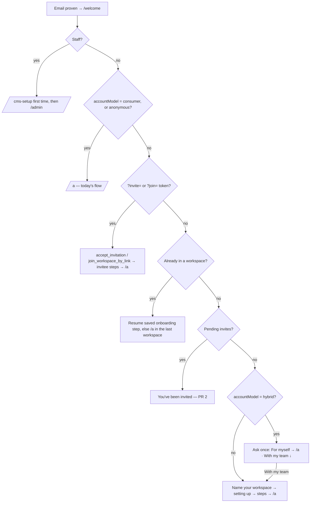

# Workspaces (B2B onboarding)

The kit can run as a consumer app, a team app, or both. One founder-level
setting, the **account model**, picks which. This doc covers the model, how
sign-up routes people, the data behind it, and how modules will scope their
data by workspace.

Design package (spec, wireframes, implemented screenshots):
[`docs/design/b2b-onboarding/`](./design/b2b-onboarding/).

## The account model

| Model | Value | Who it's for | What changes |
| --- | --- | --- | --- |
| Individuals | `consumer` (default) | members, customers, clients | Nothing. Today's flow, unchanged. |
| Teams and companies | `business` | B2B | Every user lives in a workspace: Name your workspace after sign-up, a workspace switcher, a getting-started checklist. |
| Both | `hybrid` | mixed | After email proof, one question ("For myself" / "With my team"), asked once. Anyone can create a workspace later. |

- Stored in the `authentication-settings` Payload global, **Account model** tab
  (see [`AUTH.md`](./AUTH.md#account-model-tab) for every field).
- The founder picks it on the first screen of `/cms-setup`, before the seed
  runs. It is shown once, only to staff, and never again after a choice.
- The model changes **UI and routing only**. RLS is identical in every model.
- **Staff ≠ workspace admin.** `profiles.is_staff` runs the app (`/admin`);
  `memberships.role` runs a customer's workspace. Neither implies the other.

## Routing: what `/welcome` decides

Every sign-in ends at `/welcome`. It gathers inputs and calls the pure
`resolvePostAuthDestination()` in `packages/app/src/post-auth.ts`, which mobile
reuses. Every branch is unit-tested in `post-auth.test.ts`.

- Staff are checked before the account model, so the founder's flow never
  changes. An invite token beats existing memberships.
- In Teams mode the `(app)` shell also sends a non-staff user with no
  workspace to Name your workspace (`needsWorkspaceGate`), so people who reach
  `/a` without passing `/welcome` can't skip it.
- `pendingInvites` is wired to `0` until PR 2 ships the `/onboarding/invites`
  screen; no invites can be created before then.

## Screens

Built from the kit's shadcn components and theme tokens (never the wireframe
CSS), so each founder's `theme-settings` branding applies in light and dark.

| Route | Wireframe | Files |
| --- | --- | --- |
| `/cms-setup` (first screen) | AccountModel | `components/cms-setup/account-model-picker.tsx`, `app/api/cms/account-model/route.ts` |
| `/sign-up` | SignUp | `components/auth/auth-flow.tsx` (copy by model + last-used hint) |
| `/onboarding/choose` | Hybrid | `components/onboarding/hybrid-choice-form.tsx` |
| `/onboarding/workspace` | CreateWorkspace | `components/onboarding/create-workspace-step.tsx` |
| `/onboarding/setting-up` | SettingUp | `components/onboarding/setting-up.tsx` |
| `/onboarding/profile` | Profile | `components/onboarding/profile-step.tsx` |
| `/onboarding/updates` | Updates | `components/onboarding/updates-step.tsx` |
| `/a` | Home | `components/workspaces/workspace-switcher.tsx`, `components/workspaces/home-getting-started.tsx` |

All web paths are under `apps/nextjs/src/`. The onboarding pages live in the
`app/(frontend)/(onboarding)/` route group; its layout requires a signed-in,
non-anonymous user in Teams or Both mode. `/onboarding` is a protected prefix
in `proxy.ts`.

**Stepper rules.** The enabled, shipped steps come from
`activeOnboardingSteps()` (`packages/app/src/workspaces.ts`) in the founder's
order. Creators see every step; invitees only see Profile and Updates. Each
step has **Do this later**; progress is saved per person per workspace with
`save_onboarding_progress`, so `/welcome` resumes at the same step. Steps a
member skipped stay on the `/a` checklist until done; the checklist hides
itself when everything is finished.

**Steps not shipped yet** are skipped even when enabled: `invite`
(invitations, PR 2), `integrations` (module-contributed steps, PR 3) and `plan`
(workspace billing, PR 3).

## Data

The tables, RPCs and policies are documented in
[`ERD.md`](./ERD.md#tables-by-group) under **Teams / multi-tenancy**. In short:

- `organizations` gained a unique, non-reserved `slug`, invite-link fields and
  `data jsonb`; `memberships` gained onboarding progress; `invitations` gained
  hashed tokens, expiry and an audit trail; `profiles` gained `title`,
  `last_org_id` and `email_preferences`.
- Every cross-boundary write is a `security definer` RPC with
  `set search_path = ''`: `is_slug_available`, `create_workspace`,
  `accept_invitation`, `join_workspace_by_link`, `my_pending_invitations`,
  `save_onboarding_progress`.
- Co-members can read each other's profiles; anonymous sessions can't touch
  workspace tables; a workspace always keeps one owner.
- Slug rules exist twice on purpose — `public.is_reserved_slug()` and the
  `organizations_slug_*` constraints in SQL, `RESERVED_WORKSPACE_SLUGS` and
  `WORKSPACE_SLUG_RE` in `packages/app/src/workspaces.ts`. Keep them in sync.

## The active workspace

There is no workspace slug in app URLs yet: module pages mount under
`/a/<module>` through the generated registry, so moving to `/{slug}/…` would
touch every module and `proxy.ts`.

- **Server:** `getActiveOrg()` / `getWorkspaceContext()` in
  `apps/nextjs/src/lib/workspaces/server.ts`. The active workspace is the
  `active_org` cookie, then `profiles.last_org_id`, then the oldest
  membership — always validated against the user's own memberships.
- **Client:** `useMyWorkspaces()` and `useSetActiveOrg()` in `@acme/app`. The
  sidebar switcher updates `last_org_id` (membership-guarded by a trigger),
  sets the cookie and refreshes.

## How modules will scope by workspace (PR 3)

Module tables are `user_id`-owned today. Workspace scoping is opt-in per
module, following the org-scoped pattern already in
[`ERD.md`](./ERD.md#rls--ownership-model):

1. **Manifest:** a `scope: "user" | "org"` field in `module.config.ts`.
2. **Schema:** org-scoped tables carry `org_id uuid not null references
   public.organizations on delete cascade`, plus an index on it.
3. **RLS:** `using (public.is_org_member(org_id)) with check
   (public.is_org_member(org_id))`, `is_org_admin(org_id)` for admin-only
   writes, and the usual RESTRICTIVE no-anon policy.
4. **Code:** server routes read `getActiveOrg()`; client hooks read the active
   workspace and filter by `org_id`. RLS remains the guarantee — the filter is
   only for picking the current workspace.
5. **Hooks:** a server `onWorkspaceCreated(orgId, userId)` that the setting-up
   splash runs (starter content), and a manifest `onboarding` entry for
   module-contributed steps such as Connect Slack.

## Testing

- `pnpm test` — resolver branches, slug rules, step registry and settings
  normalization (`packages/app/src/*.test.ts`).
- `pnpm test:rls` — `tooling/rls-tests/src/workspaces.test.ts`: cross-workspace
  isolation and every RPC refusal path.
- `pnpm test:e2e` — `tooling/web-e2e/src/workspace-signup.spec.ts` runs in its
  own `workspaces` Playwright project after the main suite (it flips the
  site-wide model, which would reroute parallel consumer sign-ups) and restores
  Individuals afterwards.

## What's next

- **PR 2 — Invitations:** a mailer decision, the invite API and email,
  `/invite/[token]`, `/join/[token]`, the locked-email sign-in, You've been
  invited, the Invite step, Settings → Members, and the Expo screens.
- **PR 3 — Workspace billing and module hooks:** workspace-owned Stripe
  customers and per-seat quantity, `plans.billingUnit`, and the module
  `scope` / `onboarding` / `onWorkspaceCreated` hooks.
