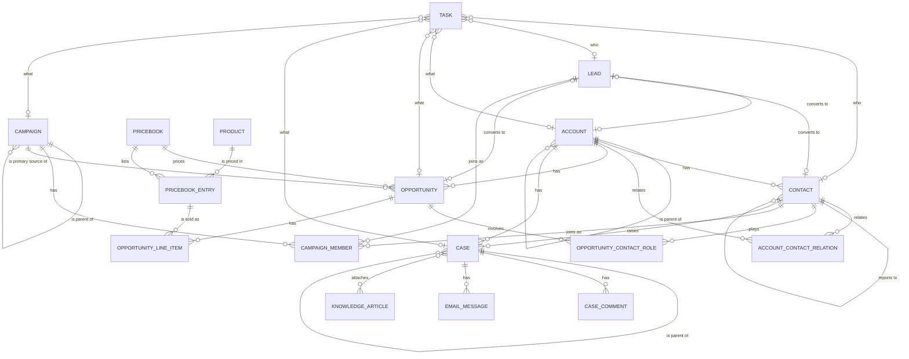

# Dream CRM — field reference

> **CRM module documentation.** This file moves to `docs/` in the private module repo
> (`vpv-group/dream-mod-crm`) when it is created. It is the **full target**: every
> record type in Salesforce Starter Suite, with the HubSpot mapping beside it. The MVP
> ships a subset; [UPGRADE.md](./UPGRADE.md) is the path from the MVP to all of this.
> The build plan for the MVP is [CRM-PLAN.md](../CRM-PLAN.md).

**Sources.** Salesforce's
[Object Reference](https://developer.salesforce.com/docs/atlas.en-us.object_reference.meta/object_reference/sforce_api_objects_list.htm)
(API v258), Salesforce's
[Free / Starter / Pro comparison chart](https://www.salesforce.com/en-us/wp-content/uploads/sites/4/documents/small-business/comparison-chart-starter-prosuite-features-us.pdf),
HubSpot's [CRM API reference](https://developers.hubspot.com/docs/api-reference/latest/crm/objects/contacts/guide),
and screenshots of the Salesforce Starter org `flow-force-4450`.

**Marks used in the tables**

| Mark | Meaning                                                                                                                 |
| ---- | ----------------------------------------------------------------------------------------------------------------------- |
| ✓    | Confirmed in the vendor's reference documentation, or visible in the screenshots                                        |
| †    | Salesforce's usual default picklist values, written from memory. Confirm against the org (plan Phase 0).                |
| ‡    | HubSpot's usual internal name or default, written from memory. Confirm with HubSpot's Properties API (upgrade step C2). |

## When each record ships

| Record                                                     | Table                                                                                                   | Ships in | Section |
| ---------------------------------------------------------- | ------------------------------------------------------------------------------------------------------- | -------- | ------- |
| Account                                                    | `mod_crm_accounts`                                                                                      | **MVP**  | §4      |
| Contact                                                    | `mod_crm_contacts`                                                                                      | **MVP**  | §5      |
| Lead                                                       | `mod_crm_leads`                                                                                         | **MVP**  | §6      |
| Opportunity                                                | `mod_crm_opportunities`                                                                                 | **MVP**  | §7      |
| Task                                                       | `mod_crm_tasks`                                                                                         | **MVP**  | §10     |
| Note                                                       | `mod_crm_notes`                                                                                         | **MVP**  | §10     |
| Case, Case Comment                                         | `mod_crm_cases`, `mod_crm_case_comments`                                                                | U1       | §9      |
| AccountContactRelation, OpportunityContactRole             | `mod_crm_account_contact_relations`, `mod_crm_opportunity_contact_roles`                                | U2       | §5, §7  |
| Event                                                      | `mod_crm_events`                                                                                        | U3       | §10     |
| Product, Price Book, Price Book Entry, Opportunity Product | `mod_crm_products`, `mod_crm_pricebooks`, `mod_crm_pricebook_entries`, `mod_crm_opportunity_line_items` | U4       | §8      |
| Campaign, Campaign Member                                  | `mod_crm_campaigns`, `mod_crm_campaign_members`                                                         | U5       | §11     |
| Knowledge, Email Message                                   | `mod_crm_knowledge_articles`, `mod_crm_case_articles`, `mod_crm_email_messages`                         | U6       | §12, §9 |

**Fields on MVP records that arrive later.** The six MVP tables are created with every
field listed for them below, except the ones that point at a table that doesn't exist
yet. Those columns are added by the upgrade step that creates the table:

| Record      | Field                                                                                                            | Arrives with |
| ----------- | ---------------------------------------------------------------------------------------------------------------- | ------------ |
| Opportunity | Price Book (`pricebook_id`), Has Line Item                                                                       | U4           |
| Opportunity | Primary Campaign Source (`campaign_id`)                                                                          | U5           |
| Opportunity | Primary Contact (`contact_id`) is an ordinary editable column in the MVP. It becomes derived from contact roles. | U2           |
| Task, Note  | Related To → Case (`case_id`)                                                                                    | U1           |
| Task, Note  | Related To → Campaign (`campaign_id`)                                                                            | U5           |
| Account     | Is Person Account, Contact ID (`is_person_account`, `person_contact_id`)                                         | U7           |

Some derived fields exist as columns in the MVP but are only kept up to date from U8
on: Push Count, Last Stage Change Date, Unread By Owner, High Priority and reminders.

---

## 1. Naming rules

| Salesforce                         | Dream CRM                                                                        | Example                                                        |
| ---------------------------------- | -------------------------------------------------------------------------------- | -------------------------------------------------------------- |
| Object API name                    | table `mod_crm_<plural_snake>`                                                   | `Opportunity` → `mod_crm_opportunities`                        |
| Field API name                     | column `snake_case(ApiName)`                                                     | `AnnualRevenue` → `annual_revenue`, `StageName` → `stage_name` |
| `…Id` lookup                       | `…_id uuid` FK, composite with `org_id`                                          | `AccountId` → `account_id`                                     |
| Compound address                   | prefixed columns                                                                 | `BillingPostalCode` → `billing_postal_code`                    |
| `Id`                               | `id uuid` (Dream) + `sf_id text` (18-character Salesforce Id, null until synced) |                                                                |
| `OwnerId`                          | `owner_id uuid` → `profiles` (default: the current user)                         |                                                                |
| `CreatedDate` / `LastModifiedDate` | `created_at` / `updated_at` (kit convention)                                     |                                                                |
| `CreatedById` / `LastModifiedById` | `created_by` / `updated_by` → `profiles`                                         |                                                                |
| `IsDeleted` (Recycle Bin)          | `deleted_at timestamptz` (soft delete)                                           |                                                                |
| `SystemModstamp`                   | `sf_system_modstamp timestamptz` (reserved for sync)                             |                                                                |
| Custom fields `Foo__c`             | `custom_fields jsonb`, keyed by API name                                         | `{"Region__c": "EMEA"}`                                        |
| Object URL slug                    | plural kebab label                                                               | `/a/crm/opportunities`, `/a/crm/price-books`                   |

**Every object table has these columns:** `id, org_id, owner_id, created_at, created_by,
updated_at, updated_by, deleted_at, sf_id, sf_system_modstamp, custom_fields`, plus a
unique index on `(org_id, sf_id) where sf_id is not null`. Child tables with no owner in
Salesforce (line items, contact roles, campaign members, case comments) leave out
`owner_id`.

**HubSpot columns, added beside the Salesforce ones** on every object table:
`hs_object_id`, `hs_lastmodifieddate` and `hs_properties`, plus a unique index on
`(org_id, hs_object_id) where hs_object_id is not null`. They mirror `sf_id`,
`sf_system_modstamp` and `custom_fields`, and are described in §13.

**Column kinds** used below:

| Kind     | Meaning                                                                                                                    |
| -------- | -------------------------------------------------------------------------------------------------------------------------- |
| stored   | An ordinary editable column                                                                                                |
| derived  | Read-only in Salesforce. Dream computes it with a generated column, a trigger or a view, and never accepts it from a form. |
| reserved | The column exists so data round-trips with Salesforce, but v1 shows no UI for it                                           |

**Left out of every object** (they need features Starter doesn't have, or are
Salesforce internals): Data.com fields (`Jigsaw`, `CleanStatus`, `DunsNumber`,
`NaicsCode`, …), geocode and ISO-code address parts (`…Latitude`, `…Longitude`,
`…GeocodeAccuracy`, `…CountryCode`, `…StateCode`), Sales Engagement cadence fields,
Einstein and activity-metric fields, portal and partner flags, `RecordTypeId`,
`MasterRecordId`, `PhotoUrl`, `IsPriorityRecord`, `CurrencyIsoCode` (the workspace has
one currency), `Division`, `Territory2Id`, `IndividualId`, and `LastViewedDate` /
`LastReferencedDate` (replaced by `mod_crm_recent_items`).

## 2. Picklists are data, not enums

Salesforce picklists can be edited per org, and some values carry extra metadata.
These are stored in **`mod_crm_picklist_values`**:

```
(org_id nullable, object, field, value, label, sort_order, is_default, is_active, meta jsonb)
```

- `org_id is null` rows hold the **global Salesforce defaults**. Every signed-in member
  can read them.
- When a workspace admin edits a picklist, the defaults are copied into
  workspace-owned rows first. Reads prefer workspace rows and fall back to the
  defaults, so no per-workspace seeding step is needed.
- `meta` mirrors Salesforce's metadata objects: `OpportunityStage`
  (`{defaultProbability, forecastCategoryName, isClosed, isWon}`), `CaseStatus` and
  `TaskStatus` (`{isClosed}`), `LeadStatus` (`{isConverted}`), `TaskPriority`
  (`{isHighPriority}`) and campaign member status (`{hasResponded}`). It also holds
  the design-system status tone for each value.
- Columns stay `text`, and a trigger checks each value against the active picklist.
  Sync can switch the check off so an unknown value from Salesforce never fails a
  write.
- `meta.hubspot` holds the matching HubSpot internal value for a picklist value, and
  for stages and statuses the HubSpot pipeline it belongs to (§13). The Salesforce
  value stays the stored one.

Shared picklists used by several objects:

| Picklist                                           | Values                                                                                                                                                                                                                                                                                                                                                                                                  |
| -------------------------------------------------- | ------------------------------------------------------------------------------------------------------------------------------------------------------------------------------------------------------------------------------------------------------------------------------------------------------------------------------------------------------------------------------------------------------- |
| Salutation †                                       | Mr., Ms., Mrs., Dr., Prof., Mx.                                                                                                                                                                                                                                                                                                                                                                         |
| Lead Source †                                      | Web, Phone Inquiry, Partner Referral, Purchased List, Other                                                                                                                                                                                                                                                                                                                                             |
| Industry †                                         | Agriculture, Apparel, Banking, Biotechnology, Chemicals, Communications, Construction, Consulting, Education, Electronics, Energy, Engineering, Entertainment, Environmental, Finance, Food & Beverage, Government, Healthcare, Hospitality, Insurance, Machinery, Manufacturing, Media, Not For Profit, Other, Recreation, Retail, Shipping, Technology, Telecommunications, Transportation, Utilities |
| Rating †                                           | Hot, Warm, Cold                                                                                                                                                                                                                                                                                                                                                                                         |
| Contact role (Opportunity and Account relations) ✓ | Business User, Decision Maker, Economic Buyer, Economic Decision Maker, Evaluator, Executive Sponsor, Influencer, Technical Buyer, Other. Dream adds Owner, Admin and Member for synced memberships.                                                                                                                                                                                                    |

## 3. How the records relate



Events and Notes relate to the same "who" and "what" records as Tasks.

## 4. Account — `Account` → `mod_crm_accounts` → `/a/crm/accounts`

| Label             | API name                                                                              | Column                                                                                      | Type            | Kind / notes                                                                                                                   |
| ----------------- | ------------------------------------------------------------------------------------- | ------------------------------------------------------------------------------------------- | --------------- | ------------------------------------------------------------------------------------------------------------------------------ |
| Account Name      | `Name`                                                                                | `name`                                                                                      | text(255)       | stored, **required**                                                                                                           |
| Account Owner     | `OwnerId`                                                                             | `owner_id`                                                                                  | user            | stored                                                                                                                         |
| Parent Account    | `ParentId`                                                                            | `parent_id`                                                                                 | → Account       | stored                                                                                                                         |
| Account Number    | `AccountNumber`                                                                       | `account_number`                                                                            | text(40)        | stored                                                                                                                         |
| Account Site      | `Site`                                                                                | `site`                                                                                      | text(80)        | stored                                                                                                                         |
| Type              | `Type`                                                                                | `type`                                                                                      | picklist        | Prospect, Customer - Direct, Customer - Channel, Channel Partner / Reseller, Installation Partner, Technology Partner, Other † |
| Industry          | `Industry`                                                                            | `industry`                                                                                  | picklist        | shared list                                                                                                                    |
| Rating            | `Rating`                                                                              | `rating`                                                                                    | picklist        | shared list                                                                                                                    |
| Ownership         | `Ownership`                                                                           | `ownership`                                                                                 | picklist        | Public, Private, Subsidiary, Other †                                                                                           |
| Account Source    | `AccountSource`                                                                       | `account_source`                                                                            | picklist        | Lead Source list                                                                                                               |
| Annual Revenue    | `AnnualRevenue`                                                                       | `annual_revenue`                                                                            | currency        | stored                                                                                                                         |
| Employees         | `NumberOfEmployees`                                                                   | `number_of_employees`                                                                       | int             | stored                                                                                                                         |
| Phone             | `Phone`                                                                               | `phone`                                                                                     | phone           | stored                                                                                                                         |
| Fax               | `Fax`                                                                                 | `fax`                                                                                       | phone           | stored                                                                                                                         |
| Website           | `Website`                                                                             | `website`                                                                                   | url             | stored                                                                                                                         |
| Ticker Symbol     | `TickerSymbol`                                                                        | `ticker_symbol`                                                                             | text(20)        | stored                                                                                                                         |
| SIC Code          | `Sic`                                                                                 | `sic`                                                                                       | text(20)        | stored                                                                                                                         |
| SIC Description   | `SicDesc`                                                                             | `sic_desc`                                                                                  | text(80)        | stored                                                                                                                         |
| Billing Address   | `BillingStreet`, `BillingCity`, `BillingState`, `BillingPostalCode`, `BillingCountry` | `billing_street`, `billing_city`, `billing_state`, `billing_postal_code`, `billing_country` | address         | stored                                                                                                                         |
| Shipping Address  | `Shipping…` (same five parts)                                                         | `shipping_*`                                                                                | address         | stored                                                                                                                         |
| Description       | `Description`                                                                         | `description`                                                                               | long text       | stored                                                                                                                         |
| Is Person Account | `IsPersonAccount`                                                                     | `is_person_account`                                                                         | bool            | derived (set at creation)                                                                                                      |
| Contact ID        | `PersonContactId`                                                                     | `person_contact_id`                                                                         | → Contact       | derived; the paired Contact holds the person's fields                                                                          |
| Last Activity     | `LastActivityDate`                                                                    | —                                                                                           | date            | derived (view over tasks and events)                                                                                           |
| _Dream only_      | —                                                                                     | `linked_org_id`                                                                             | → organizations | the customer organization this Account represents ([plan §2](../CRM-PLAN.md#2-organizations-and-sign-up-mapping))              |

## 5. Contact — `Contact` → `mod_crm_contacts` → `/a/crm/contacts`

| Label                       | API name                                 | Column                                       | Type           | Kind / notes                                                                                              |
| --------------------------- | ---------------------------------------- | -------------------------------------------- | -------------- | --------------------------------------------------------------------------------------------------------- |
| Salutation                  | `Salutation`                             | `salutation`                                 | picklist       | shared list                                                                                               |
| First Name                  | `FirstName`                              | `first_name`                                 | text(40)       | stored                                                                                                    |
| Middle Name                 | `MiddleName`                             | `middle_name`                                | text(40)       | reserved                                                                                                  |
| Last Name                   | `LastName`                               | `last_name`                                  | text(80)       | stored, **required**                                                                                      |
| Suffix                      | `Suffix`                                 | `suffix`                                     | text(40)       | reserved                                                                                                  |
| Name                        | `Name`                                   | `name`                                       | text           | derived: First + Middle + Last + Suffix                                                                   |
| Account Name                | `AccountId`                              | `account_id`                                 | → Account      | stored (the primary account)                                                                              |
| Contact Owner               | `OwnerId`                                | `owner_id`                                   | user           | stored                                                                                                    |
| Title                       | `Title`                                  | `title`                                      | text           | stored                                                                                                    |
| Department                  | `Department`                             | `department`                                 | text           | stored                                                                                                    |
| Reports To                  | `ReportsToId`                            | `reports_to_id`                              | → Contact      | stored                                                                                                    |
| Email                       | `Email`                                  | `email`                                      | email          | stored                                                                                                    |
| Phone (Business Phone)      | `Phone`                                  | `phone`                                      | phone          | stored                                                                                                    |
| Mobile                      | `MobilePhone`                            | `mobile_phone`                               | phone          | stored                                                                                                    |
| Home Phone                  | `HomePhone`                              | `home_phone`                                 | phone          | stored                                                                                                    |
| Other Phone                 | `OtherPhone`                             | `other_phone`                                | phone          | stored                                                                                                    |
| Fax (Business Fax)          | `Fax`                                    | `fax`                                        | phone          | stored                                                                                                    |
| Assistant                   | `AssistantName`                          | `assistant_name`                             | text           | stored                                                                                                    |
| Asst. Phone                 | `AssistantPhone`                         | `assistant_phone`                            | phone          | stored                                                                                                    |
| Birthdate                   | `Birthdate`                              | `birthdate`                                  | date           | stored                                                                                                    |
| Lead Source                 | `LeadSource`                             | `lead_source`                                | picklist       | shared list                                                                                               |
| Mailing Address             | `Mailing…` (five parts)                  | `mailing_*`                                  | address        | stored                                                                                                    |
| Other Address               | `Other…` (five parts)                    | `other_*`                                    | address        | stored                                                                                                    |
| Contact Description         | `Description`                            | `description`                                | long text      | stored                                                                                                    |
| Do Not Call                 | `DoNotCall`                              | `do_not_call`                                | bool           | stored                                                                                                    |
| Email Opt Out               | `HasOptedOutOfEmail`                     | `has_opted_out_of_email`                     | bool           | stored                                                                                                    |
| Fax Opt Out                 | `HasOptedOutOfFax`                       | `has_opted_out_of_fax`                       | bool           | stored                                                                                                    |
| Gender Identity             | `GenderIdentity`                         | `gender_identity`                            | picklist       | reserved; values from Phase 0                                                                             |
| Pronouns                    | `Pronouns`                               | `pronouns`                                   | picklist       | reserved; values from Phase 0                                                                             |
| Email Bounced Date / Reason | `EmailBouncedDate`, `EmailBouncedReason` | `email_bounced_date`, `email_bounced_reason` | datetime, text | reserved                                                                                                  |
| Is Email Bounced            | `IsEmailBounced`                         | —                                            | bool           | derived                                                                                                   |
| Last Activity               | `LastActivityDate`                       | —                                            | date           | derived                                                                                                   |
| _Dream only_                | —                                        | `linked_user_id`                             | → profiles     | the customer user this Contact represents ([plan §2](../CRM-PLAN.md#2-organizations-and-sign-up-mapping)) |

**AccountContactRelation** → `mod_crm_account_contact_relations` (a related list on
both records, no page of its own):

| Label                 | API name               | Column                   | Type                     | Kind / notes                                             |
| --------------------- | ---------------------- | ------------------------ | ------------------------ | -------------------------------------------------------- |
| Account               | `AccountId`            | `account_id`             | → Account                | stored, **required**, fixed after creation               |
| Contact               | `ContactId`            | `contact_id`             | → Contact                | stored, **required**, fixed after creation               |
| Roles                 | `Roles`                | `roles`                  | multipicklist (`text[]`) | Contact role list ✓                                      |
| Direct                | `IsDirect`             | `is_direct`              | bool                     | derived: true when this is the contact's primary account |
| Active                | `IsActive`             | `is_active`              | bool                     | stored                                                   |
| Start Date / End Date | `StartDate`, `EndDate` | `start_date`, `end_date` | date                     | stored                                                   |

## 6. Lead — `Lead` → `mod_crm_leads` → `/a/crm/leads`

| Label                                              | API name                                                             | Column                                                                     | Type      | Kind / notes                                                                                                                            |
| -------------------------------------------------- | -------------------------------------------------------------------- | -------------------------------------------------------------------------- | --------- | --------------------------------------------------------------------------------------------------------------------------------------- |
| Salutation, First, Middle, Last Name, Suffix, Name | as Contact                                                           | as Contact                                                                 |           | `last_name` **required**; `name` derived                                                                                                |
| Company                                            | `Company`                                                            | `company`                                                                  | text      | stored, **required** (leave empty to convert to a person account)                                                                       |
| Title                                              | `Title`                                                              | `title`                                                                    | text(128) | stored                                                                                                                                  |
| Lead Owner                                         | `OwnerId`                                                            | `owner_id`                                                                 | user      | stored                                                                                                                                  |
| Lead Status                                        | `Status`                                                             | `status`                                                                   | picklist  | stored, **required.** Open - Not Contacted (default), Working - Contacted, Closed - Converted (`isConverted`), Closed - Not Converted † |
| Lead Source                                        | `LeadSource`                                                         | `lead_source`                                                              | picklist  | shared list                                                                                                                             |
| Industry                                           | `Industry`                                                           | `industry`                                                                 | picklist  | shared list                                                                                                                             |
| Rating                                             | `Rating`                                                             | `rating`                                                                   | picklist  | shared list                                                                                                                             |
| Annual Revenue                                     | `AnnualRevenue`                                                      | `annual_revenue`                                                           | currency  | stored                                                                                                                                  |
| No. of Employees                                   | `NumberOfEmployees`                                                  | `number_of_employees`                                                      | int       | stored                                                                                                                                  |
| Email                                              | `Email`                                                              | `email`                                                                    | email     | stored                                                                                                                                  |
| Phone                                              | `Phone`                                                              | `phone`                                                                    | phone     | stored                                                                                                                                  |
| Mobile                                             | `MobilePhone`                                                        | `mobile_phone`                                                             | phone     | stored                                                                                                                                  |
| Fax                                                | `Fax`                                                                | `fax`                                                                      | phone     | stored                                                                                                                                  |
| Website                                            | `Website`                                                            | `website`                                                                  | url       | stored                                                                                                                                  |
| Address                                            | `Street`, `City`, `State`, `PostalCode`, `Country`                   | `street`, `city`, `state`, `postal_code`, `country`                        | address   | stored                                                                                                                                  |
| Description                                        | `Description`                                                        | `description`                                                              | long text | stored                                                                                                                                  |
| Email Opt Out                                      | `HasOptedOutOfEmail`                                                 | `has_opted_out_of_email`                                                   | bool      | stored                                                                                                                                  |
| Fax Opt Out                                        | `HasOptedOutOfFax`                                                   | `has_opted_out_of_fax`                                                     | bool      | stored                                                                                                                                  |
| Unread By Owner                                    | `IsUnreadByOwner`                                                    | `is_unread_by_owner`                                                       | bool      | stored; cleared when the owner first opens the lead                                                                                     |
| Gender Identity, Pronouns                          | as Contact                                                           | as Contact                                                                 | picklist  | reserved                                                                                                                                |
| Email Bounced Date / Reason                        | as Contact                                                           | as Contact                                                                 |           | reserved                                                                                                                                |
| Converted                                          | `IsConverted`                                                        | `is_converted`                                                             | bool      | derived (set only by Convert)                                                                                                           |
| Converted Date                                     | `ConvertedDate`                                                      | `converted_date`                                                           | date      | derived                                                                                                                                 |
| Converted Account / Contact / Opportunity          | `ConvertedAccountId`, `ConvertedContactId`, `ConvertedOpportunityId` | `converted_account_id`, `converted_contact_id`, `converted_opportunity_id` | lookup    | derived                                                                                                                                 |
| Last Activity                                      | `LastActivityDate`                                                   | —                                                                          | date      | derived                                                                                                                                 |

**Convert Lead** is a Postgres function, `mod_crm_convert_lead(lead_id, account_id?,
contact_id?, create_opportunity bool, opportunity_name?)`. It runs with the caller's
permissions, so RLS applies. In one transaction it creates or reuses the Account and
Contact, optionally creates the Opportunity (with a primary contact role), re-parents
the lead's Tasks, Events, Notes and campaign memberships, and stamps the `converted_*`
fields. Field mapping follows Salesforce's default lead conversion: Company → Account
Name, the lead's address → the account's billing address and the contact's mailing
address, Lead Source carried to all three records.

## 7. Opportunity — `Opportunity` → `mod_crm_opportunities` → `/a/crm/opportunities`

| Label                            | API name                                | Column                       | Type         | Kind / notes                                                                                                |
| -------------------------------- | --------------------------------------- | ---------------------------- | ------------ | ----------------------------------------------------------------------------------------------------------- |
| Opportunity Name                 | `Name`                                  | `name`                       | text(120)    | stored, **required**                                                                                        |
| Account Name                     | `AccountId`                             | `account_id`                 | → Account    | stored                                                                                                      |
| Opportunity Owner                | `OwnerId`                               | `owner_id`                   | user         | stored                                                                                                      |
| Amount                           | `Amount`                                | `amount`                     | currency     | stored; becomes derived (the sum of products) once the opportunity has line items ✓                         |
| Close Date                       | `CloseDate`                             | `close_date`                 | date         | stored, **required**                                                                                        |
| Stage                            | `StageName`                             | `stage_name`                 | picklist     | stored, **required** — values below                                                                         |
| Probability (%)                  | `Probability`                           | `probability`                | percent      | stored; defaults from the stage and can be overridden ✓                                                     |
| Forecast Category                | `ForecastCategoryName`                  | `forecast_category_name`     | picklist     | stored; defaults from the stage. Pipeline, Best Case, Most Likely, Commit, Omitted, Closed ✓                |
| Opportunity Type                 | `Type`                                  | `type`                       | picklist     | Existing Customer - Upgrade, Existing Customer - Replacement, Existing Customer - Downgrade, New Customer † |
| Lead Source                      | `LeadSource`                            | `lead_source`                | picklist     | shared list                                                                                                 |
| Next Step                        | `NextStep`                              | `next_step`                  | text(255)    | stored                                                                                                      |
| Description                      | `Description`                           | `description`                | long text    | stored                                                                                                      |
| Private                          | `IsPrivate`                             | `is_private`                 | bool         | stored; a private opportunity is visible only to its owner and workspace admins                             |
| Primary Campaign Source          | `CampaignId`                            | `campaign_id`                | → Campaign   | stored                                                                                                      |
| Price Book                       | `Pricebook2Id`                          | `pricebook_id`               | → Pricebook2 | stored                                                                                                      |
| Quantity                         | `TotalOpportunityQuantity`              | `total_opportunity_quantity` | number       | stored                                                                                                      |
| Primary Contact                  | `ContactId`                             | `contact_id`                 | → Contact    | derived: accepted at creation only, then follows the primary contact role ✓                                 |
| Expected Revenue                 | `ExpectedRevenue`                       | `expected_revenue`           | currency     | derived: Amount × Probability ✓                                                                             |
| Closed / Won                     | `IsClosed`, `IsWon`                     | `is_closed`, `is_won`        | bool         | derived from the stage ✓                                                                                    |
| Has Line Item                    | `HasOpportunityLineItem`                | `has_opportunity_line_item`  | bool         | derived                                                                                                     |
| Last Stage Change Date           | `LastStageChangeDate`                   | `last_stage_change_date`     | datetime     | derived (trigger)                                                                                           |
| Push Count                       | `PushCount`                             | `push_count`                 | int          | derived: +1 each time the close date moves to a later month ✓                                               |
| Fiscal Period / Quarter / Year   | `Fiscal`, `FiscalQuarter`, `FiscalYear` | —                            |              | derived (view; uses the workspace's fiscal-year start month)                                                |
| Has Open Activity / Overdue Task | `HasOpenActivity`, `HasOverdueTask`     | —                            | bool         | derived (view)                                                                                              |

Not included: `ContractId` and `SyncedQuoteId` (contracts and quotes are outside
Starter), `IsSplit`, `IqScore`, history ids.

Default stages †, as `value (probability %, forecast category)`: Prospecting (10,
Pipeline) · Qualification (10, Pipeline) · Needs Analysis (20, Pipeline) · Value
Proposition (50, Pipeline) · Id. Decision Makers (60, Pipeline) · Perception Analysis
(70, Pipeline) · Proposal/Price Quote (75, Pipeline) · Negotiation/Review (90,
Pipeline) · Closed Won (100, Closed, won) · Closed Lost (0, Omitted, closed).

**OpportunityContactRole** → `mod_crm_opportunity_contact_roles` (the "Contact Roles"
related list):

| Label       | API name        | Column           | Type          | Kind / notes                                       |
| ----------- | --------------- | ---------------- | ------------- | -------------------------------------------------- |
| Opportunity | `OpportunityId` | `opportunity_id` | → Opportunity | stored, **required**, fixed after creation         |
| Contact     | `ContactId`     | `contact_id`     | → Contact     | stored, **required**                               |
| Role        | `Role`          | `role`           | picklist      | Contact role list ✓                                |
| Primary     | `IsPrimary`     | `is_primary`     | bool          | stored; one per opportunity (partial unique index) |

## 8. Products and price books

**Product** — `Product2` → `mod_crm_products` → `/a/crm/products`

| Label                    | API name                | Column                     | Type      | Kind / notes                                                 |
| ------------------------ | ----------------------- | -------------------------- | --------- | ------------------------------------------------------------ |
| Product Name             | `Name`                  | `name`                     | text      | stored, **required**                                         |
| Product Code             | `ProductCode`           | `product_code`             | text      | stored                                                       |
| Product SKU              | `StockKeepingUnit`      | `stock_keeping_unit`       | text      | stored                                                       |
| Product Description      | `Description`           | `description`              | long text | stored                                                       |
| Active                   | `IsActive`              | `is_active`                | bool      | stored                                                       |
| Product Family           | `Family`                | `family`                   | picklist  | no default values; the workspace defines them ✓              |
| Quantity Unit Of Measure | `QuantityUnitOfMeasure` | `quantity_unit_of_measure` | picklist  | Each ✓                                                       |
| Display URL              | `DisplayUrl`            | `display_url`              | url       | stored                                                       |
| External ID              | `ExternalId`            | `external_id`              | text      | stored; holds the Stripe product id when synced from billing |
| Archived                 | `IsArchived`            | `is_archived`              | bool      | derived                                                      |
| Type                     | `Type`                  | `type`                     | picklist  | reserved (Commerce variations)                               |

Not included: revenue and quantity schedule fields, `IsSerialized`, billing and tax
policy ids. They need features outside Starter.

**Price Book** — `Pricebook2` → `mod_crm_pricebooks` → `/a/crm/price-books`

| Label                  | API name               | Column                   | Type     | Kind / notes                                                           |
| ---------------------- | ---------------------- | ------------------------ | -------- | ---------------------------------------------------------------------- |
| Price Book Name        | `Name`                 | `name`                   | text     | stored, **required**                                                   |
| Description            | `Description`          | `description`            | text     | stored                                                                 |
| Active                 | `IsActive`             | `is_active`              | bool     | stored                                                                 |
| Is Standard Price Book | `IsStandard`           | `is_standard`            | bool     | derived; each workspace gets exactly one, created with the workspace ✓ |
| Archived               | `IsArchived`           | `is_archived`            | bool     | derived                                                                |
| Valid From / Valid To  | `ValidFrom`, `ValidTo` | `valid_from`, `valid_to` | datetime | reserved (Commerce)                                                    |

**Price Book Entry** — `PricebookEntry` → `mod_crm_pricebook_entries`

| Label                       | API name              | Column               | Type         | Kind / notes                                                       |
| --------------------------- | --------------------- | -------------------- | ------------ | ------------------------------------------------------------------ |
| Price Book                  | `Pricebook2Id`        | `pricebook_id`       | → Pricebook2 | stored, **required**                                               |
| Product                     | `Product2Id`          | `product_id`         | → Product2   | stored, **required**; unique per price book                        |
| List Price                  | `UnitPrice`           | `unit_price`         | currency     | stored, **required**                                               |
| Active                      | `IsActive`            | `is_active`          | bool         | stored                                                             |
| Use Standard Price          | `UseStandardPrice`    | `use_standard_price` | bool         | stored; when true the list price follows the standard price book ✓ |
| Product Name / Product Code | `Name`, `ProductCode` | —                    | text         | derived from the product                                           |
| Archived                    | `IsArchived`          | `is_archived`        | bool         | derived                                                            |

Salesforce's rule is kept: a product needs an entry in the standard price book before
it can be added to any other.

**Opportunity Product** — `OpportunityLineItem` → `mod_crm_opportunity_line_items`

| Label               | API name              | Column               | Type             | Kind / notes                                                      |
| ------------------- | --------------------- | -------------------- | ---------------- | ----------------------------------------------------------------- |
| Opportunity         | `OpportunityId`       | `opportunity_id`     | → Opportunity    | stored, **required**                                              |
| Price Book Entry    | `PricebookEntryId`    | `pricebook_entry_id` | → PricebookEntry | stored, **required**; must belong to the opportunity's price book |
| Product             | `Product2Id`          | `product_id`         | → Product2       | derived from the entry                                            |
| Quantity            | `Quantity`            | `quantity`           | number           | stored, **required**                                              |
| Sales Price         | `UnitPrice`           | `unit_price`         | currency         | stored; defaults to the list price                                |
| List Price          | `ListPrice`           | `list_price`         | currency         | derived (copied from the entry)                                   |
| Discount            | `Discount`            | `discount`           | percent          | stored                                                            |
| Subtotal            | `Subtotal`            | `subtotal`           | currency         | derived: Quantity × Sales Price                                   |
| Total Price         | `TotalPrice`          | `total_price`        | currency         | derived: Subtotal less Discount                                   |
| Date                | `ServiceDate`         | `service_date`       | date             | stored                                                            |
| Line Description    | `Description`         | `description`        | text(255)        | stored                                                            |
| Sort Order          | `SortOrder`           | `sort_order`         | int              | stored                                                            |
| Product Code / Name | `ProductCode`, `Name` | —                    | text             | derived                                                           |

## 9. Case — `Case` → `mod_crm_cases` → `/a/crm/cases`

| Label                                | API name                                                            | Column                                                                  | Type        | Kind / notes                                                                                                   |
| ------------------------------------ | ------------------------------------------------------------------- | ----------------------------------------------------------------------- | ----------- | -------------------------------------------------------------------------------------------------------------- |
| Case Number                          | `CaseNumber`                                                        | `case_number`                                                           | auto-number | derived; per-workspace counter, `00001000` format                                                              |
| Status                               | `Status`                                                            | `status`                                                                | picklist    | stored, **required.** New (default), Working, Waiting on Customer, Escalated, Closed (`isClosed`) ✓ screenshot |
| Priority                             | `Priority`                                                          | `priority`                                                              | picklist    | High, Medium (default), Low ✓ screenshot                                                                       |
| Case Origin                          | `Origin`                                                            | `origin`                                                                | picklist    | Phone, Email, Web †                                                                                            |
| Type                                 | `Type`                                                              | `type`                                                                  | picklist    | Problem, Feature Request, Question †                                                                           |
| Case Reason                          | `Reason`                                                            | `reason`                                                                | picklist    | User didn't attend training, Complex functionality, Existing problem, Instructions not clear, New problem †    |
| Case Owner                           | `OwnerId`                                                           | `owner_id`                                                              | user        | stored                                                                                                         |
| Contact Name                         | `ContactId`                                                         | `contact_id`                                                            | → Contact   | stored                                                                                                         |
| Account Name                         | `AccountId`                                                         | `account_id`                                                            | → Account   | stored; defaults from the contact                                                                              |
| Parent Case                          | `ParentId`                                                          | `parent_id`                                                             | → Case      | stored                                                                                                         |
| Subject                              | `Subject`                                                           | `subject`                                                               | text(255)   | stored                                                                                                         |
| Description                          | `Description`                                                       | `description`                                                           | long text   | stored                                                                                                         |
| Escalated                            | `IsEscalated`                                                       | `is_escalated`                                                          | bool        | stored                                                                                                         |
| Web Name / Email / Phone / Company   | `SuppliedName`, `SuppliedEmail`, `SuppliedPhone`, `SuppliedCompany` | `supplied_name`, `supplied_email`, `supplied_phone`, `supplied_company` | text        | stored (filled by web and email intake)                                                                        |
| Closed                               | `IsClosed`                                                          | `is_closed`                                                             | bool        | derived from the status ✓                                                                                      |
| Date/Time Closed                     | `ClosedDate`                                                        | `closed_date`                                                           | datetime    | derived                                                                                                        |
| Closed When Created                  | `IsClosedOnCreate`                                                  | `is_closed_on_create`                                                   | bool        | derived                                                                                                        |
| Contact Email / Phone / Mobile / Fax | `ContactEmail`, `ContactPhone`, `ContactMobile`, `ContactFax`       | —                                                                       |             | derived (view; reads the contact)                                                                              |
| Internal Comments                    | `Comments`                                                          | —                                                                       |             | not a column: saving it inserts a Case Comment ✓                                                               |

Not included: `BusinessHoursId`, entitlement and SLA fields, `AssetId`, social and
community fields. The modal's _Send notification email to contact_ checkbox is a
save-time option, not a field. It renders disabled until case email ships (upgrade step U6).

**Case Comment** — `CaseComment` → `mod_crm_case_comments`

| Label     | API name      | Column         | Type       | Kind / notes                               |
| --------- | ------------- | -------------- | ---------- | ------------------------------------------ |
| Case      | `ParentId`    | `case_id`      | → Case     | stored, **required**                       |
| Body      | `CommentBody` | `comment_body` | text(4000) | stored                                     |
| Published | `IsPublished` | `is_published` | bool       | stored; true means the customer may see it |

**Email Message** — `EmailMessage` → `mod_crm_email_messages`

| Label                      | API name                                                                  | Column                                                                           | Type           | Kind / notes                                             |
| -------------------------- | ------------------------------------------------------------------------- | -------------------------------------------------------------------------------- | -------------- | -------------------------------------------------------- |
| Case                       | `ParentId`                                                                | `case_id`                                                                        | → Case         | stored                                                   |
| Related To                 | `RelatedToId`                                                             | `account_id` / `opportunity_id` / `campaign_id`                                  | lookup         | stored (same pattern as Task)                            |
| Activity                   | `ActivityId`                                                              | `task_id`                                                                        | → Task         | stored                                                   |
| Subject                    | `Subject`                                                                 | `subject`                                                                        | text           | stored                                                   |
| Text Body / HTML Body      | `TextBody`, `HtmlBody`                                                    | `text_body`, `html_body`                                                         | long text      | stored                                                   |
| Headers                    | `Headers`                                                                 | `headers`                                                                        | long text      | stored (incoming only)                                   |
| From Name / From Address   | `FromName`, `FromAddress`                                                 | `from_name`, `from_address`                                                      | text, email    | stored                                                   |
| To / CC / BCC Address      | `ToAddress`, `CcAddress`, `BccAddress`                                    | `to_address`, `cc_address`, `bcc_address`                                        | text           | stored                                                   |
| Is Incoming                | `Incoming`                                                                | `incoming`                                                                       | bool           | stored                                                   |
| Status                     | `Status`                                                                  | `status`                                                                         | picklist       | 0 New, 1 Read, 2 Replied, 3 Sent, 4 Forwarded, 5 Draft ✓ |
| Message Date               | `MessageDate`                                                             | `message_date`                                                                   | datetime       | stored                                                   |
| Message ID / Thread ID     | `MessageIdentifier`, `ThreadIdentifier`                                   | `message_identifier`, `thread_identifier`                                        | text           | stored                                                   |
| In Reply To                | `ReplyToEmailMessageId`                                                   | `reply_to_email_message_id`                                                      | → EmailMessage | stored                                                   |
| Has Attachment             | `HasAttachment`                                                           | `has_attachment`                                                                 | bool           | derived                                                  |
| Bounced / Opened / Tracked | `IsBounced`, `IsOpened`, `IsTracked`, `FirstOpenedDate`, `LastOpenedDate` | `is_bounced`, `is_opened`, `is_tracked`, `first_opened_date`, `last_opened_date` |                | reserved                                                 |

## 10. Activities and notes

**Task** — `Task` → `mod_crm_tasks` → `/a/crm/tasks`

| Label                           | API name                                                 | Column                                                        | Type                                  | Kind / notes                                                                                                          |
| ------------------------------- | -------------------------------------------------------- | ------------------------------------------------------------- | ------------------------------------- | --------------------------------------------------------------------------------------------------------------------- |
| Subject                         | `Subject`                                                | `subject`                                                     | combobox (free text with suggestions) | stored. Suggestions: Call, Email, Send Letter, Send Quote, Other †                                                    |
| Status                          | `Status`                                                 | `status`                                                      | picklist                              | stored, **required.** Not Started (default), In Progress, Completed (`isClosed`), Waiting on someone else, Deferred ✓ |
| Priority                        | `Priority`                                               | `priority`                                                    | picklist                              | stored, **required.** High (`isHighPriority`), Normal (default), Low ✓                                                |
| Due Date                        | `ActivityDate`                                           | `activity_date`                                               | date                                  | stored                                                                                                                |
| Comments                        | `Description`                                            | `description`                                                 | long text                             | stored                                                                                                                |
| Assigned To                     | `OwnerId`                                                | `owner_id`                                                    | user                                  | stored                                                                                                                |
| Name                            | `WhoId`                                                  | `lead_id` / `contact_id`                                      | lookup                                | stored; at most one                                                                                                   |
| Related To                      | `WhatId`                                                 | `account_id` / `opportunity_id` / `case_id` / `campaign_id`   | lookup                                | stored; at most one                                                                                                   |
| Type                            | `Type`                                                   | `type`                                                        | picklist                              | Call, Email, Meeting, Other †                                                                                         |
| Task Subtype                    | `TaskSubtype`                                            | `task_subtype`                                                | picklist                              | Task, Email, ListEmail, Call, LinkedIn, Cadence ✓; fixed after creation                                               |
| Closed                          | `IsClosed`                                               | `is_closed`                                                   | bool                                  | derived from the status                                                                                               |
| High Priority                   | `IsHighPriority`                                         | `is_high_priority`                                            | bool                                  | derived from the priority                                                                                             |
| Completed Date/Time             | `CompletedDateTime`                                      | `completed_date_time`                                         | datetime                              | derived                                                                                                               |
| Call Type                       | `CallType`                                               | `call_type`                                                   | picklist                              | Inbound, Internal, Outbound ✓                                                                                         |
| Call Duration / Result / Object | `CallDurationInSeconds`, `CallDisposition`, `CallObject` | `call_duration_in_seconds`, `call_disposition`, `call_object` | int, text, text                       | stored (for "Log a Call")                                                                                             |
| Reminder Set / Reminder         | `IsReminderSet`, `ReminderDateTime`                      | `is_reminder_set`, `reminder_date_time`                       | bool, datetime                        | stored; delivered through the kit's reminders module                                                                  |
| Account                         | `AccountId`                                              | —                                                             | lookup                                | derived from Who / What ✓                                                                                             |

**Polymorphic `WhoId` and `WhatId`** become real foreign-key columns, so referential
integrity and RLS stay simple. A `CHECK` allows at most one of each group. The
connector maps them by Salesforce key prefix (`00Q` Lead, `003` Contact, `001` Account,
`006` Opportunity, `500` Case, `701` Campaign).

**Event** — `Event` → `mod_crm_events` → `/a/crm/calendar`

| Label                         | API name                           | Column                                | Type           | Kind / notes                                                          |
| ----------------------------- | ---------------------------------- | ------------------------------------- | -------------- | --------------------------------------------------------------------- |
| Subject                       | `Subject`                          | `subject`                             | combobox       | stored. Suggestions: Call, Email, Meeting, Send Letter/Quote, Other † |
| Start / End                   | `StartDateTime`, `EndDateTime`     | `start_date_time`, `end_date_time`    | datetime       | stored                                                                |
| All-Day Event                 | `IsAllDayEvent`                    | `is_all_day_event`                    | bool           | stored                                                                |
| Duration                      | `DurationInMinutes`                | `duration_in_minutes`                 | int            | derived from start and end                                            |
| Due Date Only / Due Date Time | `ActivityDate`, `ActivityDateTime` | `activity_date`, `activity_date_time` | date, datetime | derived from the start                                                |
| Location                      | `Location`                         | `location`                            | text           | stored                                                                |
| Description                   | `Description`                      | `description`                         | long text      | stored                                                                |
| Show Time As                  | `ShowAs`                           | `show_as`                             | picklist       | Busy (default), Out of Office, Free ✓                                 |
| Private                       | `IsPrivate`                        | `is_private`                          | bool           | stored                                                                |
| Type                          | `Type`                             | `type`                                | picklist       | Call, Email, Meeting, Other †                                         |
| Event Subtype                 | `EventSubtype`                     | `event_subtype`                       | picklist       | Event ✓; fixed                                                        |
| Assigned To                   | `OwnerId`                          | `owner_id`                            | user           | stored                                                                |
| Name / Related To             | `WhoId`, `WhatId`                  | as Task                               | lookup         | stored                                                                |
| Reminder Set / Reminder       | as Task                            | as Task                               |                | stored                                                                |
| Repeat rule                   | `Recurrence2PatternText`           | `recurrence_pattern_text`             | text (RRULE)   | reserved                                                              |

Not included: invitees and the Classic `Recurrence*` fields.

**Note** — `ContentNote` → `mod_crm_notes`: Title (`Title`, **required**), body
(`Content`, rich text), Owner (`OwnerId`), preview (`TextPreview`, derived). The parent
record uses the same Who / What columns. On sync the link maps to
`ContentDocumentLink`.

**Recently Viewed** → `mod_crm_recent_items (user_id, object, record_id, viewed_at)`
with own-row RLS. It backs the "Recently Viewed" list view that every object home
shows by default, as in the Accounts screenshot.

## 11. Campaigns

**Campaign** — `Campaign` → `mod_crm_campaigns` → `/a/crm/campaigns`

| Label                                                                                          | API name                                                                                                                                | Column                         | Type       | Kind / notes                                                                                                                                         |
| ---------------------------------------------------------------------------------------------- | --------------------------------------------------------------------------------------------------------------------------------------- | ------------------------------ | ---------- | ---------------------------------------------------------------------------------------------------------------------------------------------------- |
| Campaign Name                                                                                  | `Name`                                                                                                                                  | `name`                         | text(80)   | stored, **required**                                                                                                                                 |
| Campaign Owner                                                                                 | `OwnerId`                                                                                                                               | `owner_id`                     | user       | stored                                                                                                                                               |
| Parent Campaign                                                                                | `ParentId`                                                                                                                              | `parent_id`                    | → Campaign | stored                                                                                                                                               |
| Type                                                                                           | `Type`                                                                                                                                  | `type`                         | picklist   | Conference, Webinar, Trade Show, Public Relations, Partners, Referral Program, Advertisement, Banner Ads, Direct Mail, Email, Telemarketing, Other † |
| Status                                                                                         | `Status`                                                                                                                                | `status`                       | picklist   | Planned (default), In Progress, Completed, Aborted †                                                                                                 |
| Start Date / End Date                                                                          | `StartDate`, `EndDate`                                                                                                                  | `start_date`, `end_date`       | date       | stored                                                                                                                                               |
| Active                                                                                         | `IsActive`                                                                                                                              | `is_active`                    | bool       | stored                                                                                                                                               |
| Description                                                                                    | `Description`                                                                                                                           | `description`                  | long text  | stored                                                                                                                                               |
| Budgeted Cost / Actual Cost                                                                    | `BudgetedCost`, `ActualCost`                                                                                                            | `budgeted_cost`, `actual_cost` | currency   | stored                                                                                                                                               |
| Expected Revenue                                                                               | `ExpectedRevenue`                                                                                                                       | `expected_revenue`             | currency   | stored                                                                                                                                               |
| Expected Response (%)                                                                          | `ExpectedResponse`                                                                                                                      | `expected_response`            | percent    | stored                                                                                                                                               |
| Num Sent                                                                                       | `NumberSent`                                                                                                                            | `number_sent`                  | number     | stored                                                                                                                                               |
| Leads / Converted Leads / Contacts / Responses / Opportunities / Won Opportunities in Campaign | `NumberOfLeads`, `NumberOfConvertedLeads`, `NumberOfContacts`, `NumberOfResponses`, `NumberOfOpportunities`, `NumberOfWonOpportunities` | —                              | int        | derived (view)                                                                                                                                       |
| Value Opportunities / Value Won Opportunities in Campaign                                      | `AmountAllOpportunities`, `AmountWonOpportunities`                                                                                      | —                              | currency   | derived (view)                                                                                                                                       |

Not included: the `Hierarchy*` roll-ups (computed in the UI when a campaign has
children) and Marketing Cloud fields.

**Campaign Member** — `CampaignMember` → `mod_crm_campaign_members`

| Label                                  | API name              | Column                  | Type       | Kind / notes                                 |
| -------------------------------------- | --------------------- | ----------------------- | ---------- | -------------------------------------------- |
| Campaign                               | `CampaignId`          | `campaign_id`           | → Campaign | stored, **required**                         |
| Lead / Contact                         | `LeadId`, `ContactId` | `lead_id`, `contact_id` | lookup     | stored; exactly one is required ✓            |
| Status                                 | `Status`              | `status`                | picklist   | Sent (default), Responded (`hasResponded`) † |
| Responded                              | `HasResponded`        | `has_responded`         | bool       | derived from the status ✓                    |
| First Responded Date                   | `FirstRespondedDate`  | `first_responded_date`  | date       | derived                                      |
| Name, Email, Company, Title, address … | (read-only copies)    | —                       |            | derived (view; reads the lead or contact)    |

## 12. Knowledge

**Knowledge** — `Knowledge__kav` → `mod_crm_knowledge_articles` → `/a/crm/knowledge`.
One row is one **version** of an article, as in Salesforce.

| Label                                | API name                                              | Column                                                     | Type        | Kind / notes                                                                             |
| ------------------------------------ | ----------------------------------------------------- | ---------------------------------------------------------- | ----------- | ---------------------------------------------------------------------------------------- |
| Title                                | `Title`                                               | `title`                                                    | text(255)   | stored, **required** ✓ screenshot                                                        |
| URL Name                             | `UrlName`                                             | `url_name`                                                 | text(255)   | stored, **required**, unique; letters, digits and hyphens. Auto-filled from the title. ✓ |
| Summary                              | `Summary`                                             | `summary`                                                  | text(1000)  | stored                                                                                   |
| Article Body                         | _custom field in the org_                             | `body`                                                     | rich text   | stored. Phase 0 reads its API name from your org. ✓ screenshot                           |
| Language                             | `Language`                                            | `language`                                                 | picklist    | stored, **required**; defaults to `en_US`                                                |
| Publication Status                   | `PublishStatus`                                       | `publish_status`                                           | picklist    | derived by Publish / Archive: Draft, Online, Archived ✓                                  |
| Validation Status                    | `ValidationStatus`                                    | `validation_status`                                        | picklist    | Not Validated (default), Validated ✓                                                     |
| Version Number                       | `VersionNumber`                                       | `version_number`                                           | int         | derived                                                                                  |
| Is Latest Version                    | `IsLatestVersion`                                     | `is_latest_version`                                        | bool        | derived                                                                                  |
| Knowledge Article ID                 | `KnowledgeArticleId`                                  | `knowledge_article_id`                                     | uuid        | derived; the same for every version of one article                                       |
| Article Number                       | `ArticleNumber`                                       | `article_number`                                           | auto-number | derived; `000001000` format                                                              |
| Visible In Internal App              | `IsVisibleInApp`                                      | `is_visible_in_app`                                        | bool        | derived; always true ✓                                                                   |
| Visible to Customer                  | `IsVisibleInCsp`                                      | `is_visible_in_csp`                                        | bool        | stored ✓ screenshot                                                                      |
| Visible In Public Knowledge Base     | `IsVisibleInPkb`                                      | `is_visible_in_pkb`                                        | bool        | stored                                                                                   |
| Visible to Partner                   | `IsVisibleInPrm`                                      | `is_visible_in_prm`                                        | bool        | reserved                                                                                 |
| Article Owner                        | `OwnerId`                                             | `owner_id`                                                 | user        | stored                                                                                   |
| Assigned To / Due Date / Note        | `AssignedToId`, `AssignmentDueDate`, `AssignmentNote` | `assigned_to_id`, `assignment_due_date`, `assignment_note` |             | stored                                                                                   |
| Next Review Date                     | `NextReviewDate`                                      | `next_review_date`                                         | datetime    | stored                                                                                   |
| First / Last Published Date          | `FirstPublishedDate`, `LastPublishedDate`             | `first_published_date`, `last_published_date`              | datetime    | derived                                                                                  |
| Article Created Date / By            | `ArticleCreatedDate`, `ArticleCreatedById`            | `article_created_date`, `article_created_by_id`            |             | derived ✓ screenshot                                                                     |
| Article Archived Date / By           | `ArticleArchivedDate`, `ArticleArchivedById`          | `article_archived_date`, `article_archived_by_id`          |             | derived ✓ screenshot                                                                     |
| Total View Count / Case Attach Count | `ArticleTotalViewCount`, `ArticleCaseAttachCount`     | —                                                          | int         | derived (view)                                                                           |

Not included: translation fields and external-source fields. **Case ↔ article links**
live in `mod_crm_case_articles (case_id, knowledge_article_id)`, matching Salesforce's
`CaseArticle`.

## 13. HubSpot compatibility (additive)

Dream CRM is built **Salesforce first**. This section lists what a HubSpot connector
needs **without changing any field in §4–§12**. Every addition is a new column
prefixed `hs_`, a new key inside picklist `meta`, or a rule for the connector.

Marks in this section: ✓ = confirmed in HubSpot's developer docs; ‡ = HubSpot's usual
internal name, written from memory, to confirm with HubSpot's Properties API (Phase 0).

### Columns on every object table

| Column                             | HubSpot source                                                       | Salesforce twin      | Notes                                                                                                                                                                   |
| ---------------------------------- | -------------------------------------------------------------------- | -------------------- | ----------------------------------------------------------------------------------------------------------------------------------------------------------------------- |
| `hs_object_id text`                | `hs_object_id` (the record ID) ✓                                     | `sf_id`              | Null until synced. HubSpot ids are numeric strings and are unique **per object type**, not globally, so uniqueness is per table: `unique (org_id, hs_object_id)`.       |
| `hs_lastmodifieddate timestamptz`  | `hs_lastmodifieddate` ✓ (contacts call it `lastmodifieddate` ✓)      | `sf_system_modstamp` | The cursor for incremental sync and for last-write-wins.                                                                                                                |
| `hs_properties jsonb default '{}'` | any HubSpot property with no Salesforce column, custom ones included | `custom_fields`      | Keyed by HubSpot internal name, e.g. `{"hs_analytics_source": "ORGANIC_SEARCH"}`. `custom_fields` keeps holding Salesforce `__c` fields only, so the two never collide. |

And one on the workspace: `mod_crm_workspaces.hs_portal_id text`, the HubSpot account
(Hub ID) the workspace is connected to. Record ids are only meaningful inside one
portal.

### HubSpot-only columns on specific tables

| Table                                                                        | Column                                       | Why HubSpot needs it                                                                                                                                                        |
| ---------------------------------------------------------------------------- | -------------------------------------------- | --------------------------------------------------------------------------------------------------------------------------------------------------------------------------- |
| `mod_crm_accounts`                                                           | `hs_domain text`                             | HubSpot's unique key for companies is `domain` ✓. Filled from `website` by default; indexed for matching.                                                                   |
| `mod_crm_accounts`, `mod_crm_contacts`, `mod_crm_leads`                      | `hs_lifecycle_stage text`                    | `lifecyclestage` ✓ is HubSpot's central field and has no Salesforce equivalent.                                                                                             |
| `mod_crm_contacts`, `mod_crm_leads`                                          | `hs_lead_status text`                        | `hs_lead_status` ✓. Its values differ from Salesforce's Lead Status, so `status` is left alone.                                                                             |
| `mod_crm_opportunities`                                                      | `hs_pipeline text`, `hs_dealstage text`      | A HubSpot deal belongs to one pipeline, and a stage id is only valid inside it ✓. `stage_name` keeps the Salesforce stage.                                                  |
| `mod_crm_cases`                                                              | `hs_pipeline text`, `hs_pipeline_stage text` | Same rule for tickets ✓. `status` keeps the Salesforce status.                                                                                                              |
| `mod_crm_tasks`                                                              | `hs_object_type text`                        | Salesforce logs a call as a Task. HubSpot has separate `tasks` and `calls` records, each with its own id space, so the row must say which one `hs_object_id` refers to.     |
| `mod_crm_tasks`, `mod_crm_events`, `mod_crm_notes`, `mod_crm_email_messages` | `hs_associations jsonb`                      | A HubSpot activity can be attached to many records. Dream keeps one "who" and one "what" (the Salesforce model); the rest are kept here so nothing is lost on the way back. |

Everything else HubSpot-specific (recurring billing terms on products and line items,
call recording URLs, meeting outcomes, original source) goes in `hs_properties`.

### How each record maps

| Dream record (Salesforce)  | HubSpot record                            | Fit             | Rule                                                                                                                                                                                                            |
| -------------------------- | ----------------------------------------- | --------------- | --------------------------------------------------------------------------------------------------------------------------------------------------------------------------------------------------------------- |
| Account                    | Company                                   | Good            | Matched by `hs_domain`. Parent Account ↔ the parent/child company association.                                                                                                                                  |
| Contact                    | Contact                                   | Good            | Matched by email, which is HubSpot's unique key ✓.                                                                                                                                                              |
| AccountContactRelation     | Contact ↔ company association             | Good            | `roles` ↔ association labels; `is_direct` ↔ the primary company. No HubSpot record id.                                                                                                                          |
| Lead                       | **Contact** with lifecycle stage `lead`   | Different model | HubSpot has no separate person record for a lead. `hs_object_id` on the lead row is the HubSpot **contact** id. When the lead converts, the new Dream Contact takes the same id and the lead row stops syncing. |
| Opportunity                | Deal                                      | Good            | `hs_pipeline` + `hs_dealstage` carry HubSpot's stage.                                                                                                                                                           |
| OpportunityContactRole     | Deal ↔ contact association                | OK              | `role` ↔ association label. HubSpot has no "primary contact"; `is_primary` stays Dream-side.                                                                                                                    |
| Product2                   | Product                                   | OK              | Recurring terms in `hs_properties`.                                                                                                                                                                             |
| Pricebook2, PricebookEntry | —                                         | None            | HubSpot has no price books. Only the **standard** price book entry maps, to the product's `price` ✓. Other price books stay in Dream.                                                                           |
| OpportunityLineItem        | Line item                                 | Good            | `hs_product_id` ✓ ↔ the product behind the price book entry.                                                                                                                                                    |
| Case                       | Ticket                                    | Good            | `hs_pipeline` + `hs_pipeline_stage`. No case number, parent case or escalation in HubSpot; those stay Dream-side.                                                                                               |
| CaseComment                | Note on the ticket                        | OK              | `is_published` has no HubSpot equivalent.                                                                                                                                                                       |
| EmailMessage               | Email                                     | Good            |                                                                                                                                                                                                                 |
| Task                       | Task, or Call when `task_subtype` is Call | Good            | `hs_object_type` says which.                                                                                                                                                                                    |
| Event                      | Meeting                                   | Good            |                                                                                                                                                                                                                 |
| Note                       | Note                                      | Good            | HubSpot notes have no title: the title becomes the first line of the body going out, and is cut from it coming in.                                                                                              |
| Campaign, CampaignMember   | —                                         | Not synced      | HubSpot campaigns group marketing assets and have no member-with-status.                                                                                                                                        |
| Knowledge                  | —                                         | Not synced      | No write API for knowledge base articles ‡.                                                                                                                                                                     |

### Property mapping

Only fields that map are listed. A Salesforce field with no row here has no HubSpot
home and simply isn't sent.

| Dream column (Salesforce field)                                                             | HubSpot property                                                           | Notes                                                                                                                             |
| ------------------------------------------------------------------------------------------- | -------------------------------------------------------------------------- | --------------------------------------------------------------------------------------------------------------------------------- |
| **Account → Company**                                                                       |                                                                            |                                                                                                                                   |
| `name` (`Name`)                                                                             | `name` ✓                                                                   | HubSpot requires `name` or `domain` ✓                                                                                             |
| `website` (`Website`)                                                                       | `website` ‡ and `domain` ✓                                                 | `domain` is derived from the URL                                                                                                  |
| `phone` (`Phone`)                                                                           | `phone` ✓                                                                  |                                                                                                                                   |
| `industry` (`Industry`)                                                                     | `industry` ✓                                                               | HubSpot uses a fixed list with different values; translated through `meta.hubspot`                                                |
| `type` (`Type`)                                                                             | `type` ‡                                                                   | different value list; translated                                                                                                  |
| `annual_revenue`, `number_of_employees`                                                     | `annualrevenue` ‡, `numberofemployees` ‡                                   |                                                                                                                                   |
| `description`                                                                               | `description` ‡                                                            |                                                                                                                                   |
| `billing_street`, `billing_city`, `billing_state`, `billing_postal_code`, `billing_country` | `address` ‡, `city` ✓, `state` ✓, `zip` ‡, `country` ‡                     | HubSpot has **one** address per company. Billing maps; Shipping stays Dream-side.                                                 |
| `owner_id` (`OwnerId`)                                                                      | `hubspot_owner_id` ✓                                                       | matched by the owner's email                                                                                                      |
| `hs_lifecycle_stage`                                                                        | `lifecyclestage` ✓                                                         |                                                                                                                                   |
| **Contact → Contact**                                                                       |                                                                            |                                                                                                                                   |
| `email`                                                                                     | `email` ✓                                                                  | the upsert key                                                                                                                    |
| `first_name`, `last_name`                                                                   | `firstname` ✓, `lastname` ✓                                                | HubSpot requires only one of email, first name or last name ✓                                                                     |
| `salutation`                                                                                | `salutation` ‡                                                             |                                                                                                                                   |
| `title` (`Title`)                                                                           | `jobtitle` ✓                                                               |                                                                                                                                   |
| `phone`, `mobile_phone`, `fax`                                                              | `phone` ✓, `mobilephone` ✓, `fax` ✓                                        |                                                                                                                                   |
| `birthdate`                                                                                 | `date_of_birth` ‡                                                          |                                                                                                                                   |
| `mailing_street`, `mailing_city`, `mailing_state`, `mailing_postal_code`, `mailing_country` | `address` ✓, `city` ✓, `state` ✓, `zip` ✓, `country` ✓                     | one address; Other Address stays Dream-side                                                                                       |
| `account_id` (`AccountId`)                                                                  | primary company association                                                |                                                                                                                                   |
| `owner_id`                                                                                  | `hubspot_owner_id` ✓                                                       |                                                                                                                                   |
| `hs_lifecycle_stage`, `hs_lead_status`                                                      | `lifecyclestage` ✓, `hs_lead_status` ✓                                     |                                                                                                                                   |
| `has_opted_out_of_email`                                                                    | —                                                                          | Not a property write in HubSpot. It goes through the communication-preferences API, in one direction at a time.                   |
| **Lead → Contact**                                                                          |                                                                            | same as Contact, plus:                                                                                                            |
| `company` (`Company`)                                                                       | `company` ✓                                                                | free text on the contact                                                                                                          |
| `website`, `industry`, `annual_revenue`                                                     | `website` ✓, `industry` ‡, `annualrevenue` ‡                               |                                                                                                                                   |
| `street`, `city`, `state`, `postal_code`, `country`                                         | `address` ✓, `city` ✓, `state` ✓, `zip` ✓, `country` ✓                     |                                                                                                                                   |
| **Opportunity → Deal**                                                                      |                                                                            |                                                                                                                                   |
| `name` (`Name`)                                                                             | `dealname` ✓                                                               |                                                                                                                                   |
| `amount`, `close_date`                                                                      | `amount` ✓, `closedate` ✓                                                  |                                                                                                                                   |
| `hs_pipeline`, `hs_dealstage`                                                               | `pipeline` ✓, `dealstage` ✓                                                | HubSpot requires `dealstage`, and `pipeline` when there is more than one ✓                                                        |
| `type` (`Type`)                                                                             | `dealtype` ‡                                                               | HubSpot has two values (new, existing business); translated                                                                       |
| `next_step`, `description`                                                                  | `hs_next_step` ‡, `description` ‡                                          |                                                                                                                                   |
| `owner_id`                                                                                  | `hubspot_owner_id` ✓                                                       |                                                                                                                                   |
| `account_id`, contact roles                                                                 | company and contact associations                                           |                                                                                                                                   |
| **Product2 → Product**                                                                      |                                                                            |                                                                                                                                   |
| `name`, `description`                                                                       | `name` ✓, `description` ✓                                                  |                                                                                                                                   |
| `stock_keeping_unit` (`StockKeepingUnit`)                                                   | `hs_sku` ✓                                                                 |                                                                                                                                   |
| standard price book entry `unit_price`                                                      | `price` ✓                                                                  |                                                                                                                                   |
| **OpportunityLineItem → Line item**                                                         |                                                                            |                                                                                                                                   |
| product (via the price book entry)                                                          | `hs_product_id` ✓                                                          |                                                                                                                                   |
| `quantity`, `unit_price`                                                                    | `quantity` ✓, `price` ✓                                                    |                                                                                                                                   |
| `discount`                                                                                  | `hs_discount_percentage` ‡                                                 |                                                                                                                                   |
| `description`                                                                               | `description` ‡                                                            |                                                                                                                                   |
| **Case → Ticket**                                                                           |                                                                            |                                                                                                                                   |
| `subject`                                                                                   | `subject` ✓                                                                | required by HubSpot ✓                                                                                                             |
| `description`                                                                               | `content` ‡                                                                |                                                                                                                                   |
| `hs_pipeline`, `hs_pipeline_stage`                                                          | `hs_pipeline` ✓, `hs_pipeline_stage` ✓                                     | stage is required ✓                                                                                                               |
| `priority`                                                                                  | `hs_ticket_priority` ✓                                                     | High ↔ `HIGH` ✓; Medium, Low ↔ `MEDIUM`, `LOW` ‡                                                                                  |
| `origin` (`Origin`)                                                                         | `source_type` ‡                                                            |                                                                                                                                   |
| `type` (`Type`)                                                                             | `hs_ticket_category` ‡                                                     |                                                                                                                                   |
| `owner_id`, `contact_id`, `account_id`                                                      | `hubspot_owner_id` ✓ and associations                                      |                                                                                                                                   |
| **Task → Task**                                                                             |                                                                            |                                                                                                                                   |
| `subject`, `description`                                                                    | `hs_task_subject` ✓, `hs_task_body` ✓                                      |                                                                                                                                   |
| `activity_date` (Due Date)                                                                  | `hs_timestamp` ✓                                                           | **required** by HubSpot ✓. A task with no due date sends its creation time.                                                       |
| `status`                                                                                    | `hs_task_status` ✓                                                         | Completed ↔ `COMPLETED` ✓, Not Started ↔ `NOT_STARTED` ✓; In Progress, Waiting, Deferred ↔ `IN_PROGRESS`, `WAITING`, `DEFERRED` ‡ |
| `priority`                                                                                  | `hs_task_priority` ✓                                                       | High ↔ `HIGH`, Normal ↔ `MEDIUM`, Low ↔ `LOW` ✓                                                                                   |
| `type`                                                                                      | `hs_task_type` ✓                                                           | Call ↔ `CALL`, Email ↔ `EMAIL`, anything else ↔ `TODO` ✓                                                                          |
| `reminder_date_time`                                                                        | `hs_task_reminders` ✓                                                      |                                                                                                                                   |
| **Task (subtype Call) → Call**                                                              |                                                                            |                                                                                                                                   |
| `subject`, `description`                                                                    | `hs_call_title` ✓, `hs_call_body` ✓                                        |                                                                                                                                   |
| `call_duration_in_seconds`                                                                  | `hs_call_duration` ✓                                                       | HubSpot stores **milliseconds** ✓                                                                                                 |
| `call_type`                                                                                 | `hs_call_direction` ✓                                                      | Inbound ↔ `INBOUND`, Outbound ↔ `OUTBOUND` ✓; Internal has no equivalent                                                          |
| `call_disposition`                                                                          | `hs_call_disposition` ✓                                                    | HubSpot stores an outcome GUID ✓; translated                                                                                      |
| completed time                                                                              | `hs_timestamp` ✓                                                           | required ✓                                                                                                                        |
| **Event → Meeting**                                                                         |                                                                            |                                                                                                                                   |
| `subject`, `description`                                                                    | `hs_meeting_title` ✓, `hs_meeting_body` ✓                                  | title is required ✓                                                                                                               |
| `start_date_time`, `end_date_time`                                                          | `hs_meeting_start_time` ✓ (also `hs_timestamp` ✓), `hs_meeting_end_time` ✓ | start is required ✓                                                                                                               |
| `location`                                                                                  | `hs_meeting_location` ✓                                                    |                                                                                                                                   |
| `owner_id`                                                                                  | `hubspot_owner_id` ✓                                                       | required for meetings ✓                                                                                                           |
| **Note → Note**                                                                             |                                                                            |                                                                                                                                   |
| `title` + `body`                                                                            | `hs_note_body` ✓                                                           | 65,536 characters max ✓                                                                                                           |
| `created_at`                                                                                | `hs_timestamp` ✓                                                           | required ✓                                                                                                                        |
| **EmailMessage → Email**                                                                    |                                                                            |                                                                                                                                   |
| `subject`, `text_body`, `html_body`                                                         | `hs_email_subject` ✓, `hs_email_text` ✓, `hs_email_html` ✓                 |                                                                                                                                   |
| `headers` (and from / to / cc / bcc)                                                        | `hs_email_headers` ✓                                                       | HubSpot fills its from and to fields from the headers ✓                                                                           |
| `incoming`                                                                                  | `hs_email_direction` ✓                                                     | true ↔ `INCOMING_EMAIL`, false ↔ `EMAIL` ✓                                                                                        |
| `status`                                                                                    | `hs_email_status` ✓                                                        | 3 Sent ↔ `SENT` ✓; other Salesforce statuses aren't sent                                                                          |
| `message_date`                                                                              | `hs_timestamp` ✓                                                           | required ✓                                                                                                                        |

### Values that need translating

These live in picklist `meta.hubspot`, so a workspace can change them without code.

| Salesforce picklist | HubSpot side                                                                                                                                                                                                             | Default translation                                                                                                                                                                                                                                                                                                                                                                 |
| ------------------- | ------------------------------------------------------------------------------------------------------------------------------------------------------------------------------------------------------------------------ | ----------------------------------------------------------------------------------------------------------------------------------------------------------------------------------------------------------------------------------------------------------------------------------------------------------------------------------------------------------------------------------- |
| Opportunity Stage   | Deal stage, per pipeline. HubSpot's default pipeline ✓: Appointment scheduled (20%), Qualified to buy (40%), Presentation scheduled (60%), Decision maker bought-in (80%), Contract sent (90%), Closed won, Closed lost. | Set per workspace when HubSpot is connected. Suggested start: Prospecting → Appointment scheduled; Qualification → Qualified to buy; Needs Analysis, Value Proposition → Presentation scheduled; Id. Decision Makers, Perception Analysis → Decision maker bought-in; Proposal/Price Quote, Negotiation/Review → Contract sent; Closed Won → Closed won; Closed Lost → Closed lost. |
| Case Status         | Ticket stage, per pipeline. HubSpot's default support pipeline ‡: New, Waiting on contact, Waiting on us, Closed.                                                                                                        | New → New; Working, Escalated → Waiting on us; Waiting on Customer → Waiting on contact; Closed → Closed.                                                                                                                                                                                                                                                                           |
| Lead Status         | `hs_lead_status` ‡: New, Open, In Progress, Open Deal, Unqualified, Attempted to Contact, Connected, Bad Timing.                                                                                                         | Kept in its own column; no forced translation.                                                                                                                                                                                                                                                                                                                                      |
| — (derived)         | `lifecyclestage` ✓: `subscriber`, `lead`, `marketingqualifiedlead`, `salesqualifiedlead`, `opportunity`, `customer`, `evangelist`.                                                                                       | Unconverted Lead → `lead`; Contact with an open Opportunity → `opportunity`; Contact or Account with a Closed Won Opportunity or an active subscription → `customer`.                                                                                                                                                                                                               |

### Rules the HubSpot connector follows

1. **Salesforce requiredness stays.** HubSpot requires far less, so a record can arrive
   without a field Dream requires. The connector fills a placeholder instead of
   relaxing the rule: `[not provided]` for Lead Company and for Last Name, and the last
   day of the current month for an Opportunity with no close date. Each placeholder is
   listed under `hs_properties._placeholders` and is never written back to HubSpot.
2. **Lifecycle stage only moves forward** ✓. HubSpot rejects a backwards move unless
   the value is cleared first, so the connector never sends an earlier stage.
3. **Upsert, don't create.** Contacts are upserted by `email` ✓ and companies are
   looked up by `domain` first. HubSpot can also create companies from email domains
   on its own; the connector matches those instead of duplicating them.
4. **One who, one what.** Inbound, the primary association fills the Salesforce-style
   column and the others go to `hs_associations`. Outbound, both are sent.
5. **Owners** are matched by email through HubSpot's Owners API. An unmatched owner
   falls back to the workspace's default owner.
6. **Units and formats** are converted at the edge: seconds ↔ milliseconds for calls,
   dates ↔ timestamps, Salesforce labels ↔ HubSpot internal values.
7. **One external CRM per workspace at a time.** A workspace is connected to
   Salesforce or to HubSpot. Both sets of columns exist so that switching, or a
   one-off migration between the two, needs no schema change.

### Sign-ups in HubSpot terms

The sign-up sync ([plan §2.2](../CRM-PLAN.md#22-what-happens-when-someone-signs-up)) maps directly: an organization becomes a **company**
(`name`, `domain` from its website), each member becomes a **contact** (by email)
associated to it with the membership role as the association label, lifecycle stage
starts at `lead` and moves to `customer` on an active subscription.

---
