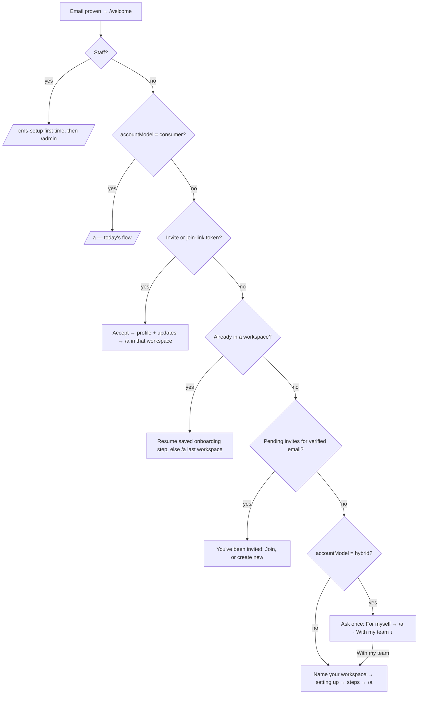

# Dream Starter Kit — B2B workspace onboarding (spec)

Nov 18, 2026 · written against `vpv-group/dream-starter-kit` main @ `642279a` (Nov 17, 2026)

## Summary

Add one founder-level setting, **Account model**, with three values:

- **Individuals** (`consumer`): today's D2C flow, unchanged.
- **Teams** (`business`): B2B. Every user lives in a workspace.
- **Both** (`hybrid`): individual by default, can create or join a workspace.

The founder picks it during `/cms-setup`. It can be changed later in `/admin → System → Authentication`.

In Teams mode the flow copies Linear's shape:

1. Sign up.
2. Confirm email.
3. **Name your workspace** (name + URL).
4. A 4-step skippable welcome: profile, invite teammates, connect apps, updates.
5. Land in the app.

Invited people skip workspace creation and land straight in the workspace they were invited to.

The kit already ships `organizations`, `memberships` and `invitations` with RLS in the baseline migration, but nothing in the app uses them. Most of the work is:

- one new migration (slugs, invite tokens, security-definer RPCs)
- new routing in `/welcome`
- the new screens

Workspace-level billing is the biggest follow-on and ships later (PR 3).

**Build it in core, not as a module.** It changes `/welcome`, the auth pages and `/api/auth/config`, which modules can't own. Modules can *contribute* onboarding steps (e.g. Connect Slack) through a new manifest field.

**Naming rule:** "staff" (`profiles.is_staff`) runs the app. "Workspace owner/admin" (`memberships.role`) runs a customer's team. Neither ever implies the other. The founder doesn't need a workspace, and a customer's workspace admin never gets `/admin`.

## What Linear does (reference)

Linear runs one sign-up page for both cases and decides what you see *after* you prove your email. If your email already belongs to a workspace you go straight in; if not, you create one.

| Screen | What's on it | Borrow? |
| --- | --- | --- |
| Create your workspace (/signup) | Google / email / SAML SSO, ToS, "You used email to log in last time" | Yes. The kit's AuthFlow already does this; add the last-used hint |
| Check your email | Magic link plus "Enter code manually" | Already in kit (`/check-email`) |
| Invited member lands in workspace | No workspace step: membership existed, so auth goes straight to the app | Yes, core of flow B |
| Create a workspace (/join) | Name, URL slug auto-filled from name, Region, "Using x · Use a different email" | Yes, minus Region |
| Splash | Logo while the workspace and sample data are created | Yes |
| 5-step welcome | Profile (avatar crop, title), Invite (emails + copy link), Connect GitHub, Connect Slack, Updates. All skippable, with dot progress | Yes. Integrations come from modules |
| App | Seeded starter content in the new workspace | Yes, via a workspace-created hook |
| Billing | Workspace starts on Free. Per-seat plans, Switch plan modal | PR 3 |

Three choices to copy:

- No plan picker during onboarding.
- Every step after workspace creation is skippable.
- The only required inputs are email and workspace name.

## What the kit has today vs. gaps

| Area | Today | Gap |
| --- | --- | --- |
| Sign-up UI | `AuthFlow` (login-05). Methods are ordered and toggled in the `authentication-settings` global. Default sign-up heading is already "Create your workspace" | Copy should switch by account model; invite pages need a locked-email variant |
| Email proof | `/check-email` → link (`/confirm-email`) or 6-digit code → `/welcome` | None |
| Post-auth routing | `/welcome`: mirrors CMS user, Free tag, anon reconciliation. Staff → `/cms-setup` or `/admin`; everyone else → `/a` | Invite acceptance, membership check, create-workspace and resume branches |
| Founder setup | First signup is `is_staff` → `/cms-setup` (seed progress bar) | Add the Account model choice here |
| Orgs | `organizations(id,name,owner_id)`, `memberships(org_id,user_id,role)`, `invitations(org_id,email,role,status)`, RLS, `is_org_member`, `is_org_admin`, owner-membership trigger | No slug/logo/invite link. Invitations have no token, expiry, inviter or accepted_at, and the invitee can't read their own invite under RLS. **No app code uses these tables** |
| Invites | `/accept-invite` exists but is **staff-only** (Supabase `inviteUserByEmail`) | Workspace invites need their own token + email, because `inviteUserByEmail` fails for existing accounts |
| Email sending | Only Supabase auth emails (`supabase/templates/`) | No transactional mailer for invite emails. Decision needed (see the prompt) |
| First-run content | `onboarding` collection = consumer intro slides | Separate, ordered B2B steps |
| Billing | `mod_billing_customers.user_id` (unique), per-user subscriptions | Workspace-owned customer + seats (PR 3) |
| Module data | Module tables are `user_id`-owned | Opt-in `org_id` scoping per module (PR 3) |

## Founder configuration: Account model

The first time the founder lands on `/cms-setup`, before the seed runs, they answer one question: **"Who signs up for your app?"** Three cards, one click, then the existing progress bar. Wireframe: `AccountModel`.

| Card | Value | What changes |
| --- | --- | --- |
| Individuals | `consumer` | Nothing (today's flow) |
| Teams and companies | `business` | Sign-up creates or joins a workspace; switcher, members and invites appear |
| Both | `hybrid` | After email proof, one extra screen ("For myself" / "With my team", asked once); "Create a workspace" in the account menu |

**Stored in** a new **Account model** tab of the `authentication-settings` global:

- `accountModel`: select, default `consumer`, so existing clones don't change.
- `workspaceLabel`: Workspace (default), Organization, Team, Studio, Practice. Drives all copy.
- `workspaceUrlPrefix`: shown before the slug field. Defaults to the site host.
- `inviteExpiryDays`: default 7.
- `allowInviteLinks`: default on.
- `onboardingSteps`: an orderable list with toggles, like the login-method list.
  - Built-in steps: `profile`, `invite`, `integrations`, `updates`, `plan` (`plan` is off by default).
  - Module-contributed steps appear here automatically.

Add these to `AuthSettings` and `normalizeAuthSettings` (`packages/app/src/auth-settings.ts`). Expose them via `getAuthSettings()` (web) and `GET /api/auth/config` → `useAuthConfig()` (mobile).

**Changing the model later:**

- *Individuals → Teams:* `/welcome` sends existing members to Name your workspace on their next visit. Offer an optional backfill that creates a personal workspace for every member.
- *Teams → Individuals:* data stays and the UI hides it. Warn about this in the field description.
- The model never touches RLS.

## Flow A — a new customer creates a workspace

| # | Route | Wireframe | Notes |
| --- | --- | --- | --- |
| 1 | `/sign-up` | `SignUp` | Existing `AuthFlow`. Add a "You used {method} last time" hint from a cookie |
| 2 | `/check-email` | `CheckEmail` | Existing (link or 6-digit code) |
| 3 | `/welcome` | — | Redirect only (see Routing) |
| 4 | `/onboarding/workspace` | `CreateWorkspace` | Name (required) + URL slug auto-filled from name, editable, debounced availability check. Footer "Signed in as {email} · Use a different email" (signs out). Calls `create_workspace` |
| 5 | `/onboarding/setting-up` | `SettingUp` | Runs workspace-created hooks (starter content), then forwards. Never blocks on failure; fallback "Continue" link |
| 6 | `/onboarding/profile` | `Profile` | Name, avatar upload, title → `profiles.display_name`, `avatar_url`, new `title` |
| 7 | `/onboarding/invite` | `Invite` | Emails (comma/newline), role (Member/Admin), copy invite link. Owners/admins only |
| 8 | `/onboarding/connect/[step]` | `ConnectSlack` | One screen per enabled module step |
| 9 | `/onboarding/updates` | `Updates` | Getting-started tips (on), product updates (off) |
| 10 | `/a` | `Home` | Getting-started checklist mirrors skipped steps. Workspace switcher at the top of the sidebar |

**Stepper rules:**

- Segmented progress shows the enabled steps; the eyebrow reads "Step 02 / 04".
- Every step has **Do this later**, and Back is allowed.
- Progress is saved per person per workspace in `memberships.onboarding_step` and `onboarding_completed_at`, so `/welcome` resumes at the same step.
- The optional **Choose a plan** step (off by default) slots in last.

## Flow B — a teammate joins

There are three ways in. All of them end with a membership row, a 2-step welcome (profile, updates), then the app. Invitees never see Name your workspace.

**1. Email invite.**

1. An owner or admin invites `ana@acme.com` (step 7 or Settings → Members).
2. A server route stores the invite:
   - an `invitations` row with a random 32-byte token, stored as SHA-256 only
   - `expires_at` = now + `inviteExpiryDays`
   - `invited_by`
3. It sends the email "Alex invited you to Acme on {App}" (wireframe `InviteEmail`), which links to `/invite/{token}`.
4. `/invite/{token}` (public, wireframe `InviteLanding`) shows the workspace, the inviter, and "Continue as {invited email}". What happens next depends on the visitor:
   - **Signed out:** the auth flow with the email pre-filled and **locked** (`JoinSignIn`), then `/welcome?invite={token}`.
   - **Signed in as the invited email:** accept immediately.
   - **Signed in as someone else:** "This invite was sent to …" with Switch account (`InviteProblem`).
   - **Expired, revoked or used:** "Ask {inviter} for a new invite" (`InviteProblem`, with a different banner per case).
5. `accept_invitation(token)` runs, then the user goes to `/onboarding/profile`, then `/a` in that workspace.

The route is `/invite/[token]`, kept separate from the staff-only `/accept-invite`.

**2. Invite link.** One rotating join token per workspace, at `/join/{token}`.

- Works like an email invite without the email lock.
- Admins can disable it or reset it.
- It can be restricted to the workspace's email domains.
- Joiners get the `member` role.

**3. Plain sign-up with pending invites** (wireframe `PendingInvites`).

- Has memberships → go to the last-active workspace.
- No memberships but `my_pending_invitations()` returns rows → "You've been invited": Join per workspace, or "Create a new workspace".
- Show this choice rather than auto-accepting.

## Routing: what /welcome decides



Staff are checked before the account model, so the founder's experience never changes. An invite token beats existing memberships.

Put the decision in a **pure function** in `packages/app`:

`resolvePostAuthDestination({ accountModel, isStaff, cmsSeeded, token, memberships, pendingInvites, hybridChoice })`

`/welcome` only gathers the inputs and redirects, and mobile reuses the same function. The hybrid choice is saved to the user's auth metadata.

**Workspace in the URL? Not in v1.**

- Keep `/a`. Hold the active workspace in `profiles.last_org_id` plus a cookie.
- Add a switcher in the sidebar header.
- Slugs appear on invite pages and in settings.
- Reason: module pages mount under `/a/<module>` via the generated registry, so moving to `/{slug}/…` would touch every module and `proxy.ts`.

## Data model and RPCs

One new migration (`supabase/migrations/<timestamp>_workspaces.sql`). Never edit the baseline. Every cross-boundary write goes through `security definer` functions with `set search_path = ''`, like the existing `is_org_member`.

| Table | Add | Why |
| --- | --- | --- |
| `organizations` | `slug citext unique not null` (check `^[a-z0-9](-?[a-z0-9]){1,38}$`), `logo_url`, `join_token_hash`, `join_link_enabled bool default true`, `allowed_domains text[]`, `data jsonb default '{}'` | URL, branding, invite link, domain-restricted joins |
| `memberships` | `onboarding_step text`, `onboarding_completed_at timestamptz` | Resume the stepper |
| `invitations` | `token_hash text unique`, `invited_by uuid`, `expires_at`, `accepted_at`, `accepted_by`; widen `status` to `pending/accepted/revoked`; partial unique index `(org_id, lower(email)) where status='pending'` | Secure links, expiry, audit, no duplicates |
| `profiles` | `title text`, `last_org_id uuid references organizations on delete set null`; add both to the column-level `grant update` | Profile step, active workspace |

**Functions** (security definer, `grant execute … to authenticated`, revoked from `anon`):

- `is_slug_available(_slug citext) returns boolean`
  - Also rejects reserved slugs: `a, admin, api, auth, billing, cms-api, cms-setup, invite, join, mcp, oauth, onboarding, pricing, profile, sign-in, sign-up, welcome, w, www`.
- `create_workspace(_name text, _slug citext) returns organizations`
  - Rejects anonymous sessions and validates the slug.
  - Inserts the org; the existing trigger adds the owner membership.
  - Sets `last_org_id`.
- `accept_invitation(_token text) returns organizations`
  - Hashes the token.
  - Requires a pending, unexpired invite whose `lower(email)` equals `lower(auth.jwt()->>'email')` with the email confirmed.
  - Inserts the membership with `on conflict do nothing` and stamps `accepted_at` / `accepted_by`.
  - Sets `last_org_id`.
- `join_workspace_by_link(_token text) returns organizations`
  - Requires `join_link_enabled`, and passes the `allowed_domains` check when set.
  - Joins as role `member`.
- `my_pending_invitations() returns table(org_id, org_name, org_slug, logo_url, inviter_name, role)`
  - The invitee's only window onto their invites.
  - Never returns tokens.

**Server routes** (service role, server-only):

- `POST /api/workspaces/{id}/invitations`
  - Checks `is_org_admin` with the user's own client.
  - Generates tokens, inserts rows and sends emails.
  - Rate-limited to about 50 per org per day.
- `POST /api/workspaces/{id}/join-link/reset`
  - Rotates the token and returns the plaintext once.

**RLS:** add a co-member read policy on `profiles` so member lists work:

```sql
create policy "profiles: co-members read" on public.profiles for select to authenticated
  using (exists (
    select 1 from public.memberships me
    join public.memberships them on them.org_id = me.org_id
    where me.user_id = (select auth.uid()) and them.user_id = profiles.id));
```

Also add a RESTRICTIVE no-anon policy on `organizations` and `memberships`, like the chat tables.

Then run `pnpm db:gen-types` and `pnpm db:gen-migrations`, and update `docs/ERD.md`.

## Billing, modules, mobile

**Billing (PR 3).** The workspace pays, per seat.

- `mod_billing_customers` and `mod_billing_subscriptions` gain a nullable `org_id`, with a check that exactly one of `user_id` / `org_id` is set. Read RLS = own row or `is_org_member(org_id)`.
- Checkout takes `orgId` in business mode; the caller must be an org admin. Quantity = member count, synced by a membership trigger.
- `plans.billingUnit` is `per_user | per_seat`.
- Add `useWorkspacePlan(orgId)`.

**Modules (PR 3).**

- Manifest `onboarding: [{ key, title, description, benefits[], component }]`. `chat-adapter-slack` is the first candidate.
- Manifest `scope: "user" | "org"`.
- A server hook `onWorkspaceCreated(orgId, userId)`.
- `useActiveOrg()` on the client and `getActiveOrg()` on the server.

**Mobile (Expo).**

- Same screens under `apps/expo/src/app/(onboarding)/`.
- Shared validators and hooks in `packages/app`: `useCreateWorkspace`, `useAcceptInvitation`, `useMyPendingInvitations`.
- RPCs use the user's own client.
- Universal links / app links for `/invite/*`.
- The switcher lives in the profile tab; the active org is stored in SecureStore.

## Edge cases and security

| Case | Behaviour |
| --- | --- |
| Invite accepted by a different, unconfirmed or anonymous account | Refused in `accept_invitation`; UI offers Switch account |
| Invite link forwarded outside the company | Optional `allowed_domains`; reset or disable any time |
| Free-mail domains in `allowed_domains` | Blocked (static list in `packages/app`) |
| Invite spam | Only confirmed, non-anon admins can invite; ~50/org/day; dedupe pending invites per email |
| Token leakage | SHA-256 only; 32 random bytes; never returned or logged |
| Slug clashes | Reserved list, `citext` uniqueness |
| Tab closed mid-onboarding | `/welcome` resumes at `memberships.onboarding_step` |
| Last owner leaves or is removed | Blocked by a trigger; ownership must be transferred first |
| Owner deletes their account | `organizations.owner_id … on delete cascade` would delete the whole workspace. Block deletion in the `delete-account` edge function while the user is the sole owner of a workspace with other members |
| Founder in Teams mode | Still routed to `/cms-setup` / `/admin`; `is_staff` never grants workspace rights |
| Anonymous (Turnstile) users | Can't create or join workspaces |
| Hybrid user picks For myself | No org row; "Create a workspace" stays in the account menu |
| Invitee already in other workspaces | Gets an extra membership; `last_org_id` moves to the new one |

## Build plan

| PR | Scope | Done when |
| --- | --- | --- |
| 1. Workspaces core | Migration + RPCs + co-member policy; Account model tab + `AuthSettings`; founder card picker in `/cms-setup`; `/welcome` via the pure resolver; `/onboarding/*` (workspace, setting-up, profile, updates, Both choice); sidebar workspace switcher + `getActiveOrg()`; Home checklist; docs | A new Teams-mode user signs up, creates a workspace, finishes onboarding, and lands in `/a` with the switcher |
| 2. Invitations | Mailer decision + invite email; invite API; `/invite/[token]`, `/join/[token]`; locked-email sign-in; You've been invited; Invite step; Settings → Members (list, role, remove, resend, revoke, reset link); Expo screens | A second user accepts an emailed invite and a link, and lands in the right workspace on web and mobile |
| 3. Billing + module hooks | Org billing + seats; `plans.billingUnit`; manifest `onboarding` / `scope` / `onWorkspaceCreated`; Connect Slack step | A workspace admin buys a per-seat plan; adding a member updates the quantity |

**Tests:**

- **`tooling/rls-tests`:**
  - Cross-org isolation for orgs, memberships, invites and co-member profiles.
  - `accept_invitation` fails for the wrong email, expired, revoked and anon cases.
  - A non-admin can't insert memberships.
  - `my_pending_invitations()` never returns tokens.
- **vitest:** slug validation and reserved words, email-list parsing, every branch of the `/welcome` resolver.
- **Playwright:**
  - `workspace-signup.spec.ts`: sign up → code from Mailpit → create workspace → skip steps → `/a`.
  - `workspace-invite.spec.ts`: admin invites → second user opens the Mailpit link → joins.

## Decisions taken for v1 (were open questions)

- Ship **Both (hybrid)** in PR 1. It's one extra screen and one resolver branch.
- No workspace slug in app URLs yet; use the active-workspace context instead.
- Default label is "Workspace".
- Two-sided apps (staff in Teams mode, members as Individuals) are out of scope.
